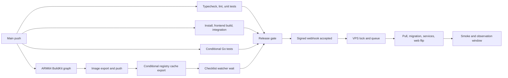

# Build and deployment speed audit — 2026-10-23

The strongest remaining opportunities are cache maintenance after image publication,
dependency-driven invalidation of image variants, and unnecessary work around the
release gate. Preserve production optimizations and validation while removing this
work from the path to serving the new release.

This is an audit and implementation plan. No workflow, production setting, runtime
code, infrastructure, repository rule, or release was changed during the audit.

## Evidence and limits

- Source reviewed: local commit `08f5826e1f293c0cd65c3871213d5e87ebf922b7`.
- Live evidence: 30 most recent `deploy` workflow runs, covering October 22–23,
  2026 in America/New_York; 24 successful and six cancelled. All were push runs on
  `main`. Successful-run job and step timestamps were collected through GitHub's API.
- Six successful builds were inspected in detail using their complete BuildKit
  logs. Two PR runs were sampled separately. These are observations, not controlled
  before/after experiments.
- The newest sampled deployment was commit `8ed4366bf2a5bbe41f2aafc005b82fba1d40f527`.
  Its `deploy.yml` and Dockerfile blob hashes exactly match this checkout:
  `9551dfc971144bbb29d83263a64ac29ef5c8121a` and
  `5447e5395cc70cf0339df437f1101163651d691d`, respectively.
- [The accompanying data](./build-deploy-audit-2026-10-23-data.json) preserves
  per-run timing summaries and sample identifiers. Raw API responses, build logs,
  and local check logs remain in `.cache/deployment-audit-2026-10-23/`.
- No VPS shell, Docker daemon, production database, real-user telemetry, production
  load test, or production ARM64 build was available locally. GitHub commit-status
  reads returned **no `deploy/production` statuses for any of the 24 successful
  runs**. Actual pull, migration, traffic-flip, bake, and end-to-end production
  times therefore remain unmeasured. Defaults in shell scripts are not proof of
  the effective host configuration.

Older audits under `docs/opti/` describe host-side builds, Vinxi, and sometimes
Helm. Those are historical. The current deployment builds native ARM64 images in
GitHub Actions and pulls them onto the Compose VPS.

## Current baseline

Elapsed time starts at workflow `created_at`, not commit author time or the start
of the developer's push. Percentiles use nearest rank. Job durations exclude their
initial queue; the whole-workflow and webhook measures include that queue.

| Measure                                       |    Median |       p95 |     Range |
| --------------------------------------------- | --------: | --------: | --------: |
| Workflow creation → webhook accepted          | **192 s** | **361 s** | 166–400 s |
| Workflow creation → Actions completion        |     195 s |     363 s | 169–403 s |
| Image-build job                               |     175 s |     337 s | 157–344 s |
| BuildKit bake/build/push step                 |     135 s |     304 s | 125–310 s |
| Typecheck + lint + unit-test job              |     149 s |     255 s |  94–323 s |
| Integration job, including its separate build |     112 s |     156 s |  82–174 s |
| Initial image-job scheduling/setup delay      |       5 s |      63 s |    2–80 s |
| Final deployment-gate job                     |       5 s |      11 s |    4–11 s |

All 24 Go jobs skipped Bazel execution because their change detector found no Go
change. Their 12–16 s job durations measure the detector and runner overhead, not
Go test performance. This sample cannot establish a Go-change deployment baseline.

The image job completed last among the four prerequisites in all 24 successful
runs. That includes its checklist wait, so this does not mean compilation itself
was always the longest required work. Removing that wait exposes the true check
or image bottleneck.

The diagram separates the measured CI path from the unmeasured host path. The
five-minute observation default begins after traffic moves. Removing it would
change release protection and queue throughput; it would not make the first
traffic flip five minutes earlier for an otherwise unqueued deployment.

## Ranked opportunities

Savings below are hypotheses to validate, except where explicitly marked as
observed delay. They overlap and must not be added together.

| Priority | Change                                                              | Evidence / potential                                                         | Runtime consequence                              |
| -------- | ------------------------------------------------------------------- | ---------------------------------------------------------------------------- | ------------------------------------------------ |
| P0       | Record actual release identity and lifecycle                        | End-to-end latency is currently unobservable through sampled GitHub statuses | Enables reliable speed and rollback decisions    |
| P0       | Enforce performance checks for the release candidate                | Current PR checks are not required by the active repository ruleset          | Protects runtime speed while optimizing delivery |
| P1       | Export reusable build caches after the image gate can complete      | Three inspected refreshes took 62.7–79.8 s in the cache stage                | Same shipped code and assets                     |
| P1       | Keep image variants reusable across unrelated dependency changes    | Cold variant generation took 64.2–65.1 s; overlaps Prisma generation         | Preserve AVIF/WebP quality and URLs              |
| P1       | Remove the checklist observer from the build prerequisite           | 10 s median avoidable tail; about 4–20 s counterfactual saving across sample | No application effect                            |
| P1       | Move advisory whole-site Brotli accounting off the release path     | About 12 s between Nitro build completion and budget report                  | Keep critical-payload checks and served gzip     |
| P1       | Begin service validation alongside web smoke/bake                   | 30 s worker settle currently starts after web bake                           | Same observation windows, less serialization     |
| P2       | Split deploy checks when they become the new bottleneck             | Unit step median 77 s; check job p95 255 s                                   | Same suite, isolation, lint and type safety      |
| P2       | Improve runner/cache cold-start and change classification           | Initial image-job delay reached 80 s; lockfile changes amplify cold work     | Infrastructure and cache effects only            |
| P2       | Reuse PR build outputs selectively                                  | Sample PR rebuilt frontend in parallel jobs and browser jobs                 | Preserve environment/architecture parity         |
| P3       | Evaluate persistent isolated ARM64 builders and compression choices | Warm exports 9.9–11.4 s; dependency-change exports 48.4–50.6 s               | Benchmark before adopting                        |

### 1. Release timing and identity need a reliable source of truth

`deploy-gate` only proves that the signed webhook was accepted. The listener starts
`deploy.sh` detached. Green Actions does not prove that images pulled, migrations
passed, traffic moved, or the observation window passed.

`deploy.sh` attempts optional GitHub statuses through `GITHUB_TOKEN`. Their absence
does not prove deployment failed; it proves this audit cannot use those statuses
to time or verify host completion. The existing internal deployment-event endpoint
is a useful foundation, but its data was not available here.

Record one release ID with source SHA, resolved web/full image digests, previous
successful release, public build-configuration hash, and timestamps for queued,
lock acquired, pull complete, migration complete, candidate ready, traffic moved,
smoke passed, observation passed, and rollback. Report queue time, time to serving
new traffic, and time to validated release separately, including failures and
superseded releases. Propagate the release ID through the webhook and host logs.

There are also concrete identity defects to fix before redesigning the host lock:

- `deploy.sh:652` re-execs after a script update with only the environment. Its
  second argument, the CI-approved SHA, is lost; the new process defaults to the
  branch tip. Preserve the exact target across re-exec.
- If a requested SHA cannot be resolved, `deploy.sh:626` falls back to branch tip.
  A CI-driven release should fail closed and fetch that exact SHA explicitly;
  branch-tip behavior can remain an explicit manual mode.
- `PREV_DEPLOYED_SHA`, stale-deploy checks, and the detached guard use checkout
  `HEAD` as a proxy for the live release. Checkout moves before pull/migration and
  traffic flip. A failed release can therefore leave `HEAD` ahead of the actual
  running release. Track successfully serving release state independently.

These are source findings, not claims that the sampled deployments shipped the
wrong version. Validation should simulate delayed webhooks, failed pulls,
failed migrations, script self-updates, and a branch advancing while a release
waits for the lock.

### 2. Performance protection differs between PRs and deployment

`web-ci.yml` runs `check:bundle-budget` and strict entry composition on a source-map
build. The Docker candidate instead runs `scripts/ci/bundle-budget.ts` without
`--strict`. These are different reporters with different measurements.

The newest sampled production build reported:

| Advisory Docker measure                |      Actual |   Configured band |
| -------------------------------------- | ----------: | ----------------: |
| Shell entry/preload JavaScript, Brotli |    261.4 KB |            300 KB |
| Eager site CSS, Brotli                 | **46.0 KB** |             40 KB |
| All lazy client JavaScript, Brotli     |  8,546.4 KB | 6,000 KB advisory |

The CSS exceeded its band and the deployment workflow still passed, as configured.
Whole-site lazy JavaScript is not the amount downloaded by one navigation and
should remain a drift metric rather than become an indiscriminate hard limit.

The live `PR-Required` ruleset, ID `18009330`, is active on the default branch and
requires a PR plus non-fast-forward protection. It has **no required-status-check
rule**. The legacy branch-protection endpoint returns 404. Thus the existence of a
PR does not establish that its budget, composition, security-audit, or relevant
browser check passed. The deploy workflow's own typecheck, lint, unit, integration,
and conditional Go gates remain valuable and blocking.

Define one documented runtime-performance contract and require it on the exact
release candidate. Keep a fast transitive-entry budget and critical CSS check
before publication/trigger. Retain source-map attribution in an appropriately
required PR check or a candidate diagnostic artifact. A source-map-free production
build cannot simply run strict entry composition: it correctly refuses to attest
without maps. Establish required check names through repository settings after
checking their triggers; avoid required jobs that never report on filtered paths.

`synthetic-perf.yml` and the frame-budget browser step are advisory today. They
cannot alone establish a runtime-performance guarantee for each release.
Resolve the existing CSS overrun against an agreed runtime budget before making
that reporter strict; an unreviewed flag flip would block current candidates.

### 3. Cache maintenance remains a major dependency-change tail

The August audit made registry export conditional, which helped ordinary commits.
Dependency changes still pay for `mode=max` export in the same step and job that
the release gate needs.

| Deploy run                                                                        | Web image export | Registry cache stage | When images/cache completed, UTC |
| --------------------------------------------------------------------------------- | ---------------: | -------------------: | -------------------------------- |
| [39879420044](https://github.com/stickms/rmhstudios.com/actions/runs/39879420044) |           48.4 s |               67.4 s | Image ~00:44:04; cache ~00:45:05 |
| [39923742799](https://github.com/stickms/rmhstudios.com/actions/runs/39923742799) |           48.4 s |               62.7 s | Image ~08:23:14; cache ~08:24:11 |
| [40003239182](https://github.com/stickms/rmhstudios.com/actions/runs/40003239182) |           50.6 s |               79.8 s | Image ~18:30:31; cache ~18:31:42 |

Cache export overlaps part of image push. The observed post-image residual is
approximately **57–71 s**, not the whole cache-stage duration.

Prefer a narrow reusable-stage cache target or a persistent builder. One workable
hosted-runner design publishes both images with cache export disabled in the
candidate step, completes that prerequisite, and lets a separate maintenance job
populate reusable dependency, Prisma, media, and vibe stage caches. Account for
fresh-runner restore cost, runner minutes, cache-writer concurrency, cancellation,
and eventual completion. Dispatching a second full Vite build just to export the
same cache would be an expensive implementation.

A single `build` job with a later cache step still blocks `needs: build`, even if a
previous step has already published an output. Separate the job boundary, or
choose an explicitly designed artifact-publication workflow. Verify both image
digests are pullable before making the candidate eligible.

The current refresh detector compares `HEAD^1` with `HEAD`, whereas the Go detector
uses `github.event.before`. A multi-commit push, or a cancelled dependency-update
run followed by a source-only commit, can leave the reusable cache stale without
another refresh. Compare input fingerprints against the last successful cache
publication, not just the immediately preceding commit. Cache misses must remain
safe; unknown inputs should refresh, not reuse an unchecked artifact.

### 4. Image variants depend on the entire application dependency tree

`image-variants` inherits `deps`, whose install layer depends on the full root
package and workspace lock. Changing an unrelated dependency invalidates the
media stage even if the image masters, generator and sharp version are unchanged.
The three dependency-change logs above show variant generation at 64.2–65.1 s.

Keep outputs keyed by image bytes, generator/options, sharp and native codec
versions, and the relevant platform. Either use a dedicated media dependency
stage with a narrow lock or persist the generated variant outputs independently
and seed the current generator's missing-file skip. Validate the manifest and the
actual files together. Cache restore keys must never make an old manifest claim
that absent or differently encoded variants exist.

This work overlaps Prisma generation, so eliminating 65 s of media work does not
save 65 s of release time. A reasonable experiment targets **20–40 s net on
unrelated dependency updates**, subject to the rest of the graph.

On warm builds, a stage marked `CACHED` still restores its parent filesystem. The
newest sampled build spent about 26 s materializing cached media/dependency state,
including a **404.83 MB compressed dependency layer**. That is cache restore I/O,
not fresh AVIF encoding. Narrow dependencies can improve both cases, but shared
dependency restore needed by Vite must not be counted twice.

Docker documents the distinction between external layer caches and cache mounts:
[GitHub Actions cache management](https://docs.docker.com/build/ci/github-actions/cache/).
An ephemeral runner's pnpm cache mount is not automatically a persistent
cross-run store. Do not restore the retired empty `.vinxi` cache.

### 5. Checklist monitoring should not hold the image gate open

`deploy.yml:434` waits for a background observer in ten-second increments after
the image step. The actual release gate already waits for every prerequisite.
Stopping this watcher at image publication and rendering a final checklist from
the gate removes redundant polling from the dependency graph.

Observed watcher duration was 10 s median, 40 s p95, and 110 s maximum. The 110 s
case was mostly waiting for a legitimately slower CI job. Holding other job finish
times fixed, removing the watcher gives an estimated **4–20 s** reduction across
this sample, median **10 s**. Claiming 110 s of deploy savings would be incorrect.
Notifications can remain best-effort and preserve their current visible results.

### 6. Advisory compression accounting consumes candidate build time

The inspected ARM64 Vite stages take 75.4–80.6 s including generators and checks.
The three actual compilation phases are roughly 17–22 s client, 21–26 s SSR, and
15–17 s Nitro. About 12 s elapse after the final compilation before the advisory
Brotli report. Its implementation compresses every client JavaScript chunk, even
though most are lazy and the whole-site total is informational.

Measure the mandatory critical entry closure and site CSS before the gate. Produce
the full lazy-surface report in a later diagnostic job or retained artifact. Use
the same compression parameters for comparisons; changing quality just to make
the reporter faster changes what its numbers mean.

This can plausibly recover **8–12 s** without changing the served files. Keep
Nitro's gzip precompression, minification, tree shaking, image variants, lazy
loading, WebAssembly optimization, and server warmup intact. Turning those off
would trade release time for runtime cost.

### 7. Integration builds are duplicated, but parallelism matters

Every deployment builds frontend twice: once inside the ARM64 release image and
once on x64 for integration. The integration build takes 41–73 s, median 66 s;
its job is currently shorter than the image job. Deleting the second build does
not remove 66 s from the current critical path.

It is also not exact artifact validation: integration starts `.output/server/index.mjs`
on the host, while production uses Alpine ARM64 and the custom
`server/web-cluster.mjs` primary with the cluster preset. Container packaging,
native dependencies and primary-process behavior receive less coverage than the
application HTTP flows.

Keep the fast parallel integration job initially. Add a bounded smoke check of
the actual release image and production entrypoint on native ARM64, backed by a
throwaway database. Evaluate consolidating only if build + image startup + test
is faster overall. Making integration wait for image publication can extend the
release path even while reducing aggregate CPU minutes.

PR run [40015936059](https://github.com/stickms/rmhstudios.com/actions/runs/40015936059)
built for 52 s in `build` and 51 s in parallel `integration`; the HTTP tests took
3 s. Build artifact reuse between existing sequential browser jobs is more
promising than serializing these two fast jobs behind artifact upload/download.
Measure artifact size and transfer cost first.

PR run [39998492289](https://github.com/stickms/rmhstudios.com/actions/runs/39998492289)
spent 1,781 s in the advisory frame-budget step; `jelly-e2e` ran 2,045 s overall.
Split the blocking interaction fixture from the long advisory full-route scan,
keeping relevant deterministic checks required. Move the full scan to a dedicated
scheduled/advisory workflow where appropriate. This is primarily PR latency and
shared-runner contention work, not a direct 30-minute production-deploy saving.

### 8. Deploy checks become the next floor

The deploy `ci` job serializes image-cache warming, typecheck, lint, and the full
unit suite. Unit tests take 51–87 s, median 77 s. One cold typecheck took 139 s,
making its entire check job 323 s. Once image work drops, those checks can control
release time.

Use the existing two-shard PR suite pattern for deployment if measurements show
that it lowers the maximum prerequisite time. Retain test-file isolation and all
tests. Separate typecheck/lint from unit tests when their combined duration sets
the floor, and move cache-seeding maintenance out of that job. Include additional
checkout/install/cache-save overhead and account concurrency in the comparison.
Preserve main-branch cache writers so new PRs still restore useful caches.

The current shared dependency action pins Node but requests pnpm major `10`, while
Docker pins `10.34.6`; `package.json` has no `packageManager` pin. Docker's initial
install also omits `.npmrc`, which controls Prisma hoisting locally and in CI, and
does not receive the workspace package manifests used by the host install. Audit
and align the intended install contract explicitly before optimizing pruning or
workspace scope. These differences are reproducibility risks, not proven failures
in the sampled successful images.

### 9. Host work can overlap while retaining the observation window

`deploy/hotswap-web.sh` defaults to a 300 s bake with the previous container retained
for rollback. `deploy.sh` holds its flock throughout. Service health checking,
including a fresh 30 s worker settle, starts only after that bake completes.

Start non-web health and worker observation when those services start and join
their verdicts with web smoke/bake. This can save approximately one settle window
from validated-completion time when all services are healthy; it does not make
the web flip 30 s earlier. Attribute failures early and keep web and non-web
rollback policy explicit. Effective host values and actual savings need VPS logs.

For frequent pushes, consider moving the long observation into a separate
release-aware controller only after implementing persistent release identity and
fencing. The current detached post-deploy guard demonstrates a useful pattern,
but its `HEAD` comparison is insufficient fencing. A previous observer must never
roll back a newer release; an old rollback container must not be deleted/reused
by the next two-color swap. Unknown migration compatibility must keep deployment
serialized. Simply backgrounding the bake or setting `BAKE_SECONDS=0` does not
preserve today's safeguards.

Other host work needs measurement before changing it: concurrent image pulls,
Prisma status/startup, pool-budget calculation, service shutdown/grace periods,
image pruning, Cloudflare rule reconciliation, and background R2/backfill joins.
Several recurring best-effort jobs have no outer deadline and can delay the final
join. Completed one-time media migrations belong in a maintenance lifecycle rather
than every application release.

### 10. Asset publication must precede use by the candidate

The R2 sync runs best-effort in the background while the deployment proceeds. It
also deletes objects absent from the current checkout. A release introducing a
new model/music/sprite can therefore expose its references before upload finishes,
and deletion can remove assets still needed by old tabs or the rollback image.

Use a content-addressed asset manifest: upload newly required assets before the
candidate becomes eligible, verify availability, and garbage-collect old assets
separately after a retention interval. Skip this work through a verified unchanged
manifest, rather than bypassing it globally. This improves repeat-release speed
and protects runtime correctness. An asset-changing release may need to wait
longer than the current unsafe background path.

### 11. Migration recovery has an unsafe blanket assumption

`deploy.sh:964` assumes every failed PostgreSQL migration committed nothing and
automatically marks a named P3009 migration rolled back before retrying. The
repository contains multi-statement migrations without explicit transaction
wrappers. Do not treat error text as proof of transactional rollback or safe
replay. Prisma's version-specific [v7 recovery guide](https://www.prisma.io/docs/orm/v7/prisma-migrate/workflows/patching-and-hotfixing)
requires handling partially completed steps before replay.

Gate automatic recovery on a verified transaction/idempotency contract and inspect
failed state otherwise. Keep migration locking, bounded database reachability,
the existing lock-timeout intention, and expand/contract compatibility. Verify
that the Prisma engine actually applies the intended connection timeout settings.
This is a release-reliability finding, not a recommendation to skip migration
checks or shorten safe DDL arbitrarily.

### 12. Lower-priority infrastructure experiments

- **Persistent ARM64 builder:** can remove repeated large layer materialization
  and keep real pnpm/Go compiler caches. Use an isolated build host, not the
  production VPS; keep PR trust boundaries, cache retention, patching and capacity
  explicit. Benchmark total queued → published time against hosted runners.
- **Go cache:** the full image imports inline cache from `:latest`, yet the six
  sampled logs rebuild Go for roughly 26–35 s. Inline caching has multi-stage
  limitations documented by [Docker](https://docs.docker.com/build/cache/backends/inline/).
  A narrowly exported reusable Go stage or persistent compiler cache may help,
  but this build currently overlaps the longer web path. Do not promise that
  saving 30 s of Go CPU saves 30 s of deployment time.
- **Image compression:** the bake already parameterizes gzip/zstd. Warm web
  export/push was only 9.9–11.4 s in two samples, versus 48.4–50.6 s when dependency
  layers changed. Compare total export + push + VPS pull/unpack on the actual
  daemon before choosing zstd or changing layer layout. Preserve extraction and
  registry compatibility.
- **Change-aware release:** documentation and tests are mostly excluded from the
  Docker context already. Production deploy still starts for every main push.
  Classify deployment-only, artifact-changing and non-runtime changes using the
  complete declared input closure, preserving validation for changed tests and
  deployment scripts. Unknown files must take the full path. Do not infer a safe
  skip from a short extension/path allowlist or a previous cancelled run.
- **Bundle/compiler profiling:** collect per-phase CPU, RSS and I/O after the
  packaging/cache issues are addressed. Retain the three build phases and SSR
  semantics unless an A/B experiment demonstrates parity. Raising heap limits
  is not itself a speed optimization.

## Implementation sequence and acceptance

1. **Make the release measurable and exact.** Add durable release identity,
   timestamps and SHA preservation; establish required performance checks. Capture
   at least 20 representative releases, including dependency and Go changes.
2. **Remove small unconditional tails.** End checklist observation at image
   completion; limit pre-release compression accounting to enforced critical
   assets. Target approximately **10–20 s** from ordinary CI-to-trigger time,
   with every existing required check intact. Confirm the new floor rather than
   adding savings estimates.
3. **Reduce dependency-change penalties.** Publish reusable-stage caches outside
   the image prerequisite and decouple media artifacts. The observed 57–71 s
   post-image cache residual establishes the strongest opportunity; a combined
   **roughly 60–100 s** improvement on dependency updates is an experiment target,
   not a measured guarantee.
4. **Overlap host validation safely.** Run non-web observation alongside web
   smoke/bake. Keep the full observation window, exact rollback targets, and
   migration compatibility. Measure queue throughput separately from traffic flip.
5. **Rebalance check jobs and evaluate persistent runners.** Only after remeasuring
   which prerequisite controls p50 and p95. Reuse artifacts where transfer and
   serialization cost beat a parallel rebuild.

Use separate scenarios: no-op retry, test/docs-only, page/component-only, shared
server logic, migration, lockfile-only, new art, Go-only, and deliberately cold
cache. Record successful and failed attempts, cache restore/export bytes, maximum
RSS, runner minutes, and queue delay. Compare matching scenarios and report the
distribution, not one favorable warm run. Do not call a re-run on an unsupported
local Node version a production benchmark.

For each optimization, establish these release acceptance checks:

- Same production build flags, tree shaking, minification, image formats/quality,
  gzip behavior, WASM correctness, lazy-route boundaries and cluster worker policy.
- Emitted critical JS/CSS budgets and forbidden-entry-package checks pass on the
  candidate; source maps remain diagnostic artifacts when needed.
- Candidate image boots through `server/web-cluster.mjs`; database/Redis readiness,
  every worker slot, native dependencies, asset URLs and representative HTTP
  integration flows work. Current `/` polling is useful but does not prove every
  cluster worker has warmed or that readiness is healthy before the flip.
- Controlled runtime comparisons preserve route TTFB/throughput, event-loop delay,
  CPU/RSS, database-pool utilization, websocket behavior, mobile LCP/INP, and
  animation frame budgets. Agree on statistical noise and absolute SLOs before
  applying a regression percentage; keep user telemetry authoritative.
- Fault injection proves failed checks cannot trigger deployment, failed
  candidates cannot replace healthy traffic, and older observers/queued webhooks
  cannot overwrite newer releases. Exercise rollback with a forward-migrated DB.

## Local verification and reproducibility

The local machine had Node **24.13.0**, below the repository's **24.18.0** minimum,
and pnpm **10.32.1**, different from Docker's pinned version. Local measurements
are useful smoke checks, not ARM64 production comparisons. The first sandboxed
build failed resolving installed dependencies due to filesystem restrictions;
the subsequent unrestricted local builds succeeded.

| Check                                      | Result                                                                                                                        |
| ------------------------------------------ | ----------------------------------------------------------------------------------------------------------------------------- |
| `pnpm run build:frontend`                  | Passed; 56.396 s; generated local build only                                                                                  |
| `pnpm run build:frontend:sourcemap`        | Passed; 69.790 s                                                                                                              |
| `pnpm exec tsc --noEmit`                   | Passed; 3.010 s with existing incremental state                                                                               |
| `node scripts/check-wasm-output.mjs`       | Passed                                                                                                                        |
| `node scripts/fix-ssr-css-hash.mjs`        | Passed; both tier hashes already matched                                                                                      |
| `pnpm run check:bundle-budget`             | Passed on both builds; entry 519.7 / 525.3 KB raw; critical path 307.5 / 351.1 KB Brotli                                      |
| Strict entry composition, source-map build | Passed; 90 critical chunks, 87 attributed and three runtime chunks without maps                                               |
| `pnpm lint`                                | Failed; 2 errors and 1,088 warnings; errors are `Blob` and `Worker` globals in pre-existing ignored `.cache/wasm-browser.mjs` |

The consistency gate passed outside the restricted filesystem sandbox: 67 suites
and 3,975 tests passed. Its first sandboxed attempt could not compile a fixture.
Its diff scan covered the tracked index edit; both new audit files also passed
explicit formatting, JSON and local-link checks.

The map-free build's strict composition check correctly failed for absent maps;
it was rerun successfully on the source-map build. No lint suppression, gate
bypass, production deployment, or unrelated source repair was performed. Lint's
inclusion of gitignored local scratch illustrates another reproducibility issue:
define intended scratch exclusions explicitly rather than treating a local clean
cache and a checkout with developer scratch as equivalent.

No new unit tests or production load were needed for this documentation-only
change. Full unit-suite execution, Go tests and database-backed integration were
not rerun locally; live CI results were inspected, and a source audit is not a
substitute for their candidate checks.

To refresh the timing data, read `actions/workflows/deploy.yml/runs?per_page=30`,
then `actions/runs/<id>/jobs?per_page=100` for each completed success. Calculate
the webhook measure from the completed timestamp of `Trigger VPS deploy (webhook
listener)`, and workflow duration from `created_at` to `updated_at`. Inspect raw
job logs for stage attribution: a cached stage's `DONE` time may be materialization
rather than execution. Read rulesets as well as legacy branch protection when
auditing required checks. All API access in this audit was read-only.
