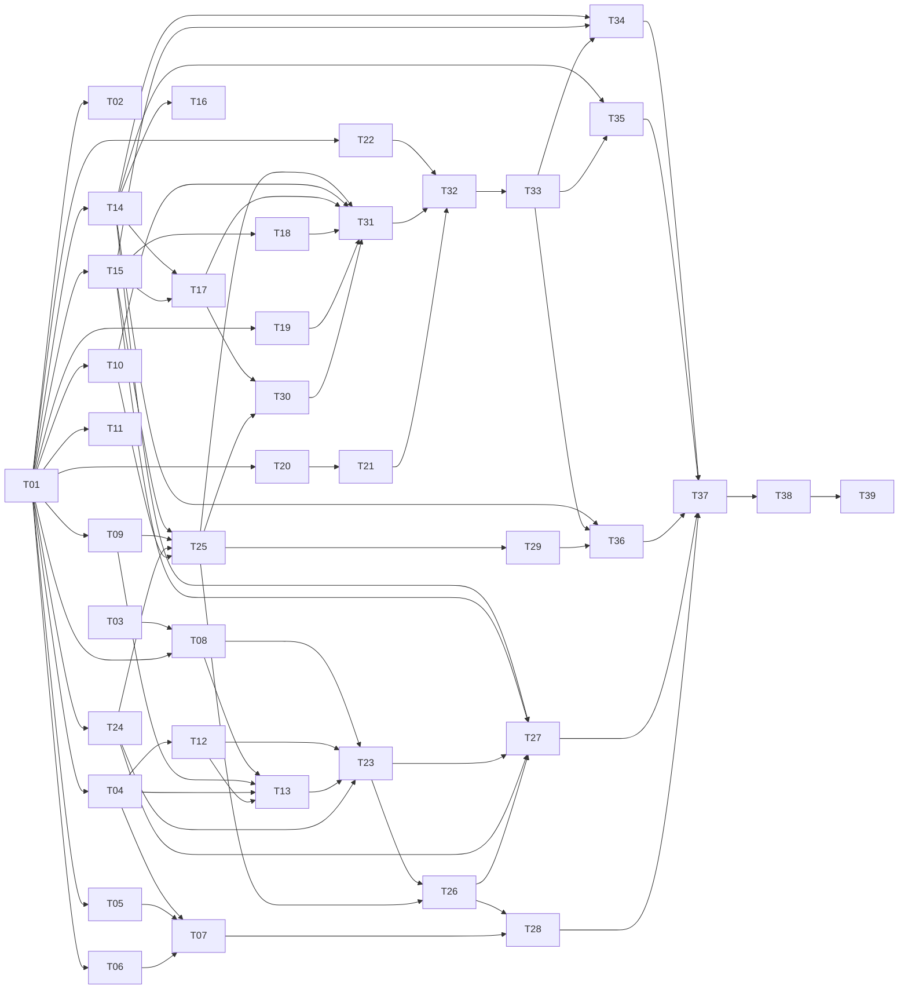

# Globe Eversion — Task-by-Task Implementation Plan

**Date:** 2026-10-17
**Status:** T01–T37 implemented (dark behind `isEversionEnabled()`); **POP removed at owner's request, 2026-10-18** (the effect ends with UNWRAP; see the spec's amendment). Open: T28 (owner visual sign-off), T38 (device lab) and T39's flag flip; see _Implementation status_ below.
**Spec:** [`2026-10-17-globe-eversion.md`](./2026-10-17-globe-eversion.md) (cited
below as **S§n** for a section and **S#n** for a numbered test in S§11).

This plan turns the spec into 39 tasks that can be handed to independent
implementers (human or agent). It is optimised for parallelism: after a single
contract-freezing task, **22 tasks can start at once**, and no lane waits on
another lane's _implementation_ — only on its _contract_.

## Implementation status

**2026-10-18 - POP removed at the owner's request.** The animation ends when UNWRAP finishes; `PLAN_MS.total` is 4780. Wherever a task below mentions POP, the pop (orb) or the glass globe, read "removed" (spec amendment 2026-10-18). The orb returns through the hub's ordinary closed-state fade.

T01-T37 are implemented and merged dark behind `isEversionEnabled()`; the
flag (`EVERSION_ENABLED`) was flipped to `true` by the owner ahead of T28 and T38. What
remains, and what is known:

- **T28 - owner visual sign-off** (the three themes, the projections, the eversion
  itself): open. **T38 - device lab** (the S§11.3 table on real phones/tablets,
  iOS worker vs in-thread mode): open. **T39 rollout** (the one-line flag flip, the
  7-day fallback-reason review) waits on both.
- **Baselines.** `testing/e2e/baselines/eversion-load.json` and `eversion-frames.json`
  (S#40, S#43) must be generated on a CI runner with the `update-baselines`
  `workflow_dispatch` input (`docs/testing.md` §7) and committed before the
  performance job is made blocking.
- **S#46 not met on software GL.** The capture p95 target (<= 120 ms) is not met on
  SwiftShader: measured ~200-440 ms median warm. It is a software-rasteriser
  number; real GPUs are the T38 question.
- **S#29 / S#30** (capture fidelity, SSIM) measured ~0.96-0.97 before the viewport
  fix; ~0.99 is expected after it and is re-measured with the baselines.
- **Known residual.** The azimuthal projections (Lambert, stereographic) show
  page-edge saw-teeth mid-morph, from clamped vertex UVs near the back point. The
  analytic wedge mask hides the stretched wedge itself, not this edge.
- **Thurston provenance.** The construction derives from the University of
  Minnesota Geometry Center `evert` code (N. Thurston) via M. McGuffin's
  `sphereEversion`, described there as "freely available" / "used with permission";
  there is **no explicit licence grant**. No code is copied: the geometry is
  re-derived and re-implemented ([`globe-eversion/thurston-derivation.md`](./globe-eversion/thurston-derivation.md) §0).
  If a clean-room source is ever required, the Bednorz-based fallback derivation
  ([`globe-eversion/bednorz-check.ts`](./globe-eversion/bednorz-check.ts), derivation
  Appendix A) is available and verified.

---

## 0. How this plan works (spec-driven rules)

1. **The spec is the source of truth.** Every task cites the spec sections it
   implements. If a task finds the spec wrong or ambiguous, it stops and files a
   **spec amendment** (§0.4) — it does not quietly diverge. Code that disagrees
   with the spec is a bug in one of them, and the amendment decides which.
2. **Contracts before code.** T01 freezes every cross-task interface (types,
   message protocol, function signatures, mark names, constants) as compiled,
   exported stubs. Tasks build against those stubs, so a consumer never waits for
   a producer to finish — only for T01.
3. **Tests before implementation.** Every acceptance criterion is a test or a
   checkable artefact. Each implementation task writes its tests from the spec
   **first** (they fail against the stub), then makes them pass. The e2e suites
   (T27, T34–T36) are _authored_ early from the spec and turn green as the
   implementation lands — so they "start" early and "finish" late.
4. **Two kinds of dependency.** Every task lists:
   - **Start after** — what must be merged before work can begin (almost always
     a contract, rarely an implementation).
   - **Finish after** — what must be merged before the task's acceptance
     criteria can all pass (e.g. an e2e test that needs a real renderer).
     A task may be developed and reviewed with only its _start_ dependencies met.
5. **Dark until the end.** Every task merges to `main` behind
   `isEversionEnabled()` (T01), which is `false` in production until T39. The
   e2e suites force it on with `?eversion=1`. So nothing here can affect a
   visitor before the device lab signs off, and tasks can merge in any order
   their dependencies allow.
6. **Every commit passes `pnpm check:consistency`** (the repo's commit gate).
   A task that adds a `requestAnimationFrame` file, a namespace, a gate entry or
   a generated file updates the matching gate _in the same commit_ (see the
   ownership table, §3).

### 0.1 Common Definition of Done (applies to every task)

- [ ] Every acceptance criterion in the task is met and demonstrated in the PR
      (test output, screenshot, or the named artefact).
- [ ] New tests are colocated per `docs/testing.md` (vitest under
      `lib/eversion/__tests__/`, e2e under `testing/e2e/`) and run in the suite
      named by the task.
- [ ] `pnpm check:consistency` green; `pnpm exec tsc --noEmit` and `pnpm lint`
      add no warnings vs `main`.
- [ ] No public signature in a T01 contract file changed without an approved
      amendment (§0.4).
- [ ] Code reads like the surrounding code: comment density and the "why"
      docblock style of `lib/globe.ts` / `LiquidGlobe.tsx`; constants come from
      `lib/eversion/constants.ts`, never inlined.
- [ ] The PR description lists the spec sections and spec test numbers covered.

### 0.2 Lanes

| Lane                      | Owns                                                       | Tasks                                                 |
| ------------------------- | ---------------------------------------------------------- | ----------------------------------------------------- |
| **A — Math**              | `lib/eversion/*.ts` pure modules                           | T03, T04, T05, T06, T07, T08, T09, T10, T11, T12, T13 |
| **B — GL**                | `lib/eversion/gl/*`, harness route                         | T23, T24, T25, T26, T28                               |
| **C — Page & capture**    | capture, placeholder, controller, overlay, hub integration | T17, T18, T19, T22, T30, T31, T32, T33                |
| **D — Settings**          | schema, API, store, panel, i18n                            | T20, T21                                              |
| **E — Test & perf infra** | helpers, e2e harness, debug hooks, CI, perf gates          | T02, T14, T15, T16, T27, T29, T34, T35, T36, T37, T38 |
| **—**                     | contracts, docs, rollout                                   | T01, T39                                              |

### 0.3 Sizes

**S** ≤ ½ day · **M** 1–2 days · **L** 3–5 days (for one experienced implementer).

### 0.4 Spec & contract amendments

A change to the spec, or to any file T01 creates (`types.ts`, `constants.ts`,
the stub signatures, `marks.ts`), is a **separate small PR** titled
`eversion: amend <file> — <why>`, which:

1. updates the spec section and/or the contract file,
2. lists every task whose _start_ or _finish_ depends on the changed item
   (use §2's dependency table), and
3. is reviewed by the owner of each affected lane before merge.

Tunable _values_ in `constants.ts` (durations, thresholds) are not contract
changes and may be adjusted inside T28/T37, with the reason in the commit.

---

## 1. Schedule

### 1.1 Waves (maximum parallelism)

A task appears in the earliest wave its **start** dependencies allow. Lanes run
in parallel; within a wave every task is independent of the others.

| Wave | Tasks that can start (all of their **start** dependencies merged)                                            | Count |
| ---- | ------------------------------------------------------------------------------------------------------------ | ----- |
| 0    | **T01** contracts · **T03** Thurston derivation (needs nothing)                                              | 2     |
| 1    | T02, T04, T05, T06, T07, T08, T09, T10, T11, T12, T13, T14, T15, T17, T18, T19, T20, T21, T22, T23, T24, T30 | 22    |
| 2    | T16, T25; authoring of T27, T34, T35                                                                         | 5     |
| 3    | T26, T29, T31; authoring of T36                                                                              | 4     |
| 4    | T28 (owner sign-off), T32                                                                                    | 2     |
| 5    | T33; T27/T34/T35/T36 turn green as their finish dependencies land                                            | 5     |
| 6    | T37 → T38 → T39                                                                                              | 1     |

Wave 1 is wide on purpose: almost every task needs only the T01 contracts to
start, and develops against stubs or mocks (T07 against Mercator alone, T13
against a mock reflection oracle, T23 against T03's formulas). Staff wave 1 by
lane rather than trying to run all 22 at once: lane A's 11 tasks are the
deepest pool, and T08 → T13 → T23 is its longest chain.

T24 starts in wave 1 against T01's mesh contract and a stub round-sphere
shader; it needs T09 only to _finish_.

### 1.2 Critical path

```
T01 ─▶ T24 ─▶ T25 ─▶ T31 ─▶ T32 ─▶ T33 ─▶ T34/T35/T36 green ─▶ T37 ─▶ T38 ─▶ T39
                 ▲        ▲
   T09 (finish) ─┘        └─ T10, T17, T18, T19, T30 (finish)
```

The math/visual chain runs **beside** it and must converge before T37:

```
T03 ─▶ T08 ─▶ T13 ─▶ T23 ─▶ T26 ─▶ T28 (sign-off) ─▶ T37
T04/T05/T06 ─▶ T07 ─┘
```

Integration (lane C) is deliberately built against the **stub shader** (a
plain textured round sphere that still honours the morph and the two sides), so
the critical path does not include the hardest math. The real eversion drops in
when T23 merges; nothing in lane C changes.

### 1.3 Dependency graph

Edges include both start and finish dependencies; §2 says which is which.



---

## 2. Dependency table

| Task | Title                                    | Lane | Size | Start after     | Finish after                  |
| ---- | ---------------------------------------- | ---- | ---- | --------------- | ----------------------------- |
| T01  | Contracts & scaffolding                  | —    | M    | —               | —                             |
| T02  | Unit-test helpers                        | E    | S    | T01             | —                             |
| T03  | Thurston derivation note                 | A    | M    | —               | —                             |
| T04  | Cylindrical projections                  | A    | S    | T01             | T02                           |
| T05  | Azimuthal projections                    | A    | S    | T01             | T02                           |
| T06  | Peirce quincuncial projection            | A    | M    | T01             | T02                           |
| T07  | Projection LUT baker                     | A    | S    | T01             | T02, T04, T05, T06            |
| T08  | Thurston oracle                          | A    | L    | T01, T03        | T02                           |
| T09  | Mesh generation                          | A    | S    | T01             | T02                           |
| T10  | Timeline engine                          | A    | L    | T01             | T02                           |
| T11  | Projection draw (Random)                 | A    | S    | T01             | —                             |
| T12  | Morph & camera math                      | A    | M    | T01             | T02, T04                      |
| T13  | Orientation, mirror & alignment          | A    | M    | T01             | T02, T04, T08, T09, T12       |
| T14  | E2E harness & image metrics              | E    | M    | T01             | —                             |
| T15  | Debug hook module                        | E    | S    | T01             | —                             |
| T16  | CI job `eversion-e2e`                    | E    | S    | T14             | —                             |
| T17  | Capture module                           | C    | L    | T01             | T14, T15                      |
| T18  | Placeholder                              | C    | S    | T01             | T15                           |
| T19  | Overlay, cover & hub-fade CSS            | C    | S    | T01             | —                             |
| T20  | Settings backend                         | D    | M    | T01             | —                             |
| T21  | Settings UI & i18n                       | D    | M    | T01             | T20; Preview button: T32      |
| T22  | `LiquidGlobe` hand-off (`onNavigate`)    | C    | S    | T01             | —                             |
| T23  | Shaders (eversion, morph, shading)       | B    | L    | T01, T03        | T08, T12, T13, T24; T27 green |
| T24  | Renderer core                            | B    | M    | T01             | T09                           |
| T25  | Worker, host, fallback, governor, tiers  | B    | L    | T01, T24        | T09, T10, T15                 |
| T26  | Harness route                            | B    | M    | T24, T25        | T23                           |
| T27  | GL parity & two-sided e2e (S#27–28)      | E    | M    | T14, T15        | T23, T24, T26                 |
| T28  | Owner visual sign-off                    | B    | S    | T26             | T07, T23                      |
| T29  | Prefetch, warm-up & load gates (S#39–40) | E    | M    | T25             | T16, T31                      |
| T30  | BEFORE capture scheduler & eligibility   | C    | M    | T01             | T17, T25 (WebGL2 detection)   |
| T31  | Run orchestration (controller + overlay) | C    | L    | T01, T25        | T10, T17, T18, T19, T30       |
| T32  | Hub `everting` phase, orb, focus         | C    | M    | T22, T31        | T21                           |
| T33  | Router & fault edge cases (S§9.4)        | C    | M    | T32             | —                             |
| T34  | Behaviour e2e suite                      | E    | L    | T14, T15        | T21, T33                      |
| T35  | Smoothness & photosensitivity e2e        | E    | M    | T14             | T33                           |
| T36  | Performance gates & baselines (S#41–46)  | E    | L    | T14, T16        | T29, T33                      |
| T37  | Performance hardening & tuning           | B/E  | M    | T34, T35, T36   | T27, T28                      |
| T38  | Device lab                               | E    | M    | T37             | —                             |
| T39  | Docs & rollout                           | —    | S    | T32 (docs part) | T38 (flag flip)               |

---

## 3. File ownership

One owner per file avoids merge conflicts between parallel tasks. A task that
must touch a file it does not own makes the smallest possible edit and names
the owner as a reviewer.

| File                                                                                             | Owner                              | Also touched by (minimal edit)                              |
| ------------------------------------------------------------------------------------------------ | ---------------------------------- | ----------------------------------------------------------- |
| `lib/eversion/types.ts`, `constants.ts`, `marks.ts`, `flags.ts`                                  | T01                                | amendments only (§0.4); T28/T37 may tune constant values    |
| `lib/eversion/projections/*.ts`                                                                  | T04, T05, T06 (one file each)      | —                                                           |
| `lib/eversion/projection-lut.ts`                                                                 | T07                                | —                                                           |
| `lib/eversion/thurston.ts`                                                                       | T08                                | —                                                           |
| `lib/eversion/mesh.ts`                                                                           | T09                                | —                                                           |
| `lib/eversion/timeline.ts`                                                                       | T10                                | —                                                           |
| `lib/eversion/random.ts`                                                                         | T11                                | —                                                           |
| `lib/eversion/morph.ts`                                                                          | T12                                | —                                                           |
| `lib/eversion/orientation.ts`                                                                    | T13                                | —                                                           |
| `lib/eversion/debug.ts`                                                                          | T15                                | each module registers its own hook via `registerDebug()`    |
| `lib/eversion/capture.ts`                                                                        | T17                                | —                                                           |
| `lib/eversion/placeholder.ts`                                                                    | T18                                | —                                                           |
| `lib/eversion/gl/shaders.ts` (+ `stub-shaders.ts`)                                               | T23 (T24 owns the stub)            | —                                                           |
| `lib/eversion/gl/renderer.ts`                                                                    | T24                                | T23 (uniform wiring)                                        |
| `lib/eversion/gl/worker.ts`, `host.ts`, `governor-tiers.ts`                                      | T25                                | —                                                           |
| `lib/eversion/prefetch.ts`                                                                       | T29                                | —                                                           |
| `components/radial/eversion/eversion.css`                                                        | T19                                | —                                                           |
| `components/radial/radial.css`                                                                   | T19                                | —                                                           |
| `components/radial/eversion/useBeforeCapture.ts`                                                 | T30                                | —                                                           |
| `components/radial/eversion/useEversionController.ts`, `EversionOverlay.tsx`                     | T31                                | T33                                                         |
| `components/radial/LiquidGlobe.tsx`                                                              | T22                                | —                                                           |
| `components/radial/RadialHub.tsx`                                                                | T32                                | T29 (one call in the idle-race effect), T30 (one hook call) |
| `app/routes/<harness route>`                                                                     | T26                                | —                                                           |
| `prisma/schema.prisma` + migration, API route, `stores/themeStore.ts`, `lib/appearance/prefs.ts` | T20                                | —                                                           |
| `components/settings/AppearancePanel.tsx`, `locales/en/settings-appearance.json`                 | T21                                | —                                                           |
| `lib/__tests__/raf-loop-allowlist.test.ts`                                                       | T25                                | T26 if the harness adds a loop                              |
| `scripts/check-bundle-budget.ts`                                                                 | T29                                | —                                                           |
| `.github/workflows/web-ci.yml`                                                                   | T16                                | —                                                           |
| `testing/e2e/lib/*`                                                                              | T14                                | —                                                           |
| `testing/e2e/eversion-*.mjs`, `testing/e2e/baselines/eversion-*.json`                            | T27, T34, T35, T36 (one file each) | T37 (baseline refresh)                                      |
| `components/radial/README.md`, `docs/design-language.md` §7, `docs/README.md`                    | T39                                | —                                                           |

---

## 4. Tasks

### T01 — Contracts & scaffolding

- **Spec:** S§3.1, S§3.3, S§7.1, S§12; S§9.1 (`GlobeStartState`); S§9.3 (enum).
- **Lane / size:** — · M
- **Start after:** — · **Finish after:** —

**Instructions**

1. Create `lib/eversion/` with the module map of S§3.1. Every module that
   another task implements is created as a **stub**: the final exported
   signatures with full TSDoc (each citing its spec section) whose bodies
   `throw new Error('eversion: <name> not implemented (T0x)')`.
2. `types.ts` — define and export:
   - `ProjectionId` (`'mercator' | 'peirce' | 'stereographic' | 'lambert' | 'equirect'`),
     `NavTransition = ProjectionId | 'random'`, `PROJECTION_IDS`, `NAV_TRANSITIONS`.
   - `Projection` interface: `id`, `forward(θ, φ, fit) → [u, v] | null`,
     `inverse(u, v, fit) → [θ, φ]`, `fit(w, h) → FitParams`,
     `singular(θ, φ) → boolean`.
   - `FitParams` (discriminated by projection), `Viewport {w, h, dpr}`,
     `Tier ('high' | 'mid' | 'low')`, `ThemeColours` (and, until 2026-10-18, `OrbRect`).
   - `GlobeStartState {yaw, pitch, yawVel, pitchVel, centre: [x, y], radius}`.
   - `Evert` signature: `evert(θ, φ, e, out: Float64Array, offset?)` — the
     oracle writes into a caller buffer so it never allocates.
   - `StageId`, `ChannelId` (S§7.1 table), `TimelineEvent`, `TimelineSnapshot`,
     and the `Timeline` class surface: `start(t0)`, `tick(now) → snapshot`,
     `fastForward(now)`, `afterReady(now)`, `afterFailed(now)`, `abort(now)`,
     `resize(now)`, `reveal(now)`, `events()`.
   - `ToWorker` / `FromWorker` discriminated unions — exactly the S§3.3 table.
   - `RendererApi` (`prime`, `setTexture`, `draw(snapshot)`, `resize`,
     `dispose`, `debugEvaluate(es: Float32Array) → Float32Array`,
     `counters()`), `CaptureApi` (`createSession()`, `captureViewport(opts)`,
     `dispose()`), `EversionController` (`isEligible()`, `onHubOpened()`,
     `onHubClosed()`, `start(node, state)`, `preview()`).
3. `constants.ts` — every value of S§12, plus the tier table of S§8.2 and the
   capture DPR caps of S§6.2.
4. `marks.ts` — the `performance.mark` names of S§11.2 as constants
   (`EVERSION_MARKS.start` …) and the mark `detail` shapes.
5. `flags.ts` — `EVERSION_ENABLED = false` and `isEversionEnabled()`, which is
   `EVERSION_ENABLED || new URLSearchParams(location.search).has('eversion')`
   (try/catch; `false` on the server).
6. `lib/eversion/README.md` — one screen: the module map, a pointer to the
   spec and this plan, and the amendment rule.

**Scope** — In: the files above. Out: any behaviour; any edit outside
`lib/eversion/`.

**Acceptance**

- `pnpm exec tsc --noEmit` passes with all stubs.
- `lib/eversion/__tests__/contracts.test.ts`: every stub throws an error naming
  its owning task; `PROJECTION_IDS` has 5 entries and `NAV_TRANSITIONS` has 6;
  every message in S§3.3 has a type in the unions (compile-time `satisfies`
  checks).
- `isEversionEnabled()` is `false` by default, `true` with `?eversion`, and
  `false` when `location` throws.
- Reviewed by one owner from each lane (A–E): this is the only gate on wave 1.

---

### T02 — Unit-test helpers

- **Spec:** S§11.1 (shared needs of S#1–24).
- **Lane / size:** E · S
- **Start after:** T01 · **Finish after:** —

**Instructions** — In `lib/eversion/__tests__/helpers.ts`:

- `sphereGrid(nθ, nφ, {excludePoles?})` — sample points;
- `jacobian2(f, θ, φ, h)` and `jacobian3(F, θ, φ, h)` — central differences;
- `seededRandom(seed)` — mulberry32;
- `kabsch(P, Q, {allowReflection})` — used by T13 _and_ as a test oracle;
- `expectClose(a, b, tol, label)` — records the first counter-example and
  asserts **once** (the pattern from `docs/testing.md`'s speed notes — never
  `expect()` inside a triple loop);
- `ssimGray` is **not** here (it belongs to T14, which runs in Node against
  PNGs).

**Scope** — In: the helpers file and its own tests. Out: any production module.

**Acceptance**

- Self-tests: `jacobian2` of a known linear map is exact to 1e-9; `kabsch`
  recovers a random rotation and a random reflection to 1e-12; `seededRandom`
  is deterministic.
- The helper tests run in < 200 ms.

---

### T03 — Thurston derivation note

- **Spec:** S§4.1–4.4, S§14 item 4.
- **Lane / size:** A · M
- **Start after:** — · **Finish after:** —

**Instructions**

1. From Levy, _Making Waves_ (1995), write
   `docs/plans/globe-eversion/thurston-derivation.md`: the explicit
   parametrisation `F(θ, φ, e)` per stage (corrugate, push, twist, unpush,
   uncorrugate), the halfway-model symmetry, and how the second half is built
   from the first.
2. State the stage parameters as functions of the smoothed windows of S§4.3,
   and identify `R` (the end isometry) analytically.
3. Give the analytic pole normals (S§4.4).
4. Record the licence decision: the derivation is from the published math; list
   any source code consulted, and confirm none was copied.

**Scope** — In: the derivation document. Out: code.

**Acceptance**

- The note is self-contained: T08 and T23 can implement it without the book.
- A spot-check script in the note (Python or TS, run once, output pasted)
  confirms `F(·, 0) = id` and `F(·, 1)` is an orientation-reversing isometry
  on 100 random points.
- Licence decision recorded; S§14 item 4 marked resolved in the spec.

---

### T04 — Cylindrical projections (Mercator, equirectangular)

- **Spec:** S§5.1–5.3; S#1, S#2 (Mercator), S#4.
- **Lane / size:** A · S
- **Start after:** T01 · **Finish after:** T02

**Instructions** — Implement `lib/eversion/projections/mercator.ts` and
`equirect.ts` against the `Projection` contract: forward/inverse in the S§5.2
conventions (`v` down, page centre ↔ front point); fit per S§5.3 (Mercator
`φ_max = 2·atan(e^{πA}) − π/2`; equirect policy switch at `A = 0.5`, with the
back gore beyond it); `singular` true beyond `φ_max` and inside the gore. Write
the tests first.

**Scope** — In: the two files plus `projections.test.ts` cases for them. Out:
the LUT (T07), shaders.

**Acceptance** — S#1 and S#2 green for Mercator; S#1 green for equirect; S#4
green for both at all six aspects (Mercator `φ_max` within 1e-12 of the closed
form; equirect switches exactly at 0.5; covered fraction within 1 % of the
analytic value).

---

### T05 — Azimuthal projections (stereographic, Lambert)

- **Spec:** S§5.1–5.3; S#1, S#2 (stereographic), S#3, S#4.
- **Lane / size:** A · S
- **Start after:** T01 · **Finish after:** T02

**Instructions** — `projections/stereographic.ts` (the page's half-width
subtends 150° from the front point; projected from the back pole) and
`projections/lambert.ts` (the page's corners on the bounding circle of radius
2). Tests first.

**Scope / Acceptance** — As T04: S#1 for both, S#2 for stereographic, S#3 for
Lambert (`det J / cos φ` constant to 1e-6), S#4 for both.

---

### T06 — Peirce quincuncial projection

- **Spec:** S§5.1–5.3, S§5.4 (why it needs a LUT); S#1, S#2, S#4.
- **Lane / size:** A · M
- **Start after:** T01 · **Finish after:** T02

**Instructions**

1. Implement the forward map via the incomplete elliptic integral of the first
   kind with modulus `1/√2` (Carlson `R_F` is recommended for stability) and the
   inverse via Jacobi `cn` with complex argument. Both live in
   `projections/peirce.ts` with a small private `elliptic.ts`.
2. Orient it so the page centre is the front point and the four singular points
   sit at the square's edge midpoints, away from the page centre.
3. Fit: "contain" the page in the square, longer side ↔ the square's side;
   outside the page is `null` (glass).

**Scope** — In: `peirce.ts`, `elliptic.ts`, and their tests. Out: performance
(it runs only at LUT bake time; correctness first).

**Acceptance** — S#1 (excluding 1e-3 rad around the four singular points), S#2
(conformality), S#4 at all aspects; one forward evaluation is ≤ 2 µs in Node
(benchmark printed, not gated).

---

### T07 — Projection LUT baker

- **Spec:** S§5.4; S#5.
- **Lane / size:** A · S
- **Start after:** T01 · **Finish after:** T02, T04, T05, T06

**Instructions** — `projection-lut.ts`: `bakeLut(projection, fit, [W, H]) →
Float32Array` (RG, glass = `(−1, −1)`), plus `toHalfFloat()` for upload as
RG16F (S§8.5). A memo cache keyed by `projectionId × aspect bucket` (bucket the
aspect to 1/64). No allocation per sample. Develop against Mercator first;
acceptance needs all five.

**Scope** — In: the baker and its test. Out: GPU upload (T24).

**Acceptance** — S#5 for all five projections; bake ≤ 25 ms for Peirce at
1024 × 512 on the CI runner (measured and printed; it becomes a hard gate in
T36 on the device budget); the half-float conversion's round-trip error is
≤ 1 texel at 4096 px.

---

### T08 — Thurston oracle

- **Spec:** S§4.2–4.5; S#6–S#11.
- **Lane / size:** A · L
- **Start after:** T01, T03 · **Finish after:** T02

**Instructions**

1. Implement `thurston.ts` exactly as T03 derives it: `evert(θ, φ, e, out)`
   plus `stageParams(e)` (the smoothed windows of S§4.3, which T23 mirrors) and
   `normal(θ, φ, e, out)` (the analytic pole normal near the poles).
2. Write S#6–S#11 first. S#8 (immersion) is the key test: sample a 256 × 128
   grid at 2001 values of `e` plus a polar-chart check. Keep S#8 + S#17
   (T10's) together under 2 s — vectorise into `Float64Array` buffers, never
   allocate per sample.
3. If S#8 fails with the S§4.3 starting windows, **tune the windows** (this is
   what the test is for) and record the final values in `constants.ts`
   (tuning, not an amendment) and in the derivation note.

**Scope** — In: `thurston.ts` and its tests. Out: GLSL (T23).

**Acceptance** — S#6–S#11 green; `IMMERSION_MIN` documented with the margin
observed; total test time printed and < 1.5 s.

---

### T09 — Mesh generation

- **Spec:** S§4.4, S§4.5 (winding), S§8.2 (resolutions).
- **Lane / size:** A · S
- **Start after:** T01 · **Finish after:** T02

**Instructions** — `mesh.ts`: `buildMesh(nθ, nφ) → { domain: Float32Array (θ, φ),
indices: Uint32Array, poleFans }` with a duplicated seam column (θ = 0 and 2π
both present, so domain coordinates are continuous within every triangle), a
dedicated triangle fan per pole (S§4.4), and CCW winding seen from outside the
unit sphere.

**Scope** — In: the mesh module and its tests. Out: GL buffers (T24).

**Acceptance**

- Every index is in range; no degenerate triangles; vertex/triangle counts
  match the closed form for the three tiers of S§8.2.
- Winding: for every triangle mapped onto the unit sphere,
  `((b−a) × (c−a)) · centroid > 0`.
- The seam is closed: the edges at θ = 0 and θ = 2π coincide in 3D.
- It builds the `high` mesh in ≤ 5 ms.

---

### T10 — Timeline engine

- **Spec:** S§7 (all), S§12; S#17–S#22.
- **Lane / size:** A · L
- **Start after:** T01 · **Finish after:** T02

**Instructions**

1. `quintic.ts` (private): segment construction from `(x0, v0, a0) → (x1, v1, a1)`
   over `T`, plus evaluation of `x`, `ẋ` and `ẍ`.
2. `timeline.ts`: the channels of S§7.1 with their default plans; `tick(now)`
   with the `MAX_DT` clamp and pause support (S§7.7); stage-event emission
   (each exactly once, in order); the after-gate + stretch (S§7.5); fast-forward
   (S§7.6); abort; resize; reveal; spin landing with the `k` choice (S§7.4),
   taking `θ_align` as an input (T13 supplies it later; default 0).
3. **Rule:** no method sets a channel value directly; every change re-plans
   from the current state.
4. The property suite (S#17–S#22): 10 000 seeded scenarios mixing a random
   fast-forward instant, AFTER arrival or never, resizes and `dt` sequences
   with stalls.

**Scope** — In: `timeline.ts`, `quintic.ts` and their tests. Out: rendering;
DOM.

**Acceptance** — S#17–S#22 green; zero allocation in `tick` (asserted by
running 10 000 ticks with `--expose-gc` heap deltas, or by inspection plus a
code comment); `tick` ≤ 5 µs.

---

### T11 — Projection draw (Random)

- **Spec:** S§5.1 (random), S§1.1-4; S#23.
- **Lane / size:** A · S
- **Start after:** T01 · **Finish after:** —

**Instructions** — `random.ts`: `resolveProjection(setting, rng = Math.random)`
→ `ProjectionId`. For `'random'` it never returns the previous draw (kept in
`sessionStorage` key `rmh-eversion-last`, with read/write in try/catch); a
fixed setting returns itself.

**Acceptance** — S#23 green; works when `sessionStorage` throws (falls back to
a module variable).

---

### T12 — Morph & camera math

- **Spec:** S§5.5, S§7.3; S#15, S#16.
- **Lane / size:** A · M
- **Start after:** T01 · **Finish after:** T02, T04

**Instructions** — `morph.ts`:

- `cameraFor(viewport)` — the perspective camera (consistent with `GLOBE_PERSP`
  from `lib/globe.ts`), with the plane `z = 0` at unit pixel scale;
- `flatPosition(θ, φ, projection, fit, viewport, out)` with glass vertices
  clamped to the nearest page-edge pixel;
- `wrapWeight(s, d)` (the wrap wave);
- `morphPosition(flat, sphere, w, out)`.

This is the TS reference for the GLSL in T23; the formulas must be
term-for-term portable (no JS-only tricks).

**Scope** — In: `morph.ts` and its tests. Out: GLSL.

**Acceptance** — S#15 (< 0.5 px at the 3 viewports × 3 DPRs, every
projection — run with Mercator until T05/T06 land, then all) and S#16 green.

---

### T13 — Orientation, mirror correction & alignment

- **Spec:** S§4.5, S§7.4; S#12–S#14.
- **Lane / size:** A · M
- **Start after:** T01 · **Finish after:** T02, T04, T08, T09, T12

**Instructions** — `orientation.ts`: `fitEndIsometry()` (Kabsch with
reflection over the oracle at `e = 1`, computed once and memoised),
`afterDomainTransform(R, spinAxis) → M_after` (a 3×3), and
`alignAngle(R, axis) → θ_align`, which feeds T10's spin landing. Develop
against a mock oracle (a reflection) until T08 merges.

**Acceptance** — S#12 (with T09's winding), S#13 (no mirror; page-up is
screen-up, at 100 points), S#14 (alignment within 0.1°) all green; an
integration test runs T10's timeline with the real `θ_align` and checks S#14 at
the UNWRAP-start event.

---

### T14 — E2E harness & image metrics

- **Spec:** S§11.2 preamble, S§11.3; S#29–S#32 tooling.
- **Lane / size:** E · M
- **Start after:** T01 · **Finish after:** —

**Instructions** — `testing/e2e/lib/`:

- `eversion-session.mjs` — launch Chromium (same `CHROMIUM_PATH` resolution as
  `frame-budget.mjs`) with the profiles (desktop 1440 × 900 @1; mobile
  390 × 844 @3 touch) × themes (dark, light, high-contrast), `?eversion=1`
  forced, a mark collector (reads `EVERSION_MARKS` via
  `performance.getEntriesByType('mark')`), and a CDP screencast recorder
  (`Page.startScreencast`, frames with timestamps);
- `image-metrics.mjs` — SSIM (grayscale, 8 × 8 windows), mean-absolute
  frame-delta series, relative-luminance series, colour-class histogram (for
  S#28);
- `baselines.mjs` — load/compare/update JSON baselines (`--update-baselines`).

Use `pngjs` if it is already in the tree; otherwise a tiny in-repo PNG decoder.
**No new heavy dependency** without a note in the PR.

**Acceptance** — Self-test `testing/e2e/eversion-metrics-selftest.mjs`: SSIM of
an image with itself = 1; with a 1-px shift > 0.9; with noise < 0.5. A
synthetic hard cut is flagged by the frame-delta detector and a crossfade is
not; the luminance detector flags a synthetic 30 % jump in 50 ms. It runs
against a static page, so it needs no other task.

---

### T15 — Debug hook module

- **Spec:** S§11.3 device-lab overlay; supports S#27, S#28, S#29, S#45, S#46.
- **Lane / size:** E · S
- **Start after:** T01 · **Finish after:** —

**Instructions** — `lib/eversion/debug.ts`, loaded **only** via dynamic import
when `?eversion-debug=1` is present (it must not appear in any static closure):

- `registerDebug(name, api)` / `window.__eversion` registry, so each module
  exposes its own test surface without editing this file;
- a stats overlay (fixed, `aria-hidden`, token colours) that prints the
  worker's `done` stats;
- documented slots that later tasks fill: `capture` (T17), `placeholder` (T18),
  `renderer.pauseAt(e)` / `solidTextures()` / `counters()` / `evaluate()`
  (T24/T25), `controller.state()` (T31).

**Acceptance** — The bundle check (temporary script here; permanent in T29)
shows `debug.ts` in no static closure; with the flag, `window.__eversion`
exists and lists registered slots; without it, `window.__eversion` is undefined.

---

### T16 — CI job `eversion-e2e`

- **Spec:** S§11.4.
- **Lane / size:** E · S
- **Start after:** T14 · **Finish after:** —

**Instructions** — Add an `eversion-e2e` job to `.github/workflows/web-ci.yml`
after `build`. It is path-filtered to `lib/eversion/**`,
`components/radial/**`, `app/globals.css`, `testing/e2e/eversion*`,
`testing/e2e/lib/**` and the settings files, and also runs nightly on `main`.
It starts the built server, then runs every `testing/e2e/eversion-*.mjs`
(empty-glob safe) and uploads screencasts and diffs as artefacts on failure.
It starts **non-blocking** (`continue-on-error: true`); T37 makes it blocking.

**Acceptance** — The job runs on a PR touching `lib/eversion/` and passes with
only T14's self-test present; it is skipped on an unrelated PR; artefacts
upload on a forced failure.

---

### T17 — Capture module

- **Spec:** S§6.1–6.4, S§6.6 (clone override); S§14 items 2–3; S#29/S#30
  (capture half), S#46.
- **Lane / size:** C · L
- **Start after:** T01 · **Finish after:** T14, T15

**Instructions**

1. `capture.ts` implementing `CaptureApi`: a lazily imported
   `modern-screenshot`, one `createContext` per session with fetch workers,
   `captureViewport({ exclude, scaleCap, timeoutMs })` → `ImageBitmap` of
   exactly the viewport at the current scroll, fixed/sticky in place.
2. **Clone overrides:** add the opaque-glass tier class to the clone root
   (resolve S§14 item 3: find the class the Glass clarity "Opaque" stop applies
   and record it in the spec); restore `opacity: 1` on the clone root (S§6.6);
   apply the S§6.4 rules for media.
3. Timeouts per S§12, abort via `AbortController`; every bitmap's ownership is
   documented (the caller transfers it).
4. Register a `capture` debug slot (T15).
5. E2E `testing/e2e/eversion-capture.mjs` (owned here): on six routes (feed,
   explore, a settings page, a profile, a media-heavy page, a light page) at
   both profiles × three themes, compare the capture with a Playwright viewport
   screenshot.

**Scope** — In: `capture.ts` and the capture e2e. Out: when to capture (T30,
T31); the cover class itself (T19).

**Acceptance** — SSIM ≥ 0.97 desktop and ≥ 0.95 mobile on all six routes × 3
themes, including a scrolled-down feed (proves the viewport crop — resolves
S§14 item 2, recorded in the spec); `.radial-hub` is absent from the capture;
main-thread capture p95 ≤ 120 ms on the CI desktop profile (S#46); a timeout
returns a rejected promise within `timeout + 20 ms` with no leaked context.

---

### T18 — Placeholder

- **Spec:** S§6.5.
- **Lane / size:** C · S
- **Start after:** T01 · **Finish after:** T15

**Instructions** — `placeholder.ts`: `buildPlaceholder(leaf, viewport, colours,
t) → ImageBitmap`. Draw on an `OffscreenCanvas` 2D (fall back to
`HTMLCanvasElement`): the `--site-bg` fill, the lucide icon (render the
icon's SVG node data to a `Path2D`), and the translated label in the site font
(`document.fonts.check` first; fall back to the system stack). Register a debug
slot.

**Acceptance** — An e2e check through the debug slot: the built bitmap has the
viewport's size × the capture DPR cap, the centre pixel region contains
non-background pixels (icon/label), and the corners equal `--site-bg` in all
three themes; build time ≤ 3 ms (median of 20).

---

### T19 — Overlay, cover & hub-fade CSS

- **Spec:** S§6.6, S§9.2 step 3, S§6.4 (`data-eversion-settle`), S§10.1.
- **Lane / size:** C · S
- **Start after:** T01 · **Finish after:** —

**Instructions**

- `components/radial/eversion/eversion.css`: `.eversion-overlay` (fixed,
  `inset: 0`, z-index just under the hub overlay, `contain: strict`, no
  `backdrop-filter`, `touch-action: none`); `html.eversion-cover` sets the
  shell root and backdrop layer to `opacity: 0`; `[data-eversion-settle]`
  suppresses entrance animations (`radial-page-rise` etc.); a
  `.eversion-overlay--fading` 200 ms opacity transition for the context-loss
  path.
- `radial.css`: `.radial-hub[data-phase='everting']` fades the veil, globe and
  foot capsule out over `HUB_FADE_MS` and hides the orb (opacity +
  `pointer-events: none`; no layout change).
- Tokens only; transitions name their properties (never `transition-all`).

**Acceptance** — `design-consistency.test.ts` and `filter-cost-budget.test.ts`
green; a Playwright check toggling the classes on a static route confirms the
shell is invisible with `eversion-cover`, and that entrance animations do not
run under `data-eversion-settle`; no change to any phase other than
`everting`.

---

### T20 — Settings backend

- **Spec:** S§9.3 (schema, API, store); S#24.
- **Lane / size:** D · M
- **Start after:** T01 · **Finish after:** —

**Instructions** — Add `navTransition String? @db.VarChar(16)` to
`AppearancePreference`, with a migration under `prisma/migrations/` following
the existing naming. Extend the zod body of `PUT /api/preferences/appearance`
with `NAV_TRANSITIONS` (from T01) and `null`, keeping `defineHandler`. Add
`navTransition` to `themeStore` with the same localStorage no-flash cache and
hydration from the account row as `reduceMotion`, plus the defaults in
`lib/appearance/prefs.ts`.

**Scope** — In: schema, migration, API, store, prefs. Out: UI (T21).

**Acceptance** — S#24 green (the API test accepts the six values and `null`,
and rejects others with 400); `prisma-validate` and `prisma-migrate-status`
are green; the existing migration-safety test passes (the column is nullable,
with no backfill); the store round-trips through localStorage; an absent row
→ `'random'`.

---

### T21 — Settings UI & i18n

- **Spec:** S§9.3 (UI, Preview), design-language §10; part of S#37.
- **Lane / size:** D · M
- **Start after:** T01 · **Finish after:** T20; Preview: T32

**Instructions** — A "Navigation transition" row in `AppearancePanel` under the
motion controls: a select (`components/ui/` primitive) with six options and a
one-line description each. It persists via the panel's existing `persist()`
and is disabled with a hint when reduced motion is on. A **Preview** button
calls `EversionController.preview()` (T01 contract; it is a no-op until T32,
and hidden while `isEversionEnabled()` is false). Strings go through `t()` in
`settings-appearance`, then `pnpm i18n:extract`; check `locales/en/...json`
(no JSX comment before `t()`).

**Acceptance** — i18n catalog/namespace gates green; the row renders in all
three themes; selecting persists (verified in T34's S#37); jsx-a11y adds no
warnings; it is disabled under reduced motion.

---

### T22 — `LiquidGlobe` hand-off (`onNavigate`)

- **Spec:** S§9.1, S§7.3.
- **Lane / size:** C · S
- **Start after:** T01 · **Finish after:** —

**Instructions** — Add an optional `onNavigate?(node, state: GlobeStartState)`
prop. When present (and the node is not external), `go()` calls it _instead of_
`onDismiss()` + `navigate()`; when absent, behaviour is byte-for-byte today's.
`snapshotGlobeState()` reads yaw/pitch, the velocities from the existing
`VelocityTracker`, and the centre/radius from cached values — **no new layout
read** in the loop or in `go()`. Never call `onNavigate` from the rehearsal
mount.

**Scope** — In: `LiquidGlobe.tsx`. Out: `RadialHub.tsx` (T32 wires the prop).

**Acceptance** — With no `onNavigate`, the existing hub e2e/smoke behaviour is
unchanged. A component test (or e2e via a temporary harness prop) shows all
three entry points (hold-release, pin click, Enter) invoke `onNavigate` once
with finite numbers, and an external pin still hard-navigates. The rAF loop's
"no writes when nothing changed" property holds (unchanged code path).

---

### T23 — Shaders (eversion, morph, shading)

- **Spec:** S§4.2–4.5, S§5.4–5.5, S§7.3, S§10.2–10.3; S#27, S#28.
- **Lane / size:** B · L
- **Start after:** T01, T03 · **Finish after:** T08, T12, T13, T24; T27 green

**Instructions**

1. `gl/shaders.ts` — GLSL ES 3.00.
   - **Vertex:** the eversion `F` (a port of T08, with stage parameters as
     uniforms computed on the CPU by T08's `stageParams` so the GPU does no
     window math), the normal (finite differences plus the pole override), the
     morph (T12) using the LUT via `textureLod`, spin/tilt/radius/centre, and
     the ripple displacement (the `lib/fluid` `RIPPLE` shape).
   - **Fragment:** the side from `gl_FrontFacing`; page UV from the LUT (with
     `M_after` for the back side); glass edges with `fwidth`; the placeholder →
     after mix; Lambert + side tint + fresnel rim; procedural 13-ring cage;
     `pageAlpha` for reveal.
   - All colours are uniforms (S§10.2).
2. A second program (or a pass flag) draws the cage lines from the same vertex
   transform (S§8.4: two draw calls).
3. A transform-feedback variant of the vertex shader outputs `F` for
   `renderer.debugEvaluate` (S#27).

**Scope** — In: shader sources and the uniform-block layout (documented in the
file). Out: GL plumbing (T24), the loop (T25).

**Acceptance** — S#27 parity (max error ≤ 1e-4 against the oracle at 64 values
of `e`); S#28 two-sidedness green; the harness (T26) renders all five
projections × the three themes without GL errors; the shaders compile on WebGL2
in Chromium, Firefox and WebKit (Playwright's three engines, compile check
only).

---

### T24 — Renderer core

- **Spec:** S§3.1 (`renderer.ts`), S§8.4–8.5, S§10.1.
- **Lane / size:** B · M
- **Start after:** T01 · **Finish after:** T09

**Instructions** — `gl/renderer.ts` implementing `RendererApi` against a
`WebGL2RenderingContext` that works on either an `OffscreenCanvas` or a DOM
canvas:

- Context `alpha: true, premultipliedAlpha: true, antialias: true,
depth: true`.
- Programs compiled once and kept; buffers from T09's mesh per tier.
- Textures: two page textures (mipmapped, anisotropic per tier) and the LUT as
  RG16F (`NEAREST`/`LINEAR` per S§5.4).
- `draw(snapshot)` — no allocation; ≤ 2 draw calls.
- `dispose()` frees everything per S§8.5; `counters()` (created/deleted per GL
  object type) behind the debug flag.
- Ship `gl/stub-shaders.ts`: a round sphere that honours the morph and both
  sides, so lanes C/E can integrate before T23.

**Scope** — In: `renderer.ts`, `stub-shaders.ts`. Out: the loop, the worker,
timing (T25); real shaders (T23).

**Acceptance** — A headless Chromium test page (through the debug slot) draws
the stub with two solid textures: the centre pixel shows `before`; after a
forced `e = 1` stub flip it shows `after`. `dispose()` returns all counters to
zero. `draw()` makes no JS allocation (Chrome heap snapshot delta across 1000
draws ≈ 0). Context-loss events are surfaced through a callback.

---

### T25 — Worker, host, fallback, governor & tiers

- **Spec:** S§3.2–3.3, S§7.7, S§8.2–8.3; S§14 item 1.
- **Lane / size:** B · L
- **Start after:** T01, T24 · **Finish after:** T09, T10, T15

**Instructions**

1. `gl/worker.ts` — receives `init`, owns the `OffscreenCanvas`, runs the
   `requestAnimationFrame` loop only between `start` and
   `done`/`abort`/context-loss, drives T10's `Timeline` and T24's renderer,
   emits the `FromWorker` events (§3.3) and posts `cover` after the first
   frame has been presented (the frame _after_ the first draw).
2. `gl/host.ts` — feature detection (OffscreenCanvas + WebGL2 in a worker +
   worker rAF), cached per session; the **same** loop on the main thread when
   unsupported; one worker per page; `pagehide` → lose context + terminate.
   Resolve S§14 item 1: record Safari's behaviour in the spec.
3. `gl/governor-tiers.ts` — the tier pick from `lib/render/tier.ts` +
   `perf-lite`; the downscale-only DPR governor (S§8.3); frame stats for
   `done` (count, dropped, p95 interval).
4. `visibilitychange` → pause/resume.
5. Update `lib/__tests__/raf-loop-allowlist.test.ts` with `worker.ts` and
   `host.ts` and the justification text from S§11.1
   ("Existing gates") — **in the same
   commit** that adds the rAF calls.

**Scope** — In: the three files and the allowlist entry. Out: DOM orchestration
(T31).

**Acceptance** — The allowlist gate is green. In headless Chromium, through the
debug slot: a full stub-shader run emits every stage event in order and `done`
with stats; with `OffscreenCanvas` forced unavailable the in-thread path
produces the same event sequence; a 300 ms main-thread busy-loop during
EVERSION causes **no** dropped frames in worker mode (the worker's stats) — this
is the headline reason for the worker; no rAF is scheduled after `done` (spy
count); hiding the tab pauses the loop.

---

### T26 — Harness route

- **Spec:** S§13 Phase 2.
- **Lane / size:** B · M
- **Start after:** T24, T25 · **Finish after:** T23

**Instructions** — A test-only route (top-level, `noindex`, excluded from the
sitemap and nav; admin-only in production builds via
`defineHandler`-equivalent gating or an env guard — follow how other internal
routes such as `/liquid-glass` are gated). It provides two bundled sample page
images, a projection picker, a theme toggle, a scrub slider over the whole
timeline, buttons for each stage, fast-forward, "AFTER arrives at t", and a
solid-colour mode. It drives the real host/worker.

**Acceptance** — The route renders each projection with the stub and the real
shaders; the scrubber can reach any timeline point; it is excluded from the
sitemap (the `lib/sitemap.ts` test is green); it is not reachable by
non-admins in a production build.

---

### T27 — GL parity & two-sided e2e (S#27, S#28)

- **Spec:** S#27, S#28.
- **Lane / size:** E · M
- **Start after:** T14, T15 (author now) · **Finish after:** T23, T24, T26

**Instructions** — `testing/e2e/eversion-gl.mjs`: the S#27 transform-feedback
parity check against the TS oracle, compiled into a test page
(`renderer.debugEvaluate` + a JSON dump of oracle values at the same points
generated by a Node pre-step), and S#28 through `solidTextures()` +
`pauseAt(e)` at `e ∈ {0, 0.25, 0.5, 0.75, 1}` with T14's colour histogram.
Author it against the spec now; it fails until T23 lands.

**Acceptance** — Green on the CI desktop profile once T23 merges; fails (as it
must) against the stub shader for S#27.

---

### T28 — Owner visual sign-off (checkpoint)

- **Spec:** S§13 Phase 2 exit; S§1 decisions 13–20.
- **Lane / size:** B · S
- **Start after:** T26 · **Finish after:** T07, T23

**Instructions** — Record a harness walkthrough (each projection, three themes,
a fast-forward, a slow-AFTER run) as a short video plus stills, and present it
to the product owner. Tune the visual constants (cage alpha, rim strength,
side tint, wrap wave, stage windows **within** what S#8 allows) and record the
changes in `constants.ts` with the reasons.

**Acceptance** — Written owner approval in the PR, or a list of amendments
filed per §0.4. This checkpoint gates T37 (no perf tuning against visuals that
may still change).

---

### T29 — Prefetch, warm-up & load gates (S#39, S#40)

- **Spec:** S§8.1; S#39, S#40.
- **Lane / size:** E · M
- **Start after:** T25 · **Finish after:** T16, T31

**Instructions**

1. `lib/eversion/prefetch.ts` — `prefetchEversion()`: runs only after `window`
   `load`, then imports the eversion chunk, `modern-screenshot` and the worker,
   constructs the worker, and compiles programs (an `init` with a 1 × 1
   canvas-less compile, or the first `prime`). It is idempotent.
2. One call in `RadialHub`'s existing idle-race `warm()` (minimal edit; T32
   owns the file).
3. Extend `scripts/check-bundle-budget.ts` with the S#39 assertion (no eversion,
   capture, worker or debug chunk in the entry's static closure).
4. `testing/e2e/eversion-load.mjs` for S#40: cold loads of `/`, `/explore` and
   a game route; the network log shows no eversion/capture/worker request
   before `load`, and none on a full-screen route; LCP/TBT medians over 10 runs
   compared with `main`'s baseline JSON.

**Acceptance** — S#39 green in the existing blocking bundle step; S#40 green;
prefetch never starts before `load` (asserted by a mark ordering check).

---

### T30 — BEFORE capture scheduler & eligibility

- **Spec:** S§6.2 (when, staleness, grace), S§1.1-1/3 (eligibility).
- **Lane / size:** C · M
- **Start after:** T01 · **Finish after:** T17, T25

**Instructions** — `useBeforeCapture.ts`: on hub open, wait `MOTION_MS`, then
the next idle (timeout 300 ms), then capture with `exclude` from S§6.2. Keep
the bitmap until it is consumed or the hub closes (then `close()` it).
Recapture on the next idle when it is older than `BEFORE_STALE_MS`. Expose
`awaitBefore(graceMs)`. `isEligible()`: `isEversionEnabled()`, not reduced
motion (both sources via `useReducedMotion` semantics), WebGL2 available (from
T25's cached detection), chunk loaded. One hook call is added in `RadialHub`
(minimal edit).

**Acceptance** — Through the debug slot: the capture begins ≥ 500 ms after
open and never during the open morph (the open's frame pacing with a capture
pending equals it without, ±1 frame); closing the hub frees the bitmap;
staleness triggers a recapture; each ineligibility reason returns `false`.

---

### T31 — Run orchestration (controller + overlay)

- **Spec:** S§3.2 (sequence), S§6.3, S§6.6, S§9.2 steps 1–5, S§10.1.
- **Lane / size:** C · L
- **Start after:** T01, T25 · **Finish after:** T10, T17, T18, T19, T30

**Instructions** — `useEversionController.ts` + `EversionOverlay.tsx`:

1. `start(node, state)`: check eligibility → if not, today's path; otherwise
   `awaitBefore(BEFORE_GRACE_MS)` → fallback on miss. Mount the overlay and
   transfer the canvas; `prime` (theme colours resolved per S§10.2, LUT from
   T07 via the worker, `resolveProjection` from T11); build and send the
   placeholder (T18); `start`; then call `navigate()` **in the same task**.
2. On `cover` → add `html.eversion-cover`.
3. **AFTER settle** detection per S§6.3 → capture with
   `data-eversion-settle` set → `texture` → or `after-failed` on
   timeout/throw.
4. On `unwrap-done` → remove `eversion-cover`, wait two main-thread rAFs →
   `reveal`.
5. On `done` → unmount, free, mark, and resolve the promise.
6. Input → `fast-forward` (pointerdown, keydown, wheel on the overlay; Escape
   included).
7. Emit every `EVERSION_MARKS` mark with `detail` (projection, tier, fallback
   reason).

**Scope** — In: the controller and the overlay component. Out: the hub phase
and orb (T32); §9.4 edge cases (T33).

**Acceptance** — On the stub shader, against the built app with `?eversion=1`,
driving `controller.start()` from the debug slot on 3 routes: the marks arrive
in order; the URL changes at `start` (not at the end — asserted by a mark/URL
timestamp); `eversion-cover` is present only between `cover` and
`unwrap-done`; the overlay is unmounted after `done`; fast-forward completes
in ≤ 650 ms + the reveal fade when AFTER is ready; an injected BEFORE failure runs today's
path with no overlay.

---

### T32 — Hub `everting` phase, orb & focus

- **Spec:** S§9.2, S§10.4, S§3.2 tail.
- **Lane / size:** C · M
- **Start after:** T22, T31 · **Finish after:** T21

**Instructions** — In `RadialHub.tsx`: the new phase `everting`; pass
`onNavigate` to `LiquidGlobe` → `controller.start(...)`; when ineligible, keep
calling `dismissForNavigation()` + `navigate()` exactly as today. Hide the orb
during the run and reveal it on `done` (amended 2026-10-18: by the hub's ordinary
closed-state fade; the pop it used to match is removed). Focus is left to the router (no orb focus restore after navigation).
Implement `preview()` (navigate to the current route) and wire T21's button.

**Acceptance** — The three entry points run the full effect end to end in the
built app (S#25 smoke in this PR; T34 is the full suite); dismissal (Escape/X/
outside tap) is unchanged; the orb is visible and focusable after `done`; the
Preview button runs the effect from Settings; with the flag off the hub is
behaviourally identical to `main` (existing hub tests green).

---

### T33 — Router & fault edge cases (S§9.4)

- **Spec:** S§9.4, S§7.5–7.6.
- **Lane / size:** C · M
- **Start after:** T32 · **Finish after:** —

**Instructions** — Handle every row of S§9.4 in the controller:

- same-route navigation;
- back/forward during the run → `abort`;
- error/404 and redirects → capture what renders;
- resize/orientation → `resize` (throttled to one per frame);
- `context-lost` → the overlay `--fading` class (T19) plus today's finish;
- a hidden tab → pause;
- input during the reveal fade is ignored.

**Acceptance** — Each row has a scripted check in T34's S#35 (authored by T34;
this task makes it green). There are no console errors or unhandled rejections
in any row.

---

### T34 — Behaviour e2e suite

- **Spec:** S#25, S#26, S#29, S#30, S#33, S#34, S#35, S#36, S#37, S#38.
- **Lane / size:** E · L
- **Start after:** T14, T15 (author now) · **Finish after:** T21, T33

**Instructions** — `testing/e2e/eversion-behaviour.mjs` implementing each
listed spec test literally, across both profiles and three themes where the
spec says so. Use route interception for slow (1.2 s, 4 s) and failing (500)
destinations; inject a `getContext` override and capture failures via the
debug slots; S#36 forces the in-thread renderer.

**Acceptance** — Every listed test is green in CI (`eversion-e2e` job); each
test's failure message names its S# number; the full file runs in ≤ 6 min on
the CI runner (split across both profiles if needed).

---

### T35 — Smoothness & photosensitivity e2e

- **Spec:** S#31, S#32.
- **Lane / size:** E · M
- **Start after:** T14 (author now) · **Finish after:** T33

**Instructions** — `testing/e2e/eversion-smoothness.mjs`: the jerk detector
over screencast frames for the four scenarios of S#31 (uninterrupted, 20
seeded fast-forward instants, 4 s delayed, 500 destination), excluding only
the documented crossfade windows (taken from the marks, not hard-coded); the
S#32 luminance check on the same recordings.

**Acceptance** — Green on both profiles; a deliberately injected hard cut
(debug slot: skip a channel re-plan) makes it fail, proving the detector works
against the real pipeline.

---

### T36 — Performance gates & baselines

- **Spec:** S#41–S#46, S§11.3.
- **Lane / size:** E · L
- **Start after:** T14, T16 · **Finish after:** T29, T33

**Instructions** — `testing/e2e/eversion-perf.mjs`:

- **S#41:** navigation delay, effect vs fallback, 6 destinations × 20 runs,
  with the destination-ready mark via `MutationObserver` + rAF.
- **S#42:** `frame-budget.mjs --gate`, plus the post-`done` idle checks.
- **S#43:** worker frame stats vs `testing/e2e/baselines/eversion-frames.json`.
- **S#44:** long tasks attributed to the effect.
- **S#45:** the 20-navigation soak with GL counters and heap.
- **S#46:** capture budgets.

The first green run on `main` writes the baselines (reviewed in the PR).

**Acceptance** — All six green; baselines committed; each metric is printed in
a summary table in the job log for trend reading.

---

### T37 — Performance hardening & tuning

- **Spec:** S§8 (all), S§11.3.
- **Lane / size:** B/E · M
- **Start after:** T34, T35, T36 · **Finish after:** T27, T28

**Instructions** — Profile the real-shader build (Chrome tracing + worker
stats). Fix whatever T34–T36 surfaced: vertex cost (tier meshes), overdraw,
LUT bake time, capture time (context reuse, scale caps), and governor
thresholds. Then flip the `eversion-e2e` job to **blocking** and refresh the
baselines with the reasons.

**Acceptance** — T27 and T34–T36 green and the job blocking; no regression in
the repo's other perf gates (`check:bundle-budget`, `frame-budget --gate`);
the profiling findings are summarised in the PR.

---

### T38 — Device lab

- **Spec:** S§11.3 device-lab table.
- **Lane / size:** E · M
- **Start after:** T37 · **Finish after:** —

**Instructions** — Run the effect with `?eversion=1&eversion-debug=1` on each
device class of the S§11.3 table: 10 navigations each, including 3
fast-forwards and one slow destination. Record the overlay stats and one
240 fps camera clip of a fast-forward per device. File any misses as
T37-follow-ups before proceeding.

**Acceptance** — The S§11.3 table is filled with measured numbers in the PR;
every row meets its target (or the owner accepts a documented exception);
iOS's worker/in-thread mode is recorded.

---

### T39 — Docs & rollout

- **Spec:** S§13 Phase 7.
- **Lane / size:** — · S
- **Start after:** T32 (docs) · **Finish after:** T38 (flag flip)

**Instructions**

1. Docs (can start after T32):
   - `components/radial/README.md` — file rows plus a "Globe eversion" section
     (why a worker, the cover class, the capture caveats, the
     never-a-hard-cut rule);
   - `docs/design-language.md` §7 — the navigation-transition exception to
     "nothing slower than 0.3 s";
   - `docs/README.md` — update this plan's and the spec's status;
   - the spec header → "Implemented".
2. Rollout (after T38): set `EVERSION_ENABLED = true` in its own commit, with
   the device-lab table linked in the message. Keep `?eversion` as a no-op
   override, and keep the harness route admin-only (or remove it).
3. After 7 days of production: check error logs for eversion fallback reasons
   (from mark `detail`, if RUM collects marks) and record them in the spec as
   a post-launch note.

**Acceptance** — The docs freshness checks are green; the flag flip is a
one-line, revertible commit; reverting it restores today's behaviour exactly
(verified by T32's flag-off check). Two review findings (R6 m8, m10) land here:

- **The Settings row is hidden while the flag is off** (`NavTransitionRow`,
  `AppearancePanel.tsx`), so the S§9.3 requirement - a choice of projection with
  Random as the default - is unreachable by any user until the flip. It is an
  explicit acceptance item: after the flip, open Settings > Appearance and confirm
  the row is visible, defaults to Random, persists, and Preview runs. (S#37 passes
  regardless: it forces the effect on with `?eversion`.)
- **`?eversion` is honoured in PRODUCTION today** (`flags.ts`): any visitor can opt
  in while `EVERSION_ENABLED` is `false`. The rollout step above says to keep it as
  a "no-op override" - that is only true once the flip makes the flag `true`.
  Decide deliberately whether the param should stay (support/QA) or be dropped from
  production builds, and do not ship the rollout flag at `false` expecting it inert.
- **Baselines** (`testing/e2e/baselines/eversion-load.json`, `eversion-frames.json`)
  must be committed before T37 makes the job blocking, produced on a CI runner via the
  `update-baselines` dispatch input (docs/testing.md §7).

---

## 5. Traceability — spec tests → tasks

| Spec test(s) | Implemented by             | Made green by                 |
| ------------ | -------------------------- | ----------------------------- |
| S#1–S#4      | T04, T05, T06              | same                          |
| S#5          | T07                        | T07                           |
| S#6–S#11     | T08                        | T08                           |
| S#12–S#14    | T13                        | T13 (+T09, T12)               |
| S#15–S#16    | T12                        | T12                           |
| S#17–S#22    | T10                        | T10 (+T13 for S#21 alignment) |
| S#23         | T11                        | T11                           |
| S#24         | T20 (API), T25 (allowlist) | same                          |
| S#25–S#26    | T34                        | T22, T32                      |
| S#27–S#28    | T27                        | T23, T24, T26                 |
| S#29–S#30    | T17 (capture), T34 (full)  | T17, T31                      |
| S#31–S#32    | T35                        | T10, T31, T33                 |
| S#33         | T34                        | T10, T18, T31                 |
| S#34         | T34                        | T30, T31                      |
| S#35         | T34                        | T33                           |
| S#36         | T34                        | T25                           |
| S#37         | T34                        | T20, T21                      |
| S#38         | T34                        | all of lane C                 |
| S#39–S#40    | T29                        | T29                           |
| S#41–S#46    | T36                        | T17, T25, T31, T37            |
| Device lab   | T38                        | T37                           |

## 6. Spec open items → tasks

| S§14 item                 | Resolved in                    |
| ------------------------- | ------------------------------ |
| 1 Worker rAF on Safari    | T25 (recorded), T38 (measured) |
| 2 Viewport-crop mechanics | T17                            |
| 3 Opaque-glass class      | T17                            |
| 4 Thurston licence        | T03                            |
| 5 Polar normals           | T08 (S#8 polar check), T23     |
