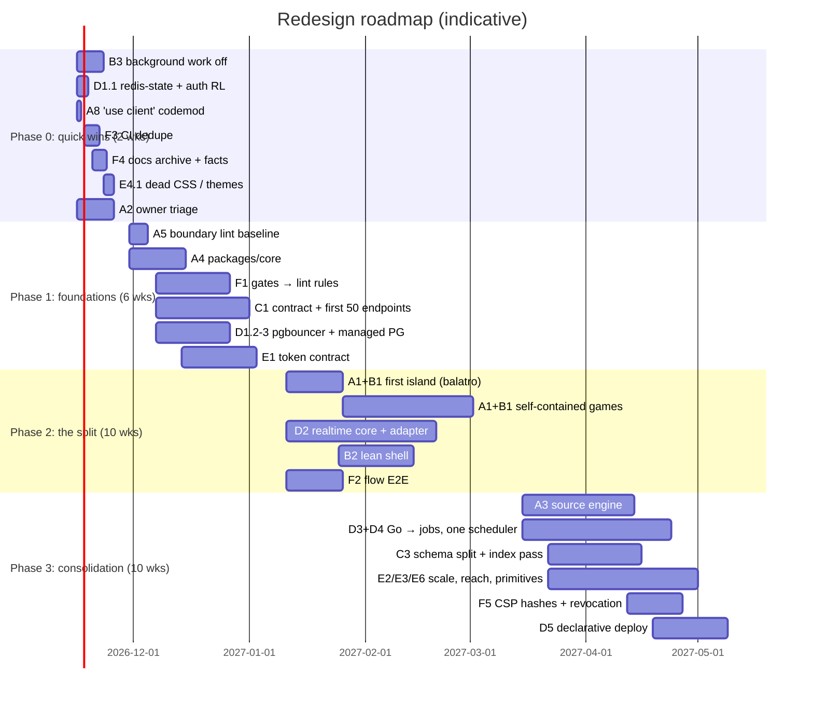

# Ground-up redesign audit — rmhstudios.com (2026-11-09)

> **What this is.** A whole-platform audit written as a *redesign brief*: if the
> site were rebuilt and refactored from the ground up, starting from how it is
> structured **today**, what would change, in what order, and why. It is ranked
> by gain (performance, appearance, code structure, best practice) and every
> item carries evidence from the tree, a target shape, implementation steps and
> a code stub.
>
> **Who it is for.** Humans planning the work, and coding agents executing it.
> It is deliberately LLM-friendly: every item has a stable ID (`A1`, `B3`, …),
> the same fixed fields, explicit file paths, and a "done when" that a script
> can check. An agent should be able to take one item ID and run with it.
>
> **Status.** Approved by the owner on 2026-11-09 except D1 (see [§1.7](#17-owner-decisions-2026-11-09)); being implemented in order of Part G. Owner decisions recorded in
> `CLAUDE.md` (Plasmatic Jelly identity, no eyebrows, the phone top bar, the
> accepted CSS-first jelly trade-offs) are treated as **constraints**, not
> targets for change. The July rewrite decision to **keep the stack**
> (`docs/full-rewrite-design-2026-07-18.md` §11) is upheld. This is a
> re-architecture *inside* TanStack Start + React 19 + Prisma, not a framework
> migration.

---

## How to read an item

Every recommendation uses this schema so it can be parsed mechanically:

```yaml
id:        A1                     # stable; reference it in commits/PRs ("refs redesign-audit A1")
title:     One-line name
gain:      perf | appearance | structure | practice   # primary axis (others listed after)
impact:    S | M | L | XL         # size of the win if fully done
effort:    S | M | L | XL         # S ≈ a day, M ≈ a week, L ≈ a month, XL ≈ a quarter (one engineer + agents)
risk:      low | med | high
depends:   [ids]                  # must land first
evidence:  facts from the tree, with paths and counts
target:    what "after" looks like
steps:     ordered, each independently shippable
stub:      code sketch (illustrative — adapt names to the code you find)
done-when: a check that is true only when finished (prefer a command)
```

Numbers marked `≈` come from regex scans and can be off by a few percent.
"Unverified" means the repo cannot show it (production host state, live
config) and someone must check by hand.

---

## Table of contents

- [0. Executive summary: the 15 biggest gains](#0-executive-summary-the-15-biggest-gains)
- [1. Baseline: the platform in numbers](#1-baseline-the-platform-in-numbers)
- [2. Diagnosis: why it got this way](#2-diagnosis-why-it-got-this-way)
- [3. Principles and non-goals for the redesign](#3-principles-and-non-goals-for-the-redesign)
- [Part A: Code structure](#part-a--code-structure)
- [Part B: Frontend performance](#part-b--frontend-performance)
- [Part C: API and data layer](#part-c--api-and-data-layer)
- [Part D: Backend, realtime, infrastructure](#part-d--backend-realtime-infrastructure)
- [Part E: Appearance and the design system](#part-e--appearance-and-the-design-system)
- [Part F: Best practice: quality, security, DX, docs](#part-f--best-practice-quality-security-dx-docs)
- [Part G: Sequenced roadmap](#part-g--sequenced-roadmap)
- [Appendix 1: Documentation drift found during this audit](#appendix-1--documentation-drift-found-during-this-audit)
- [Appendix 2: Regenerate every metric](#appendix-2--regenerate-every-metric)
- [Appendix 3: Open questions for the owner](#appendix-3--open-questions-for-the-owner)
- [Appendix 4: Agent execution protocol](#appendix-4--agent-execution-protocol)

---

## 0. Executive summary: the 15 biggest gains

The platform works. It is fast where it has been measured, well defended, and
guarded by a lot of tests. Its problem is **shape, not quality**. Six things
grew by accretion and now cost more than they return:

1. One route tree holds a social network, 18 games and 12 apps.
2. Every feature is scattered across four to six root directories.
3. There are two parallel token contracts plus about 49 exempt visual languages.
4. Client and server talk through 840 raw `fetch('/api…')` strings.
5. Two languages share one schema, kept in step by hand-mirrored SQL.
6. Consistency is enforced by about 77 source-scanning tests instead of by structure.

| Rank | ID | Gain | Primary axis | Impact | Effort |
|---:|---|---|---|:-:|:-:|
| 1 | [A1](#a1--feature-sliced-workspace) | Feature-sliced workspace: each game/app is one folder (engine, ui, net, server, api, routes, tests) | structure | XL | XL |
| 2 | [B1](#b1--split-the-route-tree-games-and-apps-become-separately-built-islands) | Split the route tree: games/apps become separately built islands, so the web entry stops ratcheting up | perf | XL | L |
| 3 | [C1](#c1--one-typed-api-contract-replaces-840-raw-fetch-strings) | One typed API contract (zod → generated client), replacing 840 raw fetch strings and two RPC styles | structure/practice | XL | L |
| 4 | [E1](#e1--one-token-contract-with-a-tier-modifier) | One token contract with a tier modifier, replacing `--site-*` + `--app-*` + a 17-variable adapter | appearance | L | M |
| 5 | [D1](#d1--get-state-off-the-single-box) | Get state off the single box: managed Postgres + PITR, PgBouncer and `redis-state` on | practice (reliability) | XL | M |
| 6 | [B2](#b2--a-lean-shell-what-runs-on-every-page) | Lean shell: cut 9 providers, 9 global mounts, ~18 effects and 11 inline scripts down to what every page needs | perf | L | M |
| 7 | [B3](#b3--stop-post-load-background-work-on-every-page) | Stop post-load work on every page: eversion WebGL + worker + DOM capture, docked globe worker, English catalog backfill | perf | L | S |
| 8 | [F1](#f1--move-convention-gates-into-real-lint-rules) | Move ~77 source-scanning gate tests and a 590-line bash gate into ESLint/Stylelint rules | practice | L | M |
| 9 | [D3](#d3--retire-the-go-worker-fleet-into-the-node-jobs-service) | Retire the Go worker fleet into Node `jobs` (pg-boss): delete Bazel, the 43-table raw-SQL mirror and ported logic | structure | L | L |
| 10 | [D2](#d2--one-realtime-gateway-with-a-backplane) | One realtime core with a Redis backplane and durable lobbies, replacing 3 hubs × own auth × in-memory state | practice (reliability) | L | L |
| 11 | [E2](#e2--a-real-type-scale-and-spacing-scale) | A real type and spacing scale: 564 arbitrary text sizes and 536 arbitrary hex values become tokens | appearance | M | M |
| 12 | [A4](#a4--a-core-package-of-primitives) | `core/` primitives: ~110 copies of math/RNG, ~45 of formatting, 11 hand-rolled socket clients, ~20 audio managers | structure | M | M |
| 13 | [F2](#f2--flow-tests-where-the-money-is) | Flow E2E where the money is: sign-up, post, coin transfer, Stripe checkout (Stripe has zero tests today) | practice | M | M |
| 14 | [C3](#c3--modular-prisma-schema-and-a-thinner-user) | Modular Prisma schema: 511 models / 13.3k lines in one file, a 614-line `User`, 32 redundant indexes | structure/perf | M | M |
| 15 | [F6](#f6--get-binary-weight-out-of-git) | Get binary weight out of git: 583 MB pack; `docs/indonesia-history` 232 MB, `public/` 256 MB, `data/balatro` 96 MB | practice | M | S |

**If you do only three things:** B3 (a week, immediate perf), D1 (removes a
total-loss risk), and the first slice of A1 + B1 together (move one
self-contained game, say Balatro, into `features/balatro` as its own island).
That slice proves the target architecture on real code before anyone commits to
the whole migration.

---

## 1. Baseline: the platform in numbers

Snapshot at commit `c9c721c0`, refreshed against `d971bf46` (main, 2026-11-09; see [§1.6](#16-changes-on-main-since-the-first-snapshot)). Re-run [Appendix 2](#appendix-2--regenerate-every-metric) to refresh.

### 1.1 Size

| Measure | Value |
|---|---|
| Tracked TS/TSX/Go/CSS lines (app, components, lib, server, go-services, hooks, stores, scripts, testing) | ≈1.43 M |
| `lib/` | 3,548 files · 713,898 lines · 189 subdirs + 179 loose files |
| `components/` | 1,903 files · 441,367 lines · 137 dirs · 1,632 `.tsx` |
| `app/` | 1,402 files · 136,641 lines |
| `server/` (Node hubs + workers) | 161 files · 62,295 lines |
| `go-services/` | 158 files · 38,840 lines (30.4k non-test) |
| Files > 1,000 / > 2,000 / > 3,000 lines | 104 / 12 / 5 |
| tf2 family (tf2-game, tf2-hud, tf2-loadout, sp-game, csgo-game) | ≈195k lines, about 15% of the codebase |
| Test files | 1,071 (≈183k lines); ≈900 in the main suite |
| Git pack size | 582.9 MB |

### 1.2 Routes and API

| Measure | Value |
|---|---|
| Route files | 1,383 |
| API route files (`app/routes/api/**`) | 988 (863 `defineHandler`, 28 `withDeveloperApi`, ≈98 hand-rolled) |
| Page `.tsx` routes | 381 (203 under `_site`, 178 full-screen) |
| Redirect-only stub pages | 30 |
| `app/routeTree.gen.ts` | 30,507 lines · 1.3 MB · 1,421 import lines |
| Raw `fetch('/api…')` call sites | 840 across 432 files |
| `createServerFn` | 123 calls in 109 files |
| React Query hooks | 65 `useQuery` + 44 `useMutation` |
| SSE endpoints (web tier) | 14 |

### 1.3 Frontend runtime

| Measure | Value |
|---|---|
| Entry budget (`scripts/check-bundle-budget.ts`) | `entryRaw` 537,900 B · `criticalPathBrotli` 359,500 B (July target: ≤300 KB) |
| Entry budget history | only ever raised: 281,000 → 294,000 → 296,500 → 299,000 → 307,700 → 537,900 |
| Inline `<script>` blocks in the document | 11 (`app/routes/__root.tsx`) |
| Providers mounted on every page | 9 contexts + 9 global mounts (`components/Providers.tsx`, 1,036 lines) |
| `'use client'` directives (a no-op in TanStack Start) | 1,536 files |
| Zustand stores | 48 `create()` calls; 15 `persist` |
| `useEffect` / `useState` | 1,774 / 4,067 |
| `typeof window` checks | 209 in 151 files |

### 1.4 Design system

| Measure | Value |
|---|---|
| CSS files / lines repo-wide | 104 / 74,968 |
| `app/globals.css` / `radial.css` / `jelly-material.css` | 6,666 / 4,083 / 2,196 lines (≈34% comments in globals) |
| Unique custom properties | `--site-*` 120 · `--app-*` 68 · ≈1,557 total · ≈49 bespoke component prefixes |
| Registered themes vs palettes in CSS | 2 registered (`graphite`, `default`); 4 unregistered full palettes (`light`, `sepia`, `nocturne`, `ultra`) referenced only by tests |
| Directories exempt from the token contract (`FULLSCREEN_TIER_DIRS`) | 49 of 133 |
| Arbitrary Tailwind values | ≈2,204 (536 hex colours, 564 px text sizes) |
| `--app-*` used as escaped arbitrary utilities (`bg-(--app-x)`) | ≈4,550 |
| Raw `<button>` vs `<Button>` | 1,831 in 618 files vs 1,257 in 430 files |
| Ad-hoc spinners | 191 (`animate-spin` + `<Loader2`) vs 161 `ui/spinner` users |
| `@keyframes` | 258 (25 in globals, 14 in radial, despite "only `jelly-drift`") |
| Distinct raw `cubic-bezier` curves | 27 |
| Font packages | 19 |
| framer-motion files that bypass `lib/motion.ts` | ≈118 of 155 |

### 1.5 Data, backend, infra

| Measure | Value |
|---|---|
| Prisma schema | 13,297 lines · 511 models · 82 enums · 277 migrations · 123 `Json` columns · 92 denormalised `*Count` columns |
| `User` model | 614 lines, nearly all back-relations |
| Redundant single-column indexes (static scan) | ≈32 |
| FKs without a leading index (upper bound) | ≈107 |
| Node processes | web ×2 (blue/green) + socket + rmhbox + rmhtube + ladder + homes + jobs |
| Socket hubs with their own session check | 3 (plus Go `pkg/auth` and Better Auth itself) |
| Socket.IO Redis adapter | none, so single instance only |
| Scheduling mechanisms | 6: pg-boss, node-cron, Go supervisor, web-tier `setInterval` (45 files), systemd timers, HTTP cron route |
| Cache layers | 6+: `apiCache` (54 importers), `cached.server` (37), response micro-cache, `lru-cache` (4), ≈101 ad-hoc TTL maps, anon HTML cache |
| Compose services | 14 (pgbouncer and redis-state **dormant**) |
| `deploy.sh` / `hotswap-web.sh` / `Dockerfile` | 1,554 / 430 / 564 lines |
| Production topology | one ARM VPS; Postgres on the host; rollback for web only |
| CI workflows | 20 (≈3,600 lines) |
| Docs | 957 files · 432 `.md` · 195 date-stamped · 37 "audit" files (9 performance audits) |
| i18n | 16 shipped + 16 pending locales · 132 namespaces · ≈19.2k English keys |

### 1.6 Changes on main since the first snapshot

Between `c9c721c0` and `d971bf46` (7 merges, 140 files, +16k lines):

- **RMH Music learn mode** (#1525–#1527): about 20 new components and state
  machines under `components/rmhmusic/learn/` and `lib/rmhmusic/learn/`, plus a
  root-level `RMHMUSIC_ROADMAP.md`. This adds 34 test files (1,037 → 1,071) and
  8 more `'use client'` files (1,528 → 1,536). It changes no conclusion here.
  The root-level roadmap is one more doc outside `docs/` (F4).
- **Jobs registration is table-driven** (#1522, `server/jobs/registry.ts`):
  registrations are isolated, cron polling is slower, sweeps are staggered and
  SDKs are lazy. This is the seam that D4's `defineJob` registry builds on.
  D4 now extends `registry.ts` rather than replacing it.
- **Deploy resilience** (#1521, #1523): the jobs container has more headroom,
  a heap cap, a longer stop grace and a boot retry, so a single worker restart
  no longer rolls back a deploy. D5's "health-gated rollout for every service"
  still stands; this narrows its most frequent failure.
- **Globe** (#1524): the refracted picture is placed once per display frame
  while scrolling. B3's "poster until first interaction" for the docked globe
  is unaffected.

Every other headline number (routes, API files, models, raw fetches,
`routeTree.gen.ts`, CSS, namespaces, workflows) is unchanged.

### 1.7 Owner decisions (2026-11-09)

The owner answered [Appendix 3](#appendix-3--open-questions-for-the-owner):

| Question | Decision | Effect on items |
|---|---|---|
| Overall | **All recommendations approved** | Every item is in scope, with the exceptions below |
| One-off pages (A2 triage) | **Keep all of them** | A2 becomes "keep, and make each one cheap": each moves into a feature or island with its own manifest. Nothing is archived. Redirect stubs still collapse into a redirect table, because they are not pages |
| Git history rewrite (F6 step 4) | **No** | F6 does only steps 1–3, applied to new and moved files; the pack stays as it is |
| Managed Postgres (D1 step 3) | **No** | D1 is **out of scope**: no data moves off the box. D2 uses the existing Redis for the Socket.IO adapter, which is pub/sub only and needs no persistence |
| Page-transition effect (eversion) | **Implementer's call** | Keep it, and load it **on intent** (B3): no idle warm-up, worker built on first use |
| Everything else in Appendix 3 | Implementer's call, following the recommendation as written | Design labs stay public, the docked globe becomes a poster until first interaction, discordbot is ported last (D3), senior-review becomes advisory, English source of truth is `locales/en` |

---

## 2. Diagnosis: why it got this way

Understanding the causes matters because a redesign that only treats symptoms
grows them back.

1. **One deployable, many products.** A social network, 18 games, 12 apps, a
   newsroom and a developer API share one `package.json` (167 deps), one Vite
   graph (8 GB heap to build), one route tree and one CSS manifest. Every new
   game adds weight to every other page: its `head()` lands in the entry, its
   directory gets an `@source not` line, and its route gets a
   `THEME_EXCLUDED_ROUTES` entry. The entry budget history is a list of games.

2. **Layer-first folders.** Code is organised by technical layer (`lib/`,
   `components/`, `app/routes/`, `app/routes/api/`,
   `server/socket-server/handlers/`), so one feature is spread across four to
   six roots. Nobody owns a feature as a unit, so sharing happens by copying:
   40 `clamp`s, 8 `mulberry32`s, 3 identical `BanListModal`s.

3. **Conventions enforced by scanning, not by construction.** The design
   language is a set of rules about strings in source files, so it is enforced
   by tests that read source files: 77 gate tests, `design-consistency.test.ts`
   at 1,111 lines, and a 590-line bash pre-scan that duplicates them. This
   works, but it is the most expensive way to get consistency, and it fights
   the 49-directory exemption list.

4. **Migrations that stop at 80%.** Liquid → jelly, raw handlers →
   `defineHandler`, hand-rolled sockets → `lib/shared/realtime/client`,
   React Query out of the shell, Go gateway → Node hubs. Each one left a tail:
   aliases (`data-liquid-*`, `data-fluid-*`), allowlists, dormant services, a
   parity test. The tails add up to a second architecture.

5. **Docs as a diary.** 195 dated docs and 9 performance audits record what
   happened, while the living docs (`CLAUDE.md`, `testing.md`,
   `architecture.md`) hold hand-written counts that are now wrong by a factor of
   1.5–4 ([Appendix 1](#appendix-1--documentation-drift-found-during-this-audit)).
   Agents read the stale counts and plan against them.

---

## 3. Principles and non-goals for the redesign

**Principles**

- **P1: The feature is the unit.** A game or app is one directory you can
  delete. Shared code is imported *by* features and never imports *from* them.
- **P2: Make the wrong thing impossible, then delete the test.** Prefer a type,
  a primitive or a lint rule to a source-scanning test. Each structural fix
  should retire at least one gate test.
- **P3: One of each.** One token contract, one API contract, one realtime core,
  one scheduler, one cache helper, one motion source, one prefetch mechanism.
  When there are two, either name the second as a deliberate exception or
  delete it.
- **P4: The page at rest does nothing.** This is already the jelly rule. Extend
  it to the whole shell: nothing is fetched, constructed or warmed until intent.
- **P5: Generated facts, written reasons.** Counts and inventories in docs are
  generated. Humans write only *why*.
- **P6: Every migration ships its own tail-deletion.** A migration PR is not
  done until the alias, allowlist entry or compat shim it introduced has an
  owner and a removal date.

**Non-goals**

- No framework change (TanStack Start, React 19, Prisma, Better Auth stay).
- No change to the Plasmatic Jelly identity or to the owner decisions recorded
  in `CLAUDE.md`. Appearance work here is about *consistency and reach*, not a
  new look.
- No rewrite of game engines for their own sake. Games move; their insides
  change only where they duplicate core code.
- No big-bang. Every item below is shippable in slices behind the current site.

---

## Part A — Code structure

### A1 — Feature-sliced workspace

```yaml
id: A1
gain: structure (+ perf via B1, + practice via ownership)
impact: XL
effort: XL
risk: med
depends: [A5 for enforcement; pairs with B1]
```

**Evidence**

- A feature lives in four to six roots. tf2 alone covers `lib/` 520 files /
  165,765 lines, `components/` 129 / 27,614, `app/routes` 12 pages + 27 API
  routes, `server/` 7 files and 108 test files. Slice It covers `lib/` 112,
  `components/` 45, 5 page routes, 36 API routes, `server/socket-server/handlers/slice-it.ts`
  (2,301 lines) and 13 tests.
- `lib/` has 189 subdirectories plus 179 loose files. Seventeen names exist both
  as a file and as a directory (`lib/profile.ts` + `lib/profile/`, `lib/seo.ts`
  + `lib/seo/`, and the same for auth, notifications, moderation, games and
  messages).
- The lib/components line is blurred. 168 non-React `.ts` files (30k lines) sit
  under `components/`; most of it is `components/velum2099/game/` (12k lines of
  imperative three.js). 11 `.tsx` files sit in `lib/`. 22 imports run from lib
  into components; the worst is `lib/rmhbox/history-display-registrations.ts`,
  which imports 9 minigame components.
- Feature code also sits in shared folders: six `hooks/useDoctrine*` hooks and
  `stores/doctrineStore.ts`; the casino (holdem, roulette, baccarat, blackjack)
  is hosted inside `components/rmhcoins` (60 edges).
- The workspace is nominal. `pnpm-workspace.yaml` lists `.`, `cli` and
  `docs/*/build`. `packages/sdk` is not even a member.

**Target layout**

```
apps/
  web/                    TanStack Start app: app/ (thin routes), shell/ (radial, site chrome), vite.config.ts
  realtime/               one hub process (see D2); mounts features/*/server
  workers/                jobs (pg-boss), ladder, homes; mounts features/*/jobs
packages/
  core/                   math, rng, format, loop, audio, persist, realtime-client, platform detection (A4)
  ui/                     components/ui primitives, jelly material CSS, PageLayout, AppShell, tokens (E1)
  platform/               auth, prisma client, economy, i18n runtime, seo, storage, rate-limit, cache (*.server)
  contract/               zod schemas + generated typed client (C1)
  engines/source/         tf2 + sp + csgo shared sim/render/net (A3)
  vibe-runtime/           pixi, p5, konva, gsap, d3, chart.js, matter, immer, uuid, lodash-es (RMHVibe sandbox only)
  sdk/                    generated developer-API client (already exists)
features/
  <name>/
    feature.ts            manifest: id, kind (game|app|site), routes, namespaces, catalog entry, island entry
    engine/               pure logic, no React, no DOM where possible
    ui/                   React components
    net/                  client realtime/API wrappers (use packages/core/realtime-client)
    server/               socket handlers (registered by apps/realtime)
    api/                  route handlers (thin files in apps/web/app/routes/api re-export these)
    jobs/                 pg-boss job definitions (registered by apps/workers)
    locales/en/*.json     the feature's i18n namespaces
    __tests__/
```

**Steps**

1. Create `features/` and the `feature.ts` manifest type in `packages/core`.
   Add a path alias `@features/*`. Change no behaviour.
2. Move the self-contained features first. Each has near-zero cross-feature
   edges: **balatro, hearthworks, slice-it, altair, void-breaker, nightrail**.
   Each move is one PR: `git mv` + an import codemod + a thin route re-export.
3. Move the socket handler for each moved feature out of
   `server/socket-server/handlers/<x>.ts` into `features/<x>/server/`, and
   register it from the hub with a feature-registry loop (stub below).
4. Pull the casino out of `components/rmhcoins` into `features/casino`, and
   doctrine out of `hooks/`/`stores/` into `features/doctrine`.
5. Fold the 179 loose `lib/*.ts` files into domain folders inside
   `packages/platform` (`lib/feed-*.ts` → `platform/feed/`). Resolve the 17
   file/directory collisions.
6. Split `package.json` per app/package once the moves are done, so server-only
   deps (socket.io, pg-boss, sharp, `@napi-rs/canvas`, satori, resvg) leave the
   web package.
7. Generate `lib/catalog` from the `feature.ts` manifests and delete the
   hand-kept catalog files. Unify it with `lib/game/registry.ts` (two catalogs
   today).

**Stub: feature manifest**

```ts
// packages/core/src/feature.ts
import { z } from 'zod';

export const FeatureManifest = z.object({
  id: z.string().regex(/^[a-z0-9-]+$/),
  kind: z.enum(['game', 'app', 'site']),
  /** Route prefix this feature owns, e.g. '/balatro'. Used by B1 to decide island vs shell. */
  basePath: z.string().startsWith('/'),
  /** 'island' = separately built client bundle (B1); 'shell' = rendered inside _site. */
  delivery: z.enum(['island', 'shell']),
  namespaces: z.array(z.string()),
  catalog: z
    .object({ title: z.string(), blurb: z.string(), image: z.string(), tags: z.array(z.string()) })
    .optional(),
  listed: z.boolean().default(true), // hidden/unlisted features say so explicitly (Appendix 3)
});
export type FeatureManifest = z.infer<typeof FeatureManifest>;
export const defineFeature = (m: z.input<typeof FeatureManifest>) => FeatureManifest.parse(m);
```

```ts
// features/balatro/feature.ts
import { defineFeature } from '@rmh/core/feature';
export default defineFeature({
  id: 'balatro',
  kind: 'game',
  basePath: '/balatro',
  delivery: 'island',
  namespaces: ['g-balatro'],
  listed: false, // currently routed but absent from lib/catalog — owner decision needed
});
```

**Stub: the hub registers features instead of importing 32 handler files**

```ts
// apps/realtime/src/features.ts
import type { Namespace } from 'socket.io';
const modules = import.meta.glob('../../../features/*/server/index.ts', { eager: true });
// with esbuild/tsx: replace with a generated features.gen.ts listing the same paths.

export interface FeatureServer {
  id: string;
  namespace: string; // e.g. '/slice-it'
  register(nsp: Namespace, deps: HubDeps): void | Promise<void>;
}
export function registerAll(io: import('socket.io').Server, deps: HubDeps) {
  for (const m of Object.values(modules) as { default: FeatureServer }[]) {
    m.default.register(io.of(m.default.namespace), deps);
  }
}
```

**Done when**

- `find features -maxdepth 1 -mindepth 1 -type d | wc -l` ≥ 30, and
  `ls server/socket-server/handlers` is empty or gone.
- `lib/` no longer exists as a grab-bag: `find lib -maxdepth 1 -type f | wc -l` is 0.
- A5's boundary rules pass with an empty allowlist.

---

### A2 — Decide the fate of unlisted, novelty and lab pages

```yaml
id: A2
gain: structure (+ perf: entry bytes, CSS manifest, i18n namespaces)
impact: M
effort: S
risk: low (product decision)
depends: []
```

**Evidence**

- Routed but not in the catalog: balatro (26.5k lines), elections, lights-out,
  pf2ecal, sohumtracker, kaikai-debt, signal-forge (`/secret/`), and tf2-game
  (reachable only through the `rmh-tf2-hud` app).
- One-off pages: `covid.tsx`, `kaikaidebtcounter.tsx`, `_site/alexdebtcounter.tsx`,
  `black-lives-matter.tsx`, `sohumbum.tsx`, `sohumbum2/*`, `sohumtracker/*`,
  `breaches.tsx`, `csgo.tsx`, `half-life-2.tsx`, `gabriels-horn.tsx`,
  `dunesday.tsx`, `services.rebar-rutabaga.tsx`.
- Design labs: `jelly.tsx` (565 lines), `liquid-glass.tsx` (a redirect),
  `eversion-lab.tsx`, `design.tsx`, `optimization.tsx`.
- 30 redirect-only stub pages.
- Each page costs entry bytes (its `head()`), a `site-tier.css` `@source not`
  line, a `THEME_EXCLUDED_ROUTES` entry, and often its own i18n namespace
  (`c-kaikai-debt`, `c-elections`, …).
- About 27 files (4,344 lines) have no static importer and no reference by
  basename anywhere. Examples: `components/site/{FriendsRail,FriendsSheet,NotificationsPopover}.tsx`,
  `components/home/{WidgetStack,WidgetEditSheet}.tsx`,
  `hooks/{useUndoableAction,useResource,useHistoryBeat}.ts`,
  `stores/focusStore.ts`, `components/ui/liquid-morph.tsx` (392 lines; it is
  mentioned only in a comment).
- `internal/ledger` in Go (755 lines) is wired into no binary.

**Steps**

1. The owner sorts every page into one of four buckets: **keep-listed**,
   **keep-unlisted** (`listed: false` in its manifest), **archive** (move to an
   `archive/` git tag and delete), or **redirect** (a server rule, not a page).
   See [Appendix 3](#appendix-3--open-questions-for-the-owner).
2. Replace the 30 redirect stub pages with one data-driven redirect table
   served by a Nitro route rule (stub below). That makes 30 fewer modules in
   `routeTree.gen.ts`.
3. Delete the zero-reference files after a build-level check: build with
   sourcemaps, then confirm the file is absent from every chunk's `sources`.

**Stub: redirect table instead of 30 route files**

```ts
// apps/web/redirects.ts — one table, typed, testable
export const REDIRECTS: ReadonlyArray<{ from: string; to: string; status?: 301 | 302 | 308 }> = [
  { from: '/liquid-glass', to: '/jelly', status: 301 },
  // … the other 29, generated once from the stub routes' beforeLoad redirects
];
```

```ts
// vite.config.ts → nitro({ routeRules })
import { REDIRECTS } from './redirects';
const routeRules = Object.fromEntries(
  REDIRECTS.map((r) => [r.from, { redirect: { to: r.to, statusCode: r.status ?? 301 } }]),
);
```

**Done when:** `grep -l "throw redirect" app/routes --include=*.tsx -r | wc -l`
covers only real conditional redirects (auth gates), and every route directory
maps to a feature manifest or to the site core.

---

### A3 — Merge tf2, sp and csgo into one Source-style engine package

```yaml
id: A3
gain: structure
impact: L
effort: L
risk: med (large, well-tested code: 108 test files)
depends: [A1]
```

**Evidence:** csgo-game → tf2-game has 213 import edges; sp-game → tf2-game
has 146; tf2 → sp/csgo has 18 back-edges. Two Rapier bindings coexist
(`@dimforge/rapier3d-compat` in sp-game, `@react-three/rapier` in
temple-of-joy). `lib/tf2-game/sim/*` contains a 21-file import cycle.

**Target**

```
packages/engines/source/
  sim/      movement, world, entities, player (from lib/tf2-game/sim)
  render/   three.js renderer, materials
  net/      snapshot/delta protocol
  data/     shared tables (weapon/sound schemas; per-game data stays in the feature)
features/tf2/   features/sp/   features/csgo/     ← adapters: game modes, data, UI
```

**Steps:** (1) Pull out the modules that both csgo and sp import into
`packages/engines/source` unchanged. (2) Invert the 18 back-edges by
introducing interfaces in the engine that tf2 implements. (3) Break the
`sim/*` cycle by moving shared types into `sim/types.ts`. (4) Pick one Rapier
binding.

**Done when:** `features/csgo` and `features/sp` import nothing from
`features/tf2`, and the engine package has no import cycles (A5's
`import/no-cycle` rule).

---

### A4 — A core package of primitives

```yaml
id: A4
gain: structure (+ perf: fewer duplicate bytes; + correctness)
impact: M
effort: M
risk: low
depends: []
```

**Evidence (definitions outside tests)**

| Helper | Copies | Examples |
|---|---:|---|
| `clamp` | 40 | `components/radial/LiquidGlobe.tsx:290`, `hooks/useLiquidBackground.ts:95`, `lib/altair/engine/enemy-navigation.ts:56` |
| `clamp01` | 32 | |
| `lerp` | 15 | |
| `mulberry32` seeded RNG | 8 | `features/dream-rift/engine/rng.ts`, `lib/jelly/arcs/rng.ts`, `lib/versecraft/gen/rng.ts`, `lib/plinko.ts`, `lib/shop/daily-shop.ts`, `lib/doctrine/puzzle-engine.ts`, … |
| `shuffle` | 9 | |
| `formatTime` | 15 | 5 in altair alone |
| `formatDuration` | 12 | lib/call, delight, globeset, rideshare, rmhtube, … |
| `formatDate` / `formatCount` / `timeAgo` | 7 / 5 / 5 | `lib/utils.ts` already has `timeAgoShort`, `formatRelativeTime` |
| Hand-rolled `io()` socket clients | 11 | altair, baccarat, blackjack, holdem, roulette, dream-rift, kowloon-knockout, neon-driftway, synapse-storm, velum2099, `components/spaces/SpaceRoom.tsx` |
| Per-game audio/sfx managers | ≈20 | howler in 5 files, Tone in 3, `getAudioContext()` in 27; 4 files bypass it |
| Direct `requestAnimationFrame` | 83 files | 8 hand-written fixed-step accumulators |
| Leaderboards | 13 UI components, 22 API routes | `lib/leaderboard.server.ts` exists but is not used everywhere |
| `localStorage` touched directly | 98 files | no shared persistence wrapper |
| `window.matchMedia` direct | 24 components | alongside `useIsMobile`/`useIsDesktop`/`useMediaQuery` |

Caveat: some same-named helpers mean different things (for example,
`formatTime` taking milliseconds in one place and seconds in another). The
codemod must check each call site.

**Target modules (`packages/core/src/`)**

```ts
// math.ts
export const clamp = (v: number, lo: number, hi: number) => (v < lo ? lo : v > hi ? hi : v);
export const clamp01 = (v: number) => clamp(v, 0, 1);
export const lerp = (a: number, b: number, t: number) => a + (b - a) * t;
export const invLerp = (a: number, b: number, v: number) => (a === b ? 0 : (v - a) / (b - a));
export const remap = (v: number, a0: number, a1: number, b0: number, b1: number) =>
  lerp(b0, b1, invLerp(a0, a1, v));

// rng.ts — the ONE seeded RNG. Go parity tests (doctrine) point here until D3 deletes the Go copy.
export function mulberry32(seed: number): () => number {
  let a = seed >>> 0;
  return () => {
    a = (a + 0x6d2b79f5) >>> 0;
    let t = a;
    t = Math.imul(t ^ (t >>> 15), t | 1);
    t ^= t + Math.imul(t ^ (t >>> 7), t | 61);
    return ((t ^ (t >>> 14)) >>> 0) / 4294967296;
  };
}
export function shuffle<T>(arr: readonly T[], rand: () => number = Math.random): T[] {
  const out = arr.slice();
  for (let i = out.length - 1; i > 0; i--) {
    const j = Math.floor(rand() * (i + 1));
    [out[i], out[j]] = [out[j]!, out[i]!];
  }
  return out;
}

// format.ts — unit in the NAME, never ambiguous
export const formatDurationMs = (ms: number, locale?: string) => { /* Intl.DurationFormat w/ fallback */ };
export const formatClockSeconds = (s: number) => { /* m:ss / h:mm:ss */ };
export const formatCompact = (n: number, locale?: string) =>
  new Intl.NumberFormat(locale, { notation: 'compact', maximumFractionDigits: 1 }).format(n);
export const formatRelative = (date: Date | number, locale?: string) => { /* Intl.RelativeTimeFormat */ };

// loop.ts — the one fixed-step loop, driven by the single frame driver (lib/jelly/frame.ts drive())
export function fixedStep(opts: { hz: number; update(dt: number): void; render(alpha: number): void }) {
  const step = 1 / opts.hz;
  let acc = 0;
  let last = 0;
  return (now: number) => {
    const dt = Math.min(0.25, last ? (now - last) / 1000 : 0);
    last = now;
    acc += dt;
    while (acc >= step) { opts.update(step); acc -= step; }
    opts.render(acc / step);
  };
}

// persist.ts — the one localStorage wrapper: try/catch, versioned, zod-validated
export function persisted<T>(key: string, schema: import('zod').ZodType<T>, fallback: T) {
  return {
    get(): T {
      try { const raw = localStorage.getItem(key); return raw ? schema.parse(JSON.parse(raw)) : fallback; }
      catch { return fallback; }
    },
    set(v: T) { try { localStorage.setItem(key, JSON.stringify(v)); } catch { /* quota/private mode */ } },
  };
}
```

**Steps:** (1) Land `packages/core` with tests. (2) Codemod one helper at a
time with `jscodeshift` (the canonical import replaces the local definition,
and the local definition is deleted). (3) Turn on an ESLint
`no-restricted-syntax` rule that bans top-level
`function clamp|lerp|mulberry32|shuffle|formatDuration` outside `packages/core`.
(4) Move the 11 hand-rolled socket clients onto
`lib/shared/realtime/client.ts`, which becomes `packages/core/realtime-client`.
(5) Build one `AudioBus` on `getAudioContext()` and drop howler (5 files).
(6) Build a `createLeaderboard(featureId, scoreSchema)` factory that produces
both the API handler and a `<Leaderboard>` component.

**Done when:** `rg -c "^(export )?(const|function) (clamp|clamp01|lerp|mulberry32|shuffle)\b" --glob '!packages/core/**'`
returns nothing, and `rg "from 'socket.io-client'" -l` lists only `packages/core`.

---

### A5 — Boundary lint and cycle ratchet

```yaml
id: A5
gain: structure (+ practice)
impact: L
effort: S
risk: low
depends: []
```

**Evidence:** There are 52 strongly connected components (223 files; this
count includes type-only edges). The largest are `features/hearthworks/engine/world/*` (28
files), `components/dunesday/os/apps/*` (22) and `lib/tf2-game/sim/*` (21).
There is also an 8-file shell cycle:
`components/site/CommandPalette` ↔ `feed/ComposeModal` ↔ `call/CallMount` ↔ `site/PlaytimeTracker` ….
127 edges run from shared code into features. `eslint.config.mjs` has no
`import/no-cycle`, no boundaries plugin and no restricted paths. The `.server`
boundary is enforced only by the Vite stub plugin, which finds export names by
regex.

**Stub**

```js
// eslint.config.mjs (excerpt)
import boundaries from 'eslint-plugin-boundaries';
import importX from 'eslint-plugin-import-x';

export default [
  {
    plugins: { boundaries, 'import-x': importX },
    settings: {
      'boundaries/elements': [
        { type: 'core', pattern: 'packages/core/**' },
        { type: 'ui', pattern: 'packages/ui/**' },
        { type: 'platform', pattern: 'packages/platform/**' },
        { type: 'engine', pattern: 'packages/engines/*/**', capture: ['engine'] },
        { type: 'feature', pattern: 'features/*/**', capture: ['feature'] },
        { type: 'app', pattern: 'apps/*/**' },
      ],
    },
    rules: {
      'boundaries/element-types': ['error', {
        default: 'disallow',
        rules: [
          { from: 'core', allow: ['core'] },
          { from: 'ui', allow: ['core', 'ui'] },
          { from: 'platform', allow: ['core', 'platform'] },
          { from: 'engine', allow: ['core', 'engine'] },
          { from: 'feature', allow: ['core', 'ui', 'platform', 'engine', ['feature', { feature: '${from.feature}' }]] },
          { from: 'app', allow: ['core', 'ui', 'platform', 'feature'] },
        ],
      }],
      'import-x/no-cycle': ['error', { maxDepth: 6, ignoreExternal: true }],
      // Client code may only TYPE-import .server modules:
      'no-restricted-imports': ['error', {
        patterns: [{ regex: '\\.server(\\.ts)?$', allowTypeImports: true,
          message: 'Value imports of *.server modules belong in server functions/handlers only.' }],
      }],
    },
  },
  // Server-side files may value-import .server modules:
  { files: ['**/*.server.ts', 'apps/realtime/**', 'apps/workers/**', '**/api/**'], rules: { 'no-restricted-imports': 'off' } },
];
```

**Steps:** (1) Add the rules at `warn`, and record a baseline file with the
current violations (the jelly-coverage ratchet pattern already exists). (2) A
CI check fails if the violation count goes *up*. (3) Burn the baseline down as
A1 moves features.

**Done when:** the baseline file is empty and both rules are at `error`.

---

### A6 — Split the god files

```yaml
id: A6
gain: structure (+ perf: smaller re-render surface; + review quality)
impact: M
effort: M
risk: med
depends: []
```

| File | Lines | Suggested seams |
|---|---:|---|
| `components/slice-it/GameCanvas.tsx` | 4,374 | renderer, input, judge/scoring, audio sync, HUD → `features/slice-it/engine/*` + a thin React host |
| `components/radial/LiquidGlobe.tsx` | 3,520 | (on every `_site` page) worker protocol, gesture controller, a11y layer, fallback renderer |
| `server/socket-server/handlers/slice-it.ts` | 2,301 | room state machine, scoring, persistence, transport |
| `server/socket-server/handlers/group-call.ts` | 2,116 | signalling vs room membership vs moderation |
| `server/socket-server/handlers/rmhtype.ts` | 2,083 | (18 `any`) race engine vs transport |
| `server/socket-server/handlers/{blackjack,holdem}.ts` | 1,948 / 1,918 | a shared `table-game` core: seats, stakes, refunds (`casino-shutdown.ts`) |
| `components/feed/ConversationView.tsx` | 1,631 | thread fetch/virtualisation, reply composer, moderation menu |
| `components/feed/ComposeBox.tsx` | 1,612 | editor, attachments, polls, audience picker, draft persistence |
| `components/Providers.tsx` | 1,036 | see B2 |
| `app/routes/__root.tsx` | 785 | see B2 (generated pre-paint script) |

**Rule of thumb for the split:** pure logic moves to `engine/` with unit
tests, the transport is a thin adapter, and the React component keeps only
wiring. Target ≤ 600 lines per file, and add a `max-lines` lint at `warn`
(800) with a baseline.

**Done when:** `git ls-files '*.ts' '*.tsx' | xargs wc -l | awk '$1>1500' | grep -v -E 'data/|\.gen\.'`
is empty.

---

### A7 — TypeScript strictness ratchet

```yaml
id: A7
gain: practice (+ structure)
impact: M
effort: M
risk: low
depends: []
```

**Evidence:** `strict: true` is on, but `noUncheckedIndexedAccess`,
`exactOptionalPropertyTypes`, `noImplicitOverride` and
`noFallthroughCasesInSwitch` are off. There are 210 `: any` and 103 `as any`
(hotspots: `rmhtype.ts` 18, `altair.ts` 16, `blackjack.ts` 9). **26 files use
`@ts-nocheck`, all in `components/velum2099/game/`**, so about 12k lines are
untyped. There are 176 `eslint-disable`s, 95 of them
`react-hooks/exhaustive-deps`. `no-explicit-any` is downgraded to warn.
`tsconfig.server.json` includes `server/recap/**`, which no longer exists. Two
compilers run (`typescript` 6 for typescript-eslint, `typescript-native` 7 for
`typecheck`).

**Steps**

1. Give each package/feature its own `tsconfig.json` that `extends` a strict
   base. Turn on `noUncheckedIndexedAccess` in `packages/*` immediately (new
   code) and in features one at a time.
2. Quarantine velum2099: move it to `features/velum2099` with its own tsconfig
   (`strict: false`), and delete the 26 `@ts-nocheck` comments in favour of
   that config. The debt becomes visible in one place.
3. Use TS project references (`composite: true`) so `tsc -b` is incremental per
   package. This is the real fix for type-check time, rather than two compilers.
4. Fix `tsconfig.server.json`, or delete it once `apps/realtime` has its own config.

**Done when:** every `tsconfig.json` under `packages/` has
`noUncheckedIndexedAccess: true`, and `rg -c "@ts-nocheck"` returns 0.

---

### A8 — Delete `'use client'` and other framework residue

```yaml
id: A8
gain: practice
impact: S
effort: S
risk: low
depends: []
```

**Evidence:** 1,536 files start with `'use client'`, which is a Next.js
directive and does nothing in TanStack Start. It misleads every agent that
reads it ("this is a client component, so the others are server components"),
which is false here. CLAUDE.md already warns that Next.js references are stale.

**Stub: one-shot codemod**

```bash
git ls-files '*.ts' '*.tsx' | xargs grep -lE "^['\"]use client['\"];?\s*$" \
  | xargs sed -i -E "1{/^['\"]use client['\"];?\s*$/d}"
```

Then add `no-restricted-syntax` for a top-level `ExpressionStatement >
Literal[value='use client']`.

**Done when:** `rg -l "^['\"]use client" | wc -l` returns 0.

---

## Part B — Frontend performance

### B1 — Split the route tree: games and apps become separately built islands

```yaml
id: B1
gain: perf (+ structure: the R3 plan from July, never started)
impact: XL
effort: L
risk: med
depends: [A1 for the first features; A2 shrinks the set]
```

**Evidence**

- `routeTree.gen.ts`: 30,507 lines, 1.3 MB, imports every one of 1,383 route
  modules, including all 988 API modules (whether API handler bodies reach the
  client graph is unverified; Start strips `server.handlers`, but the modules
  are still in the graph). In July it was 616 routes and 13,731 lines.
- The comment in `vite.config.ts` (≈line 245) says Start's splitter "only lifts
  out route COMPONENTS". So every route's `head()`, `validateSearch` and
  top-level imports are entry weight. The entry budget history
  (`check-bundle-budget.ts`) is a list of games whose `head()` landed in the
  entry (Rebar & Rutabaga, Dunesday, Slice It!).
- `holdUntilCrawlEnd: false` (`vite.config.ts:476`) is a workaround for the
  eager route crawl, per the July rewrite doc.
- The build needs `--max-old-space-size=8192`.
- The app tier exists *because* full-screen apps share the site's CSS and
  shell: `site-tier.css` is a 205-line `@source not` manifest, and there is a
  `THEME_EXCLUDED_ROUTES` duplication between `__root.tsx`'s inline script and
  `Providers.tsx:326`.

**Target**

- `apps/web` keeps the **site** (≈203 `_site` pages, auth, legal, API).
- Each `delivery: 'island'` feature is built as its own Vite **client entry**
  with its own CSS. It is mounted by a single generic shell route:
  `app/routes/$island.tsx` (or a static per-island route generated from the
  manifests). That route server-renders a minimal document (head from the
  manifest, a loading frame) and loads `/<island>/entry.[hash].js`.
- Islands share `packages/ui`, `packages/core` and the auth session cookie.
  They do **not** share the radial shell, the site providers or the site CSS.
- Island `head()` comes from `feature.ts`, which is plain data with no imports,
  so it costs a few hundred bytes in a generated head table, not a module in
  the entry.

**Stub: per-island build (Vite multi-entry, no framework change)**

```ts
// apps/web/vite.islands.config.ts
import { defineConfig } from 'vite';
import react from '@vitejs/plugin-react';
import tailwind from '@tailwindcss/vite';
import { manifests } from './features.gen'; // generated from features/*/feature.ts

const islands = manifests.filter((m) => m.delivery === 'island');

export default defineConfig({
  plugins: [react(), tailwind()],
  build: {
    outDir: '.output/public/islands',
    manifest: true,
    rollupOptions: {
      input: Object.fromEntries(islands.map((m) => [m.id, `features/${m.id}/island.tsx`])),
    },
  },
});
```

```tsx
// features/balatro/island.tsx: the island's own root, no site Providers
import { createRoot } from 'react-dom/client';
import { IslandProviders } from '@rmh/ui/island'; // QueryClient + i18n + toasts only
import { BalatroApp } from './ui/BalatroApp';
import './ui/balatro.css';

createRoot(document.getElementById('island')!).render(
  <IslandProviders feature="balatro">
    <BalatroApp />
  </IslandProviders>,
);
```

```tsx
// apps/web/app/routes/$island.tsx: one route serves every island
export const Route = createFileRoute('/$island')({
  beforeLoad: ({ params }) => { if (!ISLANDS[params.island]) throw notFound(); },
  head: ({ params }) => islandHead(params.island),        // from the generated table: data, not imports
  component: () => {
    const { island } = Route.useParams();
    const entry = ISLAND_ASSETS[island];                    // from the Vite manifest
    return (<>
      <div id="island" data-jelly-zone="playfield" />
      <link rel="stylesheet" href={entry.css} />
      <script type="module" src={entry.js} />
    </>);
  },
});
```

**Steps**

1. Build the island pipeline with **one** game (Balatro: 1 page route, 1 API
   route, self-contained). Measure entry bytes before and after.
2. Migrate the 178 full-screen pages feature by feature. Each migration
   deletes its `@source not` line, its `THEME_EXCLUDED_ROUTES` entry and its
   `FULLSCREEN_ROUTE_SEGMENTS` entry.
3. When the last app-tier page has moved, delete `app/app-tier.css`,
   `lib/style-tier.ts` and the tier-preload installer, and retire
   `holdUntilCrawlEnd: false`.
4. Lower the entry budget after each migration (a ratchet *down*). CI fails if
   the measured entry exceeds the recorded value by more than 1%.

**Done when:** `criticalPathBrotli` ≤ 300 KB (the July target) and the budget
file's history shows only decreases since this item started.

---

### B2 — A lean shell: what runs on every page

```yaml
id: B2
gain: perf
impact: L
effort: M
risk: med (FOUC regressions; `fouc-contract.test.ts` exists for this)
depends: []
```

**Evidence (from `app/routes/__root.tsx`, `components/Providers.tsx`, `app/routes/_site.tsx`)**

- **11 inline scripts:** platform, media-reveal, account seed, theme, access,
  delight, locale, cookie-consent, speculation rules, JSON-LD, plus the body
  theme script. The theme script is a ≈4 KB single line of ES5 that
  re-implements `isAppThemeRoute`, which `Providers.tsx:326` must keep in sync
  by hand.
- **Providers (1,036 lines):**
  - 9 contexts: Query, I18n, LazyMotion, MotionConfig, Session, AppTier,
    ResolvedUser, Confirm, Toaster.
  - 9 global mounts: CommandPalette, RecentsTracker, PlaytimeTracker,
    PatchNotes, ThemePreviewBar, CallMount, GroupCallMount, AccessMount,
    DelightMount.
  - 16 separate `useThemeStore` selectors (lines ≈359–373) and about 18
    `useEffect`s.
  - Global hooks: `useSpatialParallax` (a capture-phase scroll listener),
    `useLiquidBackground` (rAF + `deviceorientation`), `useLiquidInteractions`,
    `useSoftRenderSettle`, `useIdleReady`.
- **After hydration, for a signed-in viewer:**
  - `GET /api/profile/me` (`Providers.tsx:519`), although the root loader
    already resolved the user;
  - `GET /api/preferences/appearance` (`:855`);
  - a socket.io connection for incoming calls (`CallMount` → `lib/call/store`);
  - an `EventSource` on `/api/messages/stream` with a 15s polling fallback;
  - the notification pulse.
- `_site.tsx` mounts an eager `CookieConsent` plus 6 lazy modals/banners.

**Target**

- **One generated pre-paint script.** The TypeScript modules that own theme,
  access, locale, delight, platform and consent export a `prepaint(ctx)`
  function. A build step bundles them into one minified IIFE, and its hash goes
  into the CSP (see F5). The hand-written ES5 copy goes away.
- **The shell provider holds only what every page reads:** session, i18n,
  QueryClient, toasts. Everything else mounts **on first intent**: the command
  palette on ⌘K or a search focus, calls when a call event arrives over the
  single realtime connection, the theme preview bar only on `/settings/appearance`.
- **One realtime connection per tab**, multiplexing messages, notifications,
  calls and presence. Today it is SSE + a socket + polling (pairs with D2).
- **The root loader result is the user.** `/api/profile/me` is not fetched again.

**Stub: generated pre-paint**

```ts
// packages/platform/src/prepaint/index.ts: real TS, unit-tested, tree-shaken
export interface PrepaintCtx { doc: Document; nav: Navigator; cookie: string; storage: Storage | null; path: string }
import { platform } from './platform';
import { theme } from './theme';     // imports the SAME isAppThemeRoute the runtime uses
import { access } from './access';
import { locale } from './locale';
import { delight } from './delight';
import { consent } from './consent';
export function prepaint(ctx: PrepaintCtx) {
  for (const step of [platform, locale, theme, access, delight, consent]) {
    try { step(ctx); } catch { /* never block paint */ }
  }
}
```

```ts
// scripts/build-prepaint.ts: emits app/generated/prepaint.ts { code, sha256 }
import { build } from 'esbuild';
import { createHash } from 'node:crypto';
const out = await build({
  entryPoints: ['packages/platform/src/prepaint/entry.ts'], // calls prepaint({doc: document, …})
  bundle: true, minify: true, format: 'iife', target: 'es2017', write: false,
});
const code = out.outputFiles[0].text;
const sha256 = createHash('sha256').update(code).digest('base64');
// write `export const PREPAINT = { code, csp: "'sha256-${sha256}'" }`
```

```tsx
// __root.tsx head(): one script instead of eleven
scripts: [{ children: PREPAINT.code }, jsonLdScript([organizationSchema(), websiteSchema()])],
```

**Stub: intent-mounted globals**

```tsx
// packages/ui/src/intent-mount.tsx
export function IntentMount({ when, load }: { when: (fire: () => void) => () => void; load: () => Promise<{ default: React.ComponentType }> }) {
  const [C, setC] = useState<React.ComponentType | null>(null);
  useEffect(() => when(() => load().then((m) => setC(() => m.default))), []);
  return C ? <C /> : null;
}
// usage: the palette loads on the first ⌘K, not on every page
<IntentMount
  when={(fire) => onKey((e) => (e.metaKey || e.ctrlKey) && e.key === 'k', fire)}
  load={() => import('@/components/site/CommandPalette')}
/>
```

**Done when**

- The document contains ≤ 2 inline scripts (pre-paint and JSON-LD).
- `Providers.tsx` is ≤ 300 lines.
- A HAR of a signed-in home load shows no `/api/profile/me` and at most one
  long-lived realtime connection.
- The `fouc-contract` tests pass unchanged.

---

### B3 — Stop post-load background work on every page

```yaml
id: B3
gain: perf (CPU, battery, data on phones)
impact: L
effort: S
risk: low
depends: []
```

**Evidence**

- **Eversion.** `EversionRoot` warms the eversion 800 ms after idle on every
  `_site` page (`EversionRoot.tsx:59–72`; `EVERSION_ENABLED = true` in
  `lib/eversion/flags.ts:16`). `lib/eversion/prefetch.ts:96–129` then imports
  the WebGL2 host and renderer, the capture module, `modern-screenshot` and the
  bridge, and constructs the render worker. That is all for a navigation effect
  the visitor may never trigger.
- **Docked globe.** On desktop the globe mounts by default
  (`RadialGlobeDock.tsx`), and its worker renders at a 15 Hz floor (7 Hz on
  handhelds) whenever it is on screen and the tab is focused. `RadialHub` also
  preloads `LiquidGlobe` on an idle/timer race (`RadialHub.tsx:369–395`).
- **English backfill.** After idle, every client calls `backfillEn()`
  (`lib/i18n/instances.ts:48,162`). It imports `resources.en.ts`, which
  statically imports all 132 English namespaces (1.3 MB raw), even for English
  visitors whose strings already render from `defaultValue`.
- **Speculation Rules.** Speculation Rules document prefetch on hover
  (`__root.tsx` ≈357–392) fetches a full SSR document that a client-side
  navigation usually never uses (cost unmeasured). Its exclusion list documents
  8 GET handlers that write data, which is itself a bug class (see C2).

**Steps**

1. **Eversion on intent.** Prefetch the eversion chunk on `pointerdown` or
   `focus` of an eversion trigger (or on the first back-navigation gesture),
   not after idle. Construct the worker on the first use.
2. **Globe on intent.** Render the docked globe as a static poster: a CSS or
   pre-rendered image, which `LiquidGlobe` already has as a CSS fallback for
   software renderers. Start the worker on first hover, focus or press. Keep
   the 60 Hz "engaged" clock exactly as it is.
3. **No English backfill for English visitors.** Make the backfill
   per-namespace (B6) and skip it entirely when `lng === 'en'`.
4. **Pick one prefetch mechanism.** Keep the router's intent preload, which
   fetches data + chunks. Drop the Speculation Rules document prefetch for
   same-app links, or limit it to links that leave the SPA (islands, B1).
   Measure before and after with `scripts/perf/*`.

**Stub**

```ts
// lib/eversion/prefetch.ts: replace the idle warm-up with an intent warm-up
let warm: Promise<unknown> | null = null;
export function warmEversionOnIntent(el: HTMLElement) {
  const go = () => (warm ??= import('./host').then((m) => m.prepare()));
  el.addEventListener('pointerdown', go, { once: true, passive: true });
  el.addEventListener('focusin', go, { once: true });
  return () => { el.removeEventListener('pointerdown', go); el.removeEventListener('focusin', go); };
}
```

**Done when:** a cold `/` load followed by 10 s idle on desktop Chrome shows
**zero** Worker constructions, no `modern-screenshot` chunk and no
`resources.en` chunk in the network panel. Make this a Playwright assertion in
`testing/e2e`.

---

### B4 — Route data through loaders; React Query on purpose

```yaml
id: B4
gain: perf (SSR first paint, fewer waterfalls) + structure
impact: L
effort: L
risk: med
depends: [C1]
```

**Evidence:** Only 94 of 381 pages (25%) have a `loader`. 231 component files
combine `useEffect` with `fetch('/api`. In a sample of 20 routes, route files
were thin (13–211 lines) and pushed data fetching into components. Wallet
fetches inside `components/economy-plus/WalletPage.tsx:51`; login and
tournaments fetch in `useEffect`. The post page is client-rendered on a cold
URL load (`performance-audit-2026-10-21.md`). The July plan to take React Query
out of the shell went the other way: it is now used by 54 files.

**Target rule:** *The page's primary data is fetched in the route loader
(SSR, intent-preloadable). React Query is for client-owned, interactive state:
infinite scroll, optimistic mutations, polling.* Loaders seed the query cache,
so there is no double fetch.

**Stub: loader seeds the query cache (the pattern every page copies)**

```ts
// features/wallet/api/queries.ts
export const walletQuery = (userId: string) =>
  queryOptions({ queryKey: ['wallet', userId], queryFn: () => api.wallet.get(), staleTime: 30_000 });

// apps/web/app/routes/_site/wallet.tsx
export const Route = createFileRoute('/_site/wallet')({
  loader: ({ context }) => context.queryClient.ensureQueryData(walletQuery(context.user.id)),
  component: WalletPage, // uses useSuspenseQuery(walletQuery(id)): no loading state on first paint
});
```

**Done when:** `rg -l "useEffect" | xargs rg -l "fetch\\(['\"\`]/api" | wc -l` is
≤ 20 (genuinely interactive cases), and every `_site` page with primary data
has a loader.

---

### B5 — CSS back under budget

```yaml
id: B5
gain: perf (render-blocking bytes) + appearance (maintainability)
impact: M
effort: M
risk: low
depends: [E4; B1 removes app-tier CSS]
```

**Evidence:** `globals.css` grew from 2,129 lines (July) to 6,666, and
`radial.css` (4,083) is render-blocking on every `_site` page. The site CSS
budget is 48 KB brotli against a July target of ≤ 40 KB; the stricter
`scripts/ci/perf-budgets.json` is advisory only.

**Steps:** do the prune and split in E4. Load per-feature CSS with the feature
chunk, not from globals. Move `radial.css`'s globe-only rules into a sheet that
loads with `LiquidGlobe`. Make the 40 KB budget blocking.

**Done when:** `siteCssBrotli` ≤ 40 KB, enforced.

---

### B6 — i18n: load per namespace, translate what ships

```yaml
id: B6
gain: perf (+ practice)
impact: M
effort: S
risk: low
depends: []
```

**Evidence**

- `resources.<locale>.ts` statically imports *all* of a locale's namespaces
  into one chunk, so a German visitor downloads every game's strings when
  German activates.
- 132 namespaces, of which 12 are core.
- 16 `PENDING_LOCALES` are machine-translated, not shipped, and still cost
  translation runs.
- `i18n:extract` scans only `app/**` and `components/**`, not `lib/`, `hooks/`
  or `stores/`.
- Every English string exists twice (`defaultValue` in code + `locales/en`),
  enforced equal by `i18n-default-drift.test.ts`.

**Stub: per-namespace lazy backend**

```ts
// packages/platform/src/i18n/backend.ts
const loaders = import.meta.glob<{ default: Record<string, unknown> }>('/locales/*/*.json');
export const lazyBackend = {
  type: 'backend' as const,
  read(lng: string, ns: string, cb: (err: unknown, data?: unknown) => void) {
    if (lng === 'en') return cb(null, {});            // English renders from defaultValue
    const load = loaders[`/locales/${lng}/${ns}.json`];
    if (!load) return cb(null, {});                   // untranslated namespace → defaultValue
    load().then((m) => cb(null, m.default), (e) => cb(e));
  },
};
// features declare their namespaces in feature.ts; the route's loader calls i18n.loadNamespaces(ns)
```

**Steps:** (1) Use the lazy backend above. Features declare their namespaces in
the manifest, and the island or route loads them. (2) Stop translating pending
locales until one is promoted. (3) Add `lib/**`, `hooks/**` and `features/**`
to `i18next-parser.config.js`. (4) Decide on a single source for English (see
Appendix 3: either `defaultValue` is the source and `locales/en` is generated,
or the reverse).

**Done when:** a German visitor on `/` downloads only the core namespaces plus
the namespaces of the route they are on.

---

### B7 — Shell render cost on navigation

```yaml
id: B7
gain: perf (INP, nav smoothness)
impact: M
effort: M
risk: med
depends: [B2]
```

**Evidence:** `docs/ui-perf-audit-2026-10-09.md` found that page switches are
main-thread bound: one ≈880 ms task on `/games` at 4× CPU, and 100–300 ms to
leave a big page. Router updates go through `useSyncExternalStore` and cannot
be time-sliced. `performance-audit-2026-10-21.md` lists rail switches as still
render-bound at 100–230 ms frames.

**Steps**

1. Wrap outgoing heavy pages' unmount in `startTransition` and keep them in a
   `<Activity mode="hidden">` (React 19.2+) boundary for back-navigation
   instead of remounting.
2. Virtualise long rails and grids (`@tanstack/react-virtual` is already a
   dependency).
3. Memoise the radial shell's subtree off router state. Read only the
   pathname, through a selector.
4. Add an INP budget to `synthetic-perf.yml` on `/`, `/games` and `/explore`.

**Done when:** p75 INP on the RUM endpoint (`/api/rum`) is ≤ 200 ms for 4
consecutive weeks.

---

## Part C — API and data layer

### C1 — One typed API contract replaces 840 raw fetch strings

```yaml
id: C1
gain: structure + practice (+ perf through B4)
impact: XL
effort: L
risk: med
depends: [A1 helps but is not required]
```

**Evidence**

- The client calls the API through **840 `fetch('/api…')` sites in 432
  files**. Only 20 files use `lib/http.ts` `fetchJson<T>`, and there `T` is
  simply asserted.
- There are no shared response types. The client re-declares shapes by hand.
- Two RPC styles coexist: 988 REST route files, and 123 `createServerFn` calls
  in 109 files.
- 12 shared `lib/*-schema.ts` zod files. 134 non-server lib files import zod.
- OpenAPI exists only for `/api/v1` (`lib/api/openapi.ts`).
- `defineHandler` (`lib/api/handler.server.ts`, 808 lines) already holds the
  zod schemas for body and query. The contract exists on the server and is
  thrown away at the wire.

**Target:** every site endpoint is declared **once**, as a contract object
(method, path, params, query, body, response, auth, rateLimit, cache). The
server handler is typed from it, and the client gets a generated, fully typed
`api.*` object. `defineHandler` keeps its ordering logic and simply accepts a
contract.

**Stub: the contract**

```ts
// packages/contract/src/define.ts
import type { z, ZodType } from 'zod';
export interface Endpoint<
  P extends ZodType = ZodType, Q extends ZodType = ZodType, B extends ZodType = ZodType, R extends ZodType = ZodType,
> {
  method: 'GET' | 'POST' | 'PUT' | 'PATCH' | 'DELETE';
  path: string;                    // '/api/wallet/:userId/transfers'
  params?: P; query?: Q; body?: B; response: R;
  auth?: 'required' | 'optional' | 'admin' | 'none';
  rateLimit?: 'read' | 'write' | 'ai' | 'upload';
  cache?: { maxAge: number; scope: 'public' | 'private' };
}
export const endpoint = <P extends ZodType, Q extends ZodType, B extends ZodType, R extends ZodType>(
  e: Endpoint<P, Q, B, R>,
) => e;
```

```ts
// features/wallet/api/contract.ts
import { z } from 'zod';
import { endpoint } from '@rmh/contract';
export const Transfer = z.object({ id: z.string(), amount: z.number().int(), to: z.string(), at: z.string() });
export const wallet = {
  get: endpoint({ method: 'GET', path: '/api/wallet', auth: 'required',
    response: z.object({ balance: z.number().int(), recent: z.array(Transfer) }) }),
  transfer: endpoint({ method: 'POST', path: '/api/wallet/transfer', auth: 'required', rateLimit: 'write',
    body: z.object({ to: z.string(), amount: z.number().int().positive().max(1_000_000) }),
    response: Transfer }),
};
```

```ts
// server side: the handler is typed by the contract; defineHandler keeps its ordering
// apps/web/app/routes/api/wallet/transfer.ts
export const Route = createFileRoute('/api/wallet/transfer')({
  server: { handlers: { POST: implement(wallet.transfer, async ({ userId, body }) => transferCoins(userId, body)) } },
});
// implement() = defineHandler(contract options) + response.parse() in dev/test (strip in prod)
```

```ts
// client side: generated or derived at type level; zero hand-written URLs
// packages/contract/src/client.ts
export function makeClient<T extends Record<string, Record<string, Endpoint>>>(contracts: T) {
  return new Proxy({} as ClientOf<T>, { /* build URL from path+params, JSON body, parse response in dev */ });
}
export const api = makeClient({ wallet, feed, profile /* … from features.gen.ts */ });
// usage
const { balance } = await api.wallet.get();
await api.wallet.transfer({ body: { to, amount } });
```

**Steps**

1. Land `packages/contract` and `implement()`. `implement` delegates to
   `defineHandler`, so the ordering stays in one place.
2. Migrate the endpoints with the most call sites first (`grep -o "fetch('/api/[a-z-]*" | sort | uniq -c | sort -rn`).
3. Ban new raw fetches with an ESLint `no-restricted-syntax` on
   `CallExpression[callee.name='fetch'] > Literal[value=/^\/api\//]`, using a
   baseline and ratchet.
4. Generate the OpenAPI document for **all** contracts, not only `/v1`. The
   developer SDK generator (`scripts/generate-sdk.ts`) already does this for
   `/v1`.
5. Decide `createServerFn` vs REST by audience (stated rule, below), then
   collapse the cases that break it:
   - **REST contracts** for anything called from more than one place, from
     islands, from the Go/hub tier or from outside.
   - **`createServerFn`** only for route loaders private to one route.
6. Finish the remaining ≈98 hand-rolled routes. `KNOWN_UNWRAPPED` in
   `api-handler-adoption.test.ts` is the list. Several (`admin/library/*`,
   `tournaments/$id/*`) have no zod parsing and no rate limit.

**Done when:** the raw-fetch baseline is 0, `KNOWN_UNWRAPPED` is empty, and
`/api/openapi.json` lists every site endpoint.

---

### C2 — Safe methods are safe

```yaml
id: C2
gain: practice (correctness, cacheability)
impact: M
effort: S
risk: low
depends: []
```

**Evidence:** The Speculation Rules exclusion list in `__root.tsx` exists
because **8 GET handlers write data** (mark-as-read, unsubscribe, AI spend,
and others). Any prefetcher, crawler, link-preview bot or browser extension can
trigger them.

**Steps:** (1) List them by grepping the exclusion list, then audit for
`prisma.*.(update|create|delete|upsert)` inside GET handlers. (2) Turn each
into a POST. Email unsubscribe links land on a GET page that POSTs on
confirmation, and also support `List-Unsubscribe-Post` (RFC 8058). (3) Add a
`defineHandler` dev-mode assertion: a GET handler that opens a write
transaction throws in tests.

**Stub**

```ts
// lib/api/handler.server.ts (dev/test only): flag writes inside safe methods
if (process.env.NODE_ENV !== 'production' && (method === 'GET' || method === 'HEAD')) {
  return prismaReadOnly.run(() => handler(ctx)); // AsyncLocalStorage flag checked by a Prisma $extends query hook
}
```

**Done when:** the Speculation Rules exclusion list contains no API paths,
because none need excluding.

---

### C3 — Modular Prisma schema and a thinner `User`

```yaml
id: C3
gain: structure (+ perf on hot tables)
impact: M
effort: M
risk: med (migrations)
depends: []
```

**Evidence**

- One `schema.prisma`: 13,297 lines, **511 models** (CLAUDE.md says 323;
  architecture.md says 234), 82 enums, 277 migrations.
- 123 `Json` columns. 92 denormalised `*Count` columns repaired by
  `scripts/reconcile-{feed,social}-counts.ts`.
- `User` spans lines 12–626, almost all of it back-relations.
- About 32 redundant single-column indexes that a composite or unique index
  already covers as a prefix: `RMHark[userId]`, `RMHark[createdAt]`,
  `Session[userId]`, `RMHarkReaction[rmheetId]`, and others.
- Up to 107 FKs with no index that leads with the FK. This is an upper bound,
  because some are covered by raw-SQL partial indexes in migrations.
- Soft delete is inconsistent: 4 models use `deletedAt`, and RMHark adds
  `deletedBy` and `deletedByAdmin`.
- Legacy table names (`@@map("rmheet")` for `RMHark`).

**Steps**

1. **Split the schema into one file per domain** using Prisma's multi-file
   schema (`prisma/schema/*.prisma`; GA since Prisma 6.7). Use one file per
   feature or domain, for example `feed.prisma`, `economy.prisma` and
   `games/balatro.prisma`. This is a pure move; `prisma format` verifies it.
2. **Thin `User`.** Game and app state that hangs off `User` moves to per-feature
   profile tables (`BalatroProfile { userId @id }`). Relation fields remain only
   where the user side really navigates them. Prisma requires back-relation
   fields on both sides; moving the relation to a 1:1 profile model is what
   removes them from `User`.
3. **Index pass.** Generate the redundant-index list and the unindexed-FK list
   from the live database, not the schema: `pg_stat_user_indexes` with
   `idx_scan = 0` over 30 days, and FK columns without a leading index. Drop
   indexes with `DROP INDEX CONCURRENTLY` and add them with `CREATE INDEX
   CONCURRENTLY`, in raw-SQL migrations.
4. **Counters.** For each `*Count` column, decide between (a) keeping it
   denormalised but updating it in the same transaction through one helper
   (`bumpCount(model, id, field, delta)`) and running the reconciler nightly
   from pg-boss, or (b) dropping it for a covered `COUNT(*)` that is cheap at
   the current scale. Measure with `EXPLAIN ANALYZE` first.
5. **Soft delete.** Adopt one convention (`deletedAt timestamptz NULL` + a
   partial index `WHERE deletedAt IS NULL`) and one Prisma `$extends` that
   filters it. Only user-generated content gets soft delete.
6. **Json columns.** Classify the 123: keep **opaque blobs** (game saves,
   settings) as `Json` with a zod schema next to them; promote **queried
   fields** to columns.
7. Rename legacy tables only if the rename is free (Prisma `@@map` hides
   them). Leave this as the last item.

**Stub: schema folder**

```
prisma/
  schema/
    _base.prisma          # generator + datasource
    auth.prisma           # User (identity only), Session, Account, Passkey
    social/feed.prisma    # RMHark, reactions, reposts, hashtags
    economy.prisma        # ledger, wallets, purchases
    games/balatro.prisma  # BalatroProfile, runs, …
  migrations/
```

```ts
// prisma.config.ts
export default defineConfig({ schema: 'prisma/schema' });
```

**Done when:** no `.prisma` file exceeds 1,500 lines, `User` is under 80
lines, and the unused-index query returns no rows older than 30 days.

---

### C4 — One cache helper, edge caching on purpose

```yaml
id: C4
gain: perf (+ structure)
impact: M
effort: M
risk: low
depends: []
```

**Evidence:** There are at least six cache layers:

- `lib/cache.ts` `apiCache`: L1 only, 54 importers.
- `lib/cached.server.ts`: L1 + Redis L2 + pub/sub invalidation, 37 importers.
- The `defineHandler` response micro-cache (≤ 30 s), with 80 routes declaring `cache:`.
- `lru-cache`, in 4 files.
- **About 101 files with ad-hoc `TTL_MS` maps.**
- Nitro `anon-html-cache.ts`. It is inert unless a Cloudflare rule exists, and
  `deploy/apply-cloudflare-cache-rules.sh` scopes that rule to `/` only.

There is no `/api` edge caching, although `defineHandler` already refuses
`public` caching on authenticated routes when the module loads.

**Target**

- **One helper**, `cached(key, ttl, fn, { tags })` (today's `cached.server.ts`),
  with tag-based invalidation over the Redis bus.
- `apiCache` and the TTL maps are codemodded onto it.
- **Edge:** every handler that declares `cache: { scope: 'public' }` gets
  `Cache-Control: public, s-maxage=N, stale-while-revalidate=M`. One
  Cloudflare cache rule respects origin headers for `/api/*`. Anonymous HTML
  extends past `/` to catalog pages: `/games`, `/apps`, blog and news.

**Stub**

```ts
// packages/platform/src/cache.server.ts
export async function cached<T>(key: string, ttlMs: number, fn: () => Promise<T>, opts: { tags?: string[] } = {}) {
  const hit = l1.get(key) ?? (await l2.get<T>(key));
  if (hit !== undefined) return hit;
  const val = await singleflight(key, fn);           // collapse concurrent misses
  l1.set(key, val, ttlMs); await l2.set(key, val, ttlMs, opts.tags);
  return val;
}
export const invalidateTag = (tag: string) => bus.publish('cache:invalidate', { tag });
```

**Done when:** `rg -l "TTL_MS|ttlMs" --glob '!packages/platform/**' | wc -l`
is ≤ 10, and `lib/cache.ts` is deleted.

---

## Part D — Backend, realtime, infrastructure

### D1 — Get state off the single box

```yaml
id: D1
gain: practice (reliability, RPO/RTO)
impact: XL
effort: M
risk: med (cut-over)
depends: []
```

**Evidence**

- Production is **one ARM VPS** running Postgres (on the host), Redis, all
  hubs, all workers and Apache.
- Backups are a nightly `pg_dump` to R2 (`deploy/backup/pg-backup.sh`, 30
  daily and 12 monthly) plus `restore-drill.sh`, both installed **by hand** as
  systemd units. WAL/PITR is documented as "host provisioning, not repo code",
  so the repo cannot show it. **Assume up to 24 h RPO.**
- PgBouncer is defined but **dormant** (compose profile).
  `docker-compose.yml:236–244` adds up the connection budget to **165 of 197**
  usable connections: 2 workers × 22 × 2 blue/green containers, plus hubs,
  jobs and Go.
- `redis-state` (noeviction + AOF) is **dormant**, so rate-limit counters and
  dirty view/counter buffers live on the `allkeys-lru` cache (320 MB) and can
  be evicted.
- Better Auth's rate limiter uses `storage: 'memory'` unless
  `BETTER_AUTH_RATE_LIMIT_DB=1` (`lib/auth.ts:83`). The effective limit is
  therefore × 2 workers, and × 2 again during blue/green.

**Steps (in order; each is a config change, not a rewrite)**

1. **Today:** turn on `redis-state` and point rate limits, counters and
   lobbies at it. Set `BETTER_AUTH_RATE_LIMIT_DB=1`, or move Better Auth's
   limiter onto Redis secondary storage.
2. **This week:** turn on the PgBouncer profile in transaction mode. Prisma
   with `@prisma/adapter-pg` works with transaction pooling. Keep a direct URL
   for migrations and for `LISTEN/NOTIFY` (pg-boss).
3. **This month:** move Postgres to a managed service with PITR and a read
   replica, in the same region as the VPS. `DATABASE_REPLICA_URL` support
   already exists in `lib/prisma.server.ts`. Run the restore drill against the
   managed instance monthly from CI, not by hand.
4. **Later:** a second app host behind Cloudflare load balancing becomes
   possible once D2 (realtime backplane) is done.

**Done when**

- `docker compose --profile pgbouncer --profile redis-state config` is the
  production command in `deploy.sh`.
- A documented PITR restore to an arbitrary minute has been performed.
- `deploy/backup` runs from a scheduled workflow with an alert on failure.

---

### D2 — One realtime gateway with a backplane

```yaml
id: D2
gain: practice (reliability, horizontal scale) + structure
impact: L
effort: L
risk: high (live games and calls)
depends: [D1 step 1 (redis-state)]
```

**Evidence**

- There are three Socket.IO hubs: socket-server (32,679 lines, 32 handlers),
  rmhbox (17,310) and rmhtube (3,885).
- **Each validates sessions on its own**: `server/socket-server/index.ts:109–175`,
  `server/rmhbox/auth.ts` (251 lines, which also does Discord Activity OAuth)
  and `server/rmhtube/auth.ts` (165). Go `pkg/auth` and Better Auth make four
  to five implementations of one check.
- There is **no `@socket.io/redis-adapter`.** All state lives in module-level
  `Map`s, so an rmhbox restart drops every lobby. Casino stakes live in memory
  behind a refund-on-shutdown contract (`features/casino/server/casino-shutdown.ts`).
- **Hubs have no blue/green.** They restart in place on every deploy.
- The web tier also runs 14 SSE endpoints, so the site uses two transports.

**Target:** one `apps/realtime` process type, horizontally scalable, with:

- **one auth middleware**, using `packages/platform/auth/session.server.ts`
  (also used by the web tier);
- **the Redis adapter** for cross-instance rooms;
- **a durable room store** (`redis-state`) for anything that must survive a
  restart: lobbies, seats, stakes, match state snapshots;
- **graceful drain:** on SIGTERM, stop accepting connections, emit
  `server:draining`, let clients reconnect elsewhere and restore from the room
  store;
- **one transport for the site.** The SSE streams (messages, feed,
  notifications) become namespaces on the same connection. Alternatively, SSE
  stays the only transport for site push and sockets are kept for games;
  either way, pick one per use and write it down.

**Stub**

```ts
// apps/realtime/src/index.ts
import { Server } from 'socket.io';
import { createAdapter } from '@socket.io/redis-adapter';
import { redisState } from '@rmh/platform/redis.server';
import { resolveSession } from '@rmh/platform/auth/session.server'; // the ONE session check
import { registerAll } from './features';

const io = new Server({ path: '/rt', cors: { origin: ORIGINS, credentials: true } });
const pub = redisState.duplicate(); const sub = redisState.duplicate();
io.adapter(createAdapter(pub, sub));

io.use(async (socket, next) => {
  const session = await resolveSession(socket.handshake.headers.cookie); // cached, ≤ 30 s TTL
  socket.data.userId = session?.user.id ?? null;                         // soft auth; namespaces may require
  next();
});

registerAll(io, { rooms: durableRooms(redisState), prisma, log });

process.on('SIGTERM', async () => {
  io.emit('server:draining');
  io.close(); // stop accepting; existing sockets get a reconnect hint
  await durableRooms(redisState).flush();
  process.exit(0);
});
```

```ts
// packages/core/src/realtime/durable-room.ts: what replaces module-level Maps
export interface DurableRoom<S> {
  load(id: string): Promise<S | null>;
  save(id: string, s: S, ttlSec?: number): Promise<void>;
  /** optimistic concurrency: WATCH/MULTI or a version field */
  update(id: string, fn: (s: S) => S): Promise<S>;
}
```

**Steps:** (1) Extract the shared session check and use it in all three hubs.
(2) Add the adapter + room store to rmhbox first; its restart pain is the
highest. (3) Merge the hubs into one process type with namespaces, so each
feature's `server/` registers itself (A1). (4) Add drain + rolling restart to
`deploy.sh`. (5) Decide the SSE question.

**Done when:** `docker compose up --scale realtime=2` works with a sticky
cookie at the proxy, a deploy restarts hubs without dropping an rmhbox lobby,
and `rg "handshake.*cookie|session.*JOIN" apps/realtime -l` finds a single file.

---

### D3 — Retire the Go worker fleet into the Node jobs service

```yaml
id: D3
gain: structure (one language for app logic, one build system)
impact: L
effort: L
risk: med
depends: [D4]
```

**Evidence**

- Go has 30,428 non-test lines. The workers: discordbot 11,017, botworker
  3,323, recap 991, doctrine 719, vibeworker 604, streaksaver 284. Status is
  10,406 lines.
- **Bazel is used only for CI unit tests** (30 `BUILD.bazel` files). Production
  builds with plain `go build` in the Dockerfile, so 30k lines have two build
  systems.
- **Go writes ≈43 tables with raw SQL** against `pkg/db/models.go`, which
  hand-mirrors Prisma column casing.
- Ported logic is duplicated in both languages:
  - Doctrine puzzle generation: TS + Go, kept "bit-exact mulberry32" by a parity test.
  - DeepSeek clients: `lib/ai/*` and `internal/discordbot/deepseek.go`.
  - Streaks: `lib/streak.server.ts` and `internal/streaksaver`.
  - Recap: `lib/recap.server.ts` and `internal/recap`.
  - Session validation.
- Go calls back into the web tier over HTTP for push
  (`/api/internal/streak-push`, `notify-message`, `notify-typing`).
- `internal/ledger` (755 lines) is dead.
- These are I/O-bound cron and bot workers, so Go buys no performance here.

**Keep in Go:** `status`, which is designed to survive the platform being down.
The same argument favours running it **off-box** (see D6). `assets` (148 lines)
can stay or move; it is trivial either way.

**Steps (one worker per PR, smallest first)**

1. streaksaver → `features/streaks/jobs/save.ts` (pg-boss cron), reusing
   `lib/streak.server.ts`. Delete the Go copy.
2. recap → the existing TS recap. doctrine → the TS engine; delete the parity
   test and the Go seed.
3. vibeworker, then botworker.
4. discordbot (11k lines) last. Rewrite on `discord.js` inside `apps/workers`,
   or keep it as the single remaining Go binary if the gateway client is the
   valuable part. Decide on cost.
5. Delete `MODULE.bazel`, `BUILD.bazel`, `bazel/`, `pkg/db/models.go` and the
   `go-microservices.yml` workflow once only `status` remains. It then needs
   only `go test ./...`.

**Stub: a pg-boss job replacing a Go ticker**

```ts
// features/streaks/jobs/save.ts
import { defineJob } from '@rmh/platform/jobs.server';
export default defineJob({
  name: 'streaks.save-at-risk',
  cron: '*/15 * * * *',            // UTC; pg-boss schedule()
  singleton: true,                 // one runner cluster-wide
  retry: { limit: 3, backoffSec: 30 },
  async run({ log }) {
    const atRisk = await findAtRiskStreaks();          // was internal/streaksaver SQL
    for (const s of atRisk) await sendStreakPush(s);   // direct call, no HTTP hop back into web
    log.info({ count: atRisk.length }, 'streak pushes sent');
  },
});
```

**Done when:** `go-services/` contains only `cmd/status` and its packages, and
nothing in the repo invokes `bazel`.

---

### D4 — One scheduler

```yaml
id: D4
gain: structure + practice (observability of background work)
impact: M
effort: M
risk: low
depends: []
```

**Evidence:** Six mechanisms coexist:

1. pg-boss (`server/jobs`, producers in 18 lib files, ≈37 queues).
2. node-cron (ladder-worker, homes-worker, `lib/rmhladder/scheduler.ts`).
3. The Go supervisor (12 files with tickers or cron).
4. **`setInterval` in 45 web-tier files**, which conflicts with the "no cron in
   the web tier" rule. Some of these are cache GC.
5. Host systemd timers.
6. An HTTP cron route (`api/cron/webhooks.ts`).

Locking differs per mechanism (a hand lease via `$queryRawUnsafe` in
`lib/rmhladder/worker-lease.ts`, pg-boss singletons, Go errgroup).

**Target:** all application work runs as pg-boss jobs registered by
`features/*/jobs` and run by `apps/workers`. Host-level chores (backups, disk
cleanup) stay as systemd timers, or move to CI schedules if D1 moves the
database off-box. In-process `setInterval` is allowed only for per-process
housekeeping (cache GC) and is wrapped in a named helper so it can be found.

**Stub: the job registry**

```ts
// packages/platform/src/jobs.server.ts
export interface JobDef<P = void> {
  name: string; cron?: string; singleton?: boolean;
  retry?: { limit: number; backoffSec: number };
  run(ctx: { data: P; log: Logger; signal: AbortSignal }): Promise<void>;
}
export const defineJob = <P>(j: JobDef<P>) => j;

// apps/workers/src/index.ts
const jobs = await loadFeatureJobs(); // features/*/jobs/*.ts via features.gen.ts
for (const j of jobs) {
  await boss.createQueue(j.name);
  if (j.cron) await boss.schedule(j.name, j.cron, undefined, { singletonKey: j.singleton ? j.name : undefined });
  await boss.work(j.name, { batchSize: 1 }, ([job]) => j.run({ data: job.data, log: log.child({ job: j.name }), signal }));
}
```

**Done when:** `rg -l "node-cron" | wc -l` returns 0, `rg -l "setInterval" lib app features --glob '!**/*.test.*'`
lists only UI timers and the GC helper, and `/admin/jobs` shows every
scheduled job with its last run.

---

### D5 — Deploy: declarative, health-gated for every service

```yaml
id: D5
gain: practice (reliability, deploy speed)
impact: M
effort: M
risk: med
depends: [D2 for hub rollouts]
```

**Evidence**

- `deploy.sh` is 1,554 lines (31 functions), and `deploy/hotswap-web.sh` is
  430. Deploys run `git reset --hard` on the host.
- **Rollback covers web only.**
- `deploy.sh:964` auto-marks a failed `P3009` migration as rolled back and
  retries it, which assumes migrations are transactional. Multi-statement
  migrations break that assumption (`build-deploy-audit-2026-10-23.md` §11).
- `deploy.yml` re-runs web-ci's typecheck, test, build and integration jobs
  after merge, although `merge_group` already gated them.
- Push-to-live median is 192 s (p95 361 s).
- The Apache vhost (and with it the CSP) is **hand-installed**, so the live
  config can drift from the repo.

**Steps**

1. **Never auto-retry a failed migration.** Fail the deploy, page, and require
   a human `prisma migrate resolve`. Adopt **expand/contract** migrations, so
   that every migration is safe to run while the old code is live.
2. **Health-gated rollout for every service.** Either (a) keep Compose and
   generalise `hotswap-web.sh` into `rollout <service>` (start new, wait for
   `/ready`, drain old), or (b) move to a small orchestrator: Kamal 2 or
   Docker Swarm on the same VPS, both of which do health-gated rolling deploys
   natively. Option (b) deletes most of `deploy.sh`.
3. **Artifacts, not checkouts.** The host pulls images and one versioned
   `compose.yml` and does not `git reset` a working tree.
4. **Deploy the Apache vhost** (or move headers into Nitro) from CI, with a
   `apachectl configtest` + diff step.
5. **`deploy.yml` depends on the merge_group run's result** (a reusable
   workflow, or `workflow_run`) instead of re-running it.

**Done when:** `deploy.sh` is under 300 lines, a forced failure in any
service's `/ready` rolls that service back automatically, and deploy.yml has
no test jobs.

---

### D6 — Observability you can query

```yaml
id: D6
gain: practice
impact: M
effort: S
risk: low
depends: []
```

**Evidence**

- Structured JSON logs exist (`server/shared/logger.ts`; Go `pkg/log` uses the
  same fields), but Docker keeps only `json-file` 10 MB × 3 per container.
  **There is no aggregation.**
- W3C trace-context correlation exists (`lib/otel/trace.ts`), deliberately
  without the OTel SDK, and **nothing exports it**.
- Go exposes Prometheus on :9090 and **nothing scrapes it** (a July audit
  finding that is still open).
- There is no error-tracking service. Client errors go to a home-grown inbox
  (`/api/client-error` → `lib/ops/error-inbox.server`).
- The `status` service runs on the same box it reports on. An off-box
  Cloudflare watchdog exists (`deploy/oncall-watchdog`).
- No `deploy/production` GitHub statuses appeared on 24 runs.

**Steps**

1. Ship logs to a hosted sink (Grafana Cloud Loki, Better Stack, Axiom; any
   is fine) with a Docker logging driver or a Vector sidecar.
2. Add the OTel SDK behind the existing trace module. That module was designed
   for exactly this; it speaks W3C `traceparent`, so this is additive. Export
   to the same vendor.
3. Scrape `/internal/metrics` and Go `:9090` with that vendor's agent.
4. Adopt Sentry (or GlitchTip, self-hosted) for client and server errors, and
   keep the inbox as a view if wanted.
5. Run `status` off-box, as a Cloudflare Worker or a $5 VM, so the status page
   is up when the box is down.

**Done when:** "show me p95 latency and errors for `/api/feed` yesterday at
14:00" is a single query.

---

### D7 — Framework pin risk

```yaml
id: D7
gain: practice
impact: S
effort: S
risk: low
depends: []
```

**Evidence:** `nitro` is pinned to `3.0.260903-beta`, `@tanstack/react-start`
to `1.169.4` and `@tanstack/react-router` to `1.170.46`. That means SSR runs
on a beta. The pins sit beside two `patchedDependencies` (`@discord/embedded-app-sdk`
and `@react-three/drei`).

**Steps:** Add a monthly Renovate group for `@tanstack/*` + `nitro`, with the
integration suite as the gate. Record in `docs/architecture.md` why each pin
exists. Before B1 relies on multi-entry builds, confirm that the island build
does not depend on Start internals.

---

## Part E — Appearance and the design system

> These items keep the Plasmatic Jelly identity exactly as specified in
> `CLAUDE.md` and `docs/plasmatic-jelly-system.md`. They are about **reach**
> (more of the site actually uses the system) and **cost** (the system takes
> fewer lines and fewer tests to hold).

### E1 — One token contract with a tier modifier

```yaml
id: E1
gain: appearance (consistency) + structure
impact: L
effort: M
risk: med (visual regressions; screenshot both tiers)
depends: []
```

**Evidence**

- The main site uses `--site-*`: 120 names, defined 570 times across theme
  blocks, with 34 `--color-site-*` mappings in `@theme inline`.
- Full-screen apps use a **parallel** `--app-*` contract
  (`components/shared/app-theme.css`: 68 names, defined 491 times). It has its
  own type stack (Inter + JetBrains Mono, against Geist), its own radii (12/8 px
  against 32/24 px), its own hex dark ramp, its own `.app-high-contrast` and a
  `prefers-reduced-motion` path the site retired.
- The two are bridged by an **adapter**: `app-theme.css` lines 681–715 re-point
  17 `--site-*` and 5 `--jelly-*` variables on every `.glass-*` host inside
  `.app-theme`. A further 17 `--app-gel|jelly|glass-*` mirror tokens restate
  the material.
- `--app-*` is not registered in `@theme`, so it is written as **≈4,550
  escaped arbitrary utilities** (`bg-(--app-surface)`).
- Eleven palette classes sit on top (`.altair-theme`, `.rmhtube-theme`, …).
- `useIsAppTier()` is read by exactly one primitive (`liquid-tabs.tsx`).

**Target:** one semantic contract, `--site-*`, under its current names. A
**tier** is a set of *overrides* on a scope (`[data-tier="app"]`), exactly as a
theme is a set of overrides on `.style-*`. Per-app palettes are scoped
overrides of the same names. The material never needs an adapter because it
only ever reads `--site-*`.

**Stub**

```css
/* packages/ui/src/tokens/tiers.css */
[data-tier='app'] {
  /* density + chrome differences ARE the tier; colours come from the theme */
  --site-radius: var(--radius-4);       /* 16px; was --app 12px — pick one step of the 8px scale */
  --site-radius-sm: var(--radius-2);    /* 8px */
  --site-font-sans: var(--font-geist);  /* one family (E8) */
  --site-density: 0.875;
}
[data-tier='app'].rmhtube-theme { --site-accent: oklch(0.68 0.2 25); }   /* palettes are overrides, not contracts */
```

```css
/* @theme registration: every token becomes a first-class utility, no escaped arbitraries */
@theme inline {
  --color-surface: var(--site-surface);
  --color-surface-2: var(--site-surface-2);
  --color-ink: var(--site-text);
  --color-ink-muted: var(--site-text-muted);
  --color-accent: var(--site-accent);
  --radius-card: var(--site-radius);
  --radius-control: var(--site-radius-sm);
}
```

**Codemod:** `bg-(--app-surface)` → `bg-surface`, `text-(--app-text)` → `text-ink`.
Generate the mapping table from `app-theme.css` once, and apply it with a
regex codemod over className strings. ≈4,550 sites, about one PR per feature.

**Steps:** (1) Define the tier overrides and register the utilities. (2) Make
`.app-theme` set `data-tier="app"` and alias `--app-x: var(--site-x)` for the
transition. (3) Codemod feature by feature. (4) Delete the adapter block, the
mirror tokens and `--app-*`.

**Done when:** `rg -c -- "--app-" --glob '*.{css,tsx,ts}'` returns 0, and
`app-theme.css` holds only the tier overrides and palettes (≤ 150 lines).

---

### E2 — A real type scale and spacing scale

```yaml
id: E2
gain: appearance
impact: M
effort: M
risk: low
depends: [E1]
```

**Evidence:** ≈564 arbitrary text sizes: `text-[10px]` ×237, `text-[11px]`
×172, `text-[9px]` ×57, `text-[8px]` ×20 and `text-[7px]` ×9. Text under 11 px
was also a mobile finding in `ui-audit-2026-10-31.md`. There are ≈536
arbitrary hex colours, 38 arbitrary radii, 31 `z-[N]` with 11 distinct values,
58 distinct `z-index` values in CSS, and 1,511 `style={{` in `components/`.
The scale is missing, not just ignored: people reach for 10 px because the
scale has no step for "caption-small".

**Stub**

```css
@theme {
  /* type: 8 steps, fluid at the top only; nothing below 11px renders on the site */
  --text-micro: 0.6875rem;   /* 11px: counters, badges (replaces 7–10px) */
  --text-caption: 0.75rem;   /* 12px */
  --text-small: 0.8125rem;   /* 13px */
  --text-body: 0.9375rem;    /* 15px */
  --text-lead: 1.0625rem;    /* 17px */
  --text-title: clamp(1.25rem, 1.1rem + 0.6vw, 1.5rem);
  --text-display: clamp(1.75rem, 1.4rem + 1.6vw, 2.5rem);
  --text-hero: clamp(2.25rem, 1.6rem + 3vw, 3.5rem);

  /* z: named layers only */
  --z-base: 0; --z-raised: 10; --z-sticky: 100; --z-chrome: 200;
  --z-overlay: 1000; --z-modal: 1100; --z-toast: 1200; --z-arc: 1300;
}
```

**Gate:** extend the design-consistency rule as a **lint rule** (F1) that bans
`text-[Npx]`, `z-[N]` and `-[#hex]` in site-tier code. Games inside islands
are exempt by directory, through the island's own lint config.

**Done when:** the arbitrary text-size count in site-tier code is 0, and the
`z-index` values in CSS are all `var(--z-*)`.

---

### E3 — Shrink the exemption: 49 directories outside the system

```yaml
id: E3
gain: appearance (reach)
impact: L
effort: L
risk: low
depends: [E1, B1]
```

**Evidence:** `FULLSCREEN_TIER_DIRS` exempts **49 of 133** component
directories, and `FULLSCREEN_ROUTE_SEGMENTS` exempts 33 routes. The
directories include `shared` and `studio`, and many non-games: elections,
steam, dunesday, pf2ecal, sohumtracker, covid, doctrine, history. Components
declare ≈49 bespoke token prefixes (`--toj-` 101, `--ds-` 73, `--pf2e-` 65,
…). There are 20 scheme docs in `docs/game-design-schemes/`. About 1,239 raw
palette classes sit almost entirely in exempt directories.

**Rule for the redesign:**

| Kind | Visual language | Lint |
|---|---|---|
| Site pages (feed, profile, settings, blog, news, store) | Plasmatic Jelly, `--site-*` | strict |
| **Apps** (RMHTube, RMHMusic, RMHType, RMHStudy, RMHCode, …) | Same contract, `data-tier="app"` + a palette override | strict |
| **Games** | Own scheme, inside an island | own config; must still use `packages/ui` for overlays, settings and leaderboards so menus are consistent |
| Novelty/one-off pages | Decide via A2: archive or move into an island | n/a |

**Done when:** `FULLSCREEN_TIER_DIRS` lists only game directories (≈18) and
`shared`/`studio` are on the strict contract.

---

### E4 — Prune and split the global CSS

```yaml
id: E4
gain: appearance (maintainability) + perf (B5)
impact: M
effort: M
risk: low
depends: []
```

**Evidence (from `app/globals.css`, 6,666 lines, about 34% comments)**

- **Four unregistered full palettes:** `.style-light` (≈L1016–1108),
  `.style-sepia` (1210–1289), `.style-nocturne` (1293–1380) and `.style-ultra`
  (1383–1506), plus their colour-vision selectors. That is about 400 lines.
  Only 2 themes are registered (`stores/themeStore.ts` `SITE_STYLES`). The dead
  palettes are referenced **only by tests**
  (`jelly-tokens.test.ts:88`, `jelly-legibility.test.ts:188`,
  `fouc-contract.test.ts:170`), which keep them alive.
- **Ghost comments:** `.style-high-contrast` is referenced at L739, L827 and
  L6592, but no such block exists (it was removed 2026-10-27).
- `.style-graphite` is defined in three places (L1109, L1118, L1906).
- **Retired effects:** the "HIGH ENERGY ANIMATIONS" section (`rainbow-text`,
  `glitch-text`, `shake`).
- **About 15 unreferenced selectors** (`glass-sheen-hover`,
  `media-scrim(-full)`, `site-reveal`, `tab-sheet-scroll`, `style-liquid-glass`,
  …).
- **25 `@keyframes` in globals and 14 in radial**, against the rule "the only
  sanctioned keyframes are `jelly-drift`". There are also 22 `infinite`
  animations.
- **118 `!important`.**

**Target structure (`packages/ui/src/styles/`)**

```
tokens/        primitives.css (raw scales) · semantic.css (--site-*) · themes/{graphite,daylight}.css · tiers.css
material/      jelly-material.css · jelly-arcs.css · jelly-coverage.css   (unchanged contract, renamed home)
base/          reset.css · typography.css · corner-shape.css · focus.css
components/    one file per primitive that needs CSS (dialog.css, tabs.css …)
shell/         radial-core.css (always) · radial-globe.css (lazy, with LiquidGlobe)
```

Feature CSS lives in `features/<x>/ui/*.css` and loads with the feature. A
`@layer` order (`tokens, base, material, components, shell, feature,
utilities`) replaces most of the `!important` declarations.

**Steps:** (1) Delete the dead palettes and update the three tests so they
list only registered themes. (2) Delete the ghost comments, the HIGH ENERGY
section and the unreferenced selectors. Verify with a coverage run in Chrome
DevTools on the top 30 routes, or with `pnpm audit:pages`. (3) Turn history
comments into a link to the doc or commit, and keep only *why* comments.
(4) Split the files as above. (5) Reconcile the keyframes: either they become
transitions with `@starting-style` (the documented pattern) or they are listed
as sanctioned in the jelly spec.

**Done when:** no stylesheet exceeds 1,500 lines, `rg -c "!important"` is
≤ 20 outside games, and every `@keyframes` name appears in a sanctioned list
that a lint rule checks.

---

### E5 — Finish the liquid → jelly naming migration

```yaml
id: E5
gain: structure (+ agent accuracy)
impact: S
effort: S
risk: low
depends: []
```

**Evidence:** These files still carry "liquid" in the name:
`ui/liquid-tabs.tsx` (the sanctioned tab strip), `ui/liquid-glass.tsx`
(`GlassPane`, 2 users, with a no-op `liquid` prop), `ui/liquid-morph.tsx`
(**dead**, 392 lines), `app/liquid-glass.css` (live), `app/routes/liquid-glass.tsx`
(a redirect), `hooks/useLiquid{Background,Interactions,Link}`, `lib/liquid/`
(18 files; it now mostly serves the globe), `lib/fluid.ts` and
`hooks/useFluidDrag.ts`.

Three attribute vocabularies name the same switches: `data-jelly*` (≈150),
`data-fluid-press*` (31) and `data-liquid-*` (13). `design-language.md` uses
"liquid" 42 times. Agents reading these names keep reintroducing the retired
concepts.

**Rename map**

| From | To |
|---|---|
| `LiquidTabs` / `liquid-tabs.tsx` | `Tabs` / `tabs.tsx` |
| `GlassPane` / `liquid-glass.tsx` | delete (use `.glass-pane` directly) |
| `liquid-morph.tsx` | delete |
| `app/liquid-glass.css` | `packages/ui/src/styles/material/glass-roles.css` |
| `useLiquidInteractions` | `useJellyPointer` |
| `useLiquidBackground` | `useGlobeBackdrop` (globe-only) |
| `lib/liquid/` | `features/globe/` (it is the globe) |
| `data-fluid-press*`, `data-liquid-*` | `data-jelly-*` |

**Done when:** `rg -il "liquid|fluid" packages features apps --glob '!**/globe/**'`
returns nothing, and the alias table in `components/CLAUDE.md` is deleted.

---

### E6 — One primitive per job

```yaml
id: E6
gain: appearance (consistency) + structure
impact: M
effort: M
risk: low
depends: [E1]
```

**Evidence**

| Job | Shared primitive users | Hand-rolled |
|---|---:|---|
| Dialog / modal | `ui/dialog`, `ui/sheet`, `ui/overlay-panel` | 61 `*Modal*`/`*Dialog*` files outside `ui/`, **24 not using the shared one**; 14 hand `role="dialog"`; 22 `createPortal`; **`BanListModal.tsx` ×3** (rmhstudy, rmhtube, rmhtype; 83 lines each, differing only in store/socket imports) |
| Button | 1,257 `<Button>` | **1,831 raw `<button>` in 618 files** |
| Tabs | 88 `LiquidTabs` | 9 `*Tabs.tsx` outside ui, 4 hand `role="tablist"` |
| Spinner | 161 `ui/spinner` | 101 `animate-spin` + 90 `<Loader2` |
| Clipboard | 17 `CopyButton` | 37 direct `navigator.clipboard` |
| Select | 92 `ui/select` | 37 native `<select>` |
| Radix | 9 in `ui/` | 21 direct Radix imports outside `ui/` |

`components/ui/` has 55 files with mixed naming (11 PascalCase, 44 kebab-case).

**Steps**

1. Rename `ui/` files to one convention (kebab-case, matching the majority).
2. Make the tier-aware `Dialog`/`Sheet` the only portal user. Add a lint rule:
   `createPortal` and `@radix-ui/*` may be imported only inside `packages/ui`.
3. Build a generic `<BanListModal store={…} />` (or move it into
   `packages/ui/moderation`) and delete the three copies.
4. Raw `<button>` is fine for unstyled hit targets. Add a lint rule that flags
   `<button className=…>` carrying **visual** classes (`bg-*`, `rounded-*`,
   `border`) outside `packages/ui`.
5. `<Spinner>`, `<CopyButton>` and `<Select>` become the only implementations;
   codemod the rest.

**Done when:** each row's "hand-rolled" column is under 5% of its total.

---

### E7 — One motion source

```yaml
id: E7
gain: appearance (feel) + structure
impact: S
effort: S
risk: low
depends: []
```

**Evidence:** framer-motion is in 155 files, with 392 `<motion.*>`, 177 inline
`transition={{` and 129 inline `duration:`. **About 118 of those files never
import `lib/motion.ts`** (which is used by 46). CSS has 69 raw `cubic-bezier(`
with **27 distinct curves**, beside 126 uses of `var(--ease-smooth)`.

**Steps:** (1) Ban inline `transition={{…}}` objects (lint: JSX attribute
`transition` with an `ObjectExpression` value outside `lib/motion.ts`). Every
use names a token (`transition={MOTION.spring.soft}`). (2) Ban `cubic-bezier(`
outside the token file (Stylelint `declaration-property-value-disallowed-list`).
(3) Map the 27 curves to the 3–4 tokens that exist.

**Done when:** `rg -c "cubic-bezier\\(" --glob '*.css'` lists only the token
file, and `rg "transition=\\{\\{" -l` returns 0.

---

### E8 — Font budget

```yaml
id: E8
gain: appearance (identity: "silent, sleek") + perf
impact: S
effort: S
risk: low
depends: [E1, B1]
```

**Evidence:** There are 19 font packages. The site uses Geist / Geist Mono.
The app tier uses Inter / JetBrains Mono. Games and bespoke pages use Spectral
(32 import refs), IBM Plex Mono (21), Bangers, Press Start 2P, Great Vibes,
Cinzel and others. 15 component sheets set `font-family` directly.

**Steps:** Make Geist / Geist Mono the only site and app families (E1 already
moves the app tier onto Geist). Move display faces into the `package.json` of
the island that uses them. Delete Inter and JetBrains Mono from the shared
contract.

**Done when:** the web app's `package.json` lists two font packages.

---

## Part F — Best practice: quality, security, DX, docs

### F1 — Move convention gates into real lint rules

```yaml
id: F1
gain: practice (DX, speed, editor feedback, autofix)
impact: L
effort: M
risk: low
depends: []
```

**Evidence**

- **77 of 288 files in `lib/__tests__` read source from disk** to enforce
  conventions. The largest are `design-consistency` (1,111 lines),
  `i18n-catalogs` (1,204), `api-handler-adoption` (421) and `jelly-coverage`
  (411, plus baseline JSON shards).
- `scripts/check-consistency.sh` is 590 lines, and its own comments call its
  regex scans "previews of the vitest gates". **The same rules are implemented
  twice, in bash and in vitest.**
- `eslint-local-rules/` has **2 rules** (`no-adhoc-user-select`,
  `no-lucide-namespace-import`). There is no Stylelint.
- `.claude/hooks/commit-gate.sh` runs on every Bash call and string-matches
  "git commit".
- Gate runtime is unmeasured. `docs/testing.md` says ≈3 s, which is not
  credible for ≈80 test files plus `tsc`.

**Target:** each convention lives in exactly **one** place:

| Convention kind | Home | Why |
|---|---|---|
| TS/TSX syntax (raw palette class, `transition-all`, inline `transition={{}}`, raw fetch, `createPortal` outside ui, tablist roles, `'use client'`) | ESLint local rule | editor squiggle, autofix, `--cache` makes it incremental |
| CSS (hex outside tokens, `cubic-bezier`, `!important`, `@keyframes` list, `backdrop-filter` in glass roles, corner-shape pairing) | Stylelint plugin | same |
| Cross-file facts (every namespace registered, every route has head, catalog completeness, handler adoption ratchet) | a **small** set of vitest "repo" tests | genuinely global, so keep them |
| Generated-file freshness | `pnpm *:check` scripts in CI | already exist |

The commit gate becomes `lint-staged` (eslint + stylelint on staged files) +
`tsc -b` (incremental). That should take seconds, not tens of seconds.

**Stub: a lint rule replacing a regex gate**

```js
// eslint-local-rules/no-raw-palette.js
const RAW = /\b(?:bg|text|border|ring|fill|stroke|from|to|via)-(?:slate|gray|zinc|neutral|stone|red|orange|amber|yellow|lime|green|emerald|teal|cyan|sky|blue|indigo|violet|purple|fuchsia|pink|rose)-\d{2,3}\b/;
export default {
  meta: { type: 'problem', docs: { description: 'Use --site-* token utilities, not raw palette colours (design-language §13)' }, schema: [] },
  create(ctx) {
    const check = (node, value) => { const m = RAW.exec(value); if (m) ctx.report({ node, message: `Raw palette class "${m[0]}": use a site token utility.` }); };
    return {
      JSXAttribute(node) {
        if (node.name.name !== 'className' || !node.value) return;
        if (node.value.type === 'Literal') check(node, String(node.value.value));
      },
      TemplateElement(node) { check(node, node.value.raw); },
      'CallExpression[callee.name=/^(cn|clsx|cva)$/] Literal'(node) { if (typeof node.value === 'string') check(node, node.value); },
    };
  },
};
```

```js
// eslint.config.mjs: exemption by DIRECTORY CONFIG, not a test-file allowlist
{ files: ['features/*/**'], ignores: GAME_FEATURES.map((g) => `features/${g}/**`), rules: { 'local/no-raw-palette': 'error' } }
```

**Steps:** (1) Port one gate at a time and delete its vitest + bash twin in
the same PR (P2). (2) Measure the gate before and after, and publish the
numbers in `docs/testing.md` (generated, F4). (3) Make the Claude hook match
`^git commit` on the parsed command, not a substring.

**Done when:** `scripts/check-consistency.sh` is under 80 lines, fewer than 15
`lib/__tests__` files read source from disk, and `pnpm check:consistency --fast`
runs in under 10 s on a warm cache.

---

### F2 — Flow tests where the money is

```yaml
id: F2
gain: practice (correctness of revenue and identity paths)
impact: M
effort: M
risk: low
depends: []
```

**Evidence**

- **No test exercises the Stripe webhook or checkout.** Stripe runs through the
  Better Auth plugin. `grep -il stripe` over the test files finds only
  incidental matches (ladder job-source adapters, permissions policy). The
  integration suite *seeds* a subscription row instead of going through Stripe.
- The integration suite has 5 files and 390 lines.
- Browser E2E is hand-rolled Playwright `.mjs` (29 files) and covers only
  visual material and games. **No E2E covers a user flow** (sign-up, post,
  purchase).
- `new Stripe(process.env.STRIPE_SECRET_KEY || 'sk_unconfigured')` fails
  quietly.

**Stub: `@playwright/test` flow suite**

```ts
// testing/flows/checkout.spec.ts
import { test, expect } from '@playwright/test';
import { stripeTrigger } from './helpers/stripe'; // stripe-mock or Stripe test mode + `stripe trigger`

test('member checkout grants entitlements', async ({ page, request }) => {
  await page.goto('/login?e2e=alice');                     // test-only sign-in route, compiled out of prod
  await page.goto('/membership');
  await page.getByRole('button', { name: /subscribe/i }).click();
  await expect(page).toHaveURL(/checkout\.stripe\.com|\/e2e\/checkout/);
  await stripeTrigger('checkout.session.completed', { customerEmail: 'alice@e2e.test' });
  await expect.poll(async () => (await request.get('/api/entitlements')).json()).toMatchObject({ tier: 'member' });
});

test('webhook is idempotent', async ({ request }) => {
  const evt = await stripeTrigger('invoice.paid', { replay: true });
  const r1 = await request.post('/api/auth/stripe/webhook', { data: evt.body, headers: evt.headers });
  const r2 = await request.post('/api/auth/stripe/webhook', { data: evt.body, headers: evt.headers });
  expect(r1.ok() && r2.ok()).toBe(true);
  // assert the ledger row count did not double
});
```

**Flows to cover first:** sign-up → onboarding → first post; follow → feed
shows the post; coin tip/transfer (ledger balances on both sides); Stripe
checkout → entitlement → cancel → downgrade; webhook replay is idempotent;
account deletion removes PII.

**Also:** make the Stripe client throw at boot in production when the key is
missing.

**Done when:** these flows run as a blocking job in `web-ci.yml` against the
throwaway Postgres the integration suite already provisions.

---

### F3 — CI: one pipeline, no duplicates

```yaml
id: F3
gain: practice (speed, cost, clarity)
impact: M
effort: S
risk: low
depends: []
```

**Evidence**

- There are 20 workflows, about 3,600 lines in total.
- `deploy.yml` copy-pastes and **re-runs** web-ci's typecheck, eslint, audit,
  test shards and integration jobs after merge.
- `tf2-assets-sync` (706 lines) and `csgo-assets-sync` (395) follow the same
  pattern, written twice.
- The Prisma checks are split across two workflows.
- `tf2-effect-diagnostics` has a push trigger pinned to a dead branch
  (`claude/intelligent-pasteur-1ebvf7`).
- **`senior-review.yml` gates only PRs authored by one user, and fails open**:
  an API error, a timeout or an unparseable verdict all count as PASS.

**Steps**

1. `deploy.yml` uses `needs:` on a reusable `ci.yml`, or reads the
   `merge_group` check-suite result. It does not re-run tests.
2. Extract the shared asset-sync logic into one reusable workflow with a
   `game:` input.
3. Merge `prisma-validate` and `prisma-migrate-status` into one workflow.
4. Delete the dead-branch trigger.
5. `senior-review`: either apply it to all authors as **advisory** (a comment,
   not a check), or remove it. A gate that fails open and applies to one
   person is policy, not quality.

**Done when:** there are ≤ 12 workflows and no job definition appears in two
files.

---

### F4 — Docs: archive the diary, generate the facts

```yaml
id: F4
gain: practice (agent accuracy is the main beneficiary)
impact: M
effort: S
risk: low
depends: []
```

**Evidence**

- `docs/` has 957 files and 432 `.md` files (≈192k lines). **195 are
  date-stamped**, **37 have "audit" in the name** (including 9
  performance-audit files), `superpowers/` has 111 and `plans/` has 32.
- Sphinx publishes all of it, including every dated audit and plan.
- "16 languages" covers ≈11 translated pages (`docs/locale`: 15 languages × 11
  `.po` files).
- Living docs carry hand-written counts that are wrong
  ([Appendix 1](#appendix-1--documentation-drift-found-during-this-audit)).
- `AGENTS.md` claims to mirror `CLAUDE.md`, but it is 120 lines against 429.
- There are four design docs totalling ≈3.1k lines (`design.md`,
  `design-language.md`, `plasmatic-jelly-system.md`, `page-consistency.md`),
  and `design-language.md` keeps superseded sections (§5.1.1, §5.1.2).

**Steps**

1. `git mv` every dated doc into `docs/archive/YYYY/` and exclude `archive/`
   from Sphinx. Keep one living page per topic: architecture, testing, design,
   i18n, deploy, security.
2. **Generate the counts.** Add a `scripts/gen-repo-facts.ts` that writes
   `docs/_generated/facts.json` (models, routes, namespaces, test files, …).
   Living docs reference facts through a MyST substitution
   (`{{ facts.models }}`). `CLAUDE.md` says "see facts.json" instead of hard
   numbers. Add a `facts:check` freshness gate.
3. Replace `AGENTS.md` with a symlink to `CLAUDE.md`.
4. Merge the four design docs into one spec plus one checklist. Delete the
   superseded sections; git history keeps them.
5. Publish the translated docs set honestly ("API reference in 16 languages").

**Stub**

```ts
// scripts/gen-repo-facts.ts
const facts = {
  generatedAt: new Date().toISOString().slice(0, 10),
  prismaModels: count(/^model /m, 'prisma/**/*.prisma'),
  prismaEnums: count(/^enum /m, 'prisma/**/*.prisma'),
  routeFiles: glob('apps/web/app/routes/**/*.{ts,tsx}').length,
  apiRoutes: glob('apps/web/app/routes/api/**/*.ts').length,
  i18nNamespaces: NAMESPACES.length,
  testFiles: glob('**/*.test.{ts,tsx}', { ignore: ['node_modules/**'] }).length,
  workflows: glob('.github/workflows/*.yml').length,
};
await writeJson('docs/_generated/facts.json', facts, { check: process.argv.includes('--check') });
```

**Done when:** `docs/` top level has ≤ 30 files, and `rg -n "\\b(323|234|67) (models|namespaces)" CLAUDE.md docs/*.md`
returns nothing.

---

### F5 — Security hardening that the structure now allows

```yaml
id: F5
gain: practice (security)
impact: M
effort: M
risk: med (CSP breakage, so ship report-only first)
depends: [B2 for the hashed pre-paint script]
```

**Evidence**

- The CSP in `deploy/apache/rmhstudios.conf:204` keeps
  **`script-src 'unsafe-inline'`** (plus AdSense hosts and `'wasm-unsafe-eval'`)
  and `style-src 'unsafe-inline'`. The vhost is hand-installed.
- Better Auth `cookieCache.maxAge: 300` (`lib/auth.ts:72`) means a revoked or
  banned session can still read for up to 5 minutes, and each hub adds its own
  auth-cache TTL on top.
- The auth rate limiter is per-process memory (D1).
- `LimitRequestBody` is 1.5 GB ("deliberately loose").
- There are 7 `dangerouslySetInnerHTML` sites (not individually reviewed here)
  and one `sanitize-html` importer.
- An open item from `server-perf/06-report.md` is unverified: a probable
  production 500 on `/api/auth/*` with `x-forwarded-for`, caused by a zod peer
  mismatch.

**Steps**

1. **CSP with hashes.** After B2 there is one generated pre-paint script plus
   JSON-LD. Hash both at build time (`'sha256-…'`) and drop `'unsafe-inline'`
   from `script-src`. Emit the policy from Nitro (`security-headers.ts`
   already does report-only), so it ships with the code. Run report-only for
   two weeks, then enforce. AdSense needs `'strict-dynamic'` + a nonce, so put
   ad pages behind the nonce path if needed.
2. **Revocation.** Keep the cookie cache but publish a `session:revoked`
   event on the Redis bus. Web workers and the realtime gateway evict on
   receipt, so the 5 minutes becomes about 1 second.
3. **Body limits per route.** Apache gets a sane global cap (e.g. 50 MB), and
   the upload routes that need more get their own `<Location>` blocks or
   presigned direct-to-R2 uploads.
4. Review the 7 `dangerouslySetInnerHTML` sites. Each one either renders
   build-time constants (fine, so add a comment), or goes through
   `sanitize-html` with a shared allowlist.
5. Verify the `x-forwarded-for` auth issue against production and close it.

**Done when:** the production `Content-Security-Policy` header contains no
`'unsafe-inline'` in `script-src`, and revoking a session in `/settings/security`
logs out the other tab within 5 s.

---

### F6 — Get binary weight out of git

```yaml
id: F6
gain: practice (clone/CI speed, Docker context)
impact: M
effort: S
risk: low
depends: []
```

**Evidence:** The git pack is **582.9 MB**. The working tree carries
`docs/indonesia-history/` at **232 MB** (291 tracked files), `public/` at 256 MB
(`music` 82 MB, `images` 69 MB, `tf2-hud` 57 MB, `sprites` 29 MB), `data/balatro`
at 96 MB with `data/balatro-pack` at another 24 MB, and `locales/` at 37 MB.
`public/` also holds PDFs and an HTML board book (`RMH Capital — Operating
Atlas 2026.pdf`, `rmh-capital-board-book.html`).

**Steps:** (1) Move media to R2 behind the existing `assets` service or a
Cloudflare-cached bucket. The `media:migrate` and `albums:migrate` scripts
show this was already done once for user content. (2) Track what must stay in
git with Git LFS. (3) Move `docs/indonesia-history` (a book project) to its
own repository. (4) Optionally run a history rewrite (`git filter-repo`) in a
planned maintenance window. That needs owner sign-off and force-push
coordination.

**Done when:** a fresh `git clone --depth 1` is under 100 MB.

---

### F7 — Prune scripts and dependencies

```yaml
id: F7
gain: practice
impact: S
effort: S
risk: low
depends: []
```

**Evidence**

- **Completed one-off migrations:** `migrate-albums-to-storage`,
  `migrate-avatars-to-r2`, `migrate-media-to-r2`, `migrate-blogs` (still
  referenced by the Dockerfile), `backfill-handles` and `backfill-vibe-thumbs`.
- **Zero references:** `scripts/api-cache-triage.ts`, `scripts/perf-ws6/` and
  `scripts/pf2ecal-visual-audit.mjs`.
- `fix-ssr-css-hash.mjs` patches build output inside the Dockerfile, which
  points to a build bug and should be fixed at the source.
- **Dependencies:** `ws` has 0 imports. `@types/d3` and `@types/matter-js` are
  installed although no site code imports d3 or matter. `immer`, `uuid` and
  `lodash-es` are runtime deps used only by the RMHVibe sandbox bundler, so
  they belong to `packages/vibe-runtime` (A1).
- `pnpm-workspace.yaml` `allowBuilds:` still holds pnpm's placeholder values.

**Done when:** `knip` (add it) reports no unused files, exports or deps
outside an explicit ignore list.

---

### F8 — Accessibility and SEO plumbing

```yaml
id: F8
gain: practice
impact: S
effort: S
risk: low
depends: []
```

**Evidence**

- About 90 `createFileRoute` `.tsx` files have no `head()`. Some of these are
  layouts, so the exact gap is uncertain.
- `ui-audit-2026-10-31.md` found tap targets under 36 px: the settings back
  link (53×20) on 11 pages, toggles at 40×24, and chips at 24×24 (×42). It
  also found bare-text empty states on 9 pages and text under 11 px.
- jsx-a11y runs at `warn`.

**Steps:** (1) A route-level rule: every page route either exports `head()`
or is a layout (`_*.tsx`). Make it a lint rule rather than a source-scanning
test. (2) A `--hit-min: 44px` token and a `<Hit>` wrapper for small visual
controls, with `@media (pointer: coarse)` expanding the hit area without
changing layout. (3) An `<EmptyState>` primitive as the only empty-state
pattern. (4) Raise jsx-a11y to `error` for new code (baseline + ratchet).

---

## Part G — Sequenced roadmap

Each phase leaves the site shippable. IDs refer to the items above.



**Phase exit criteria**

| Phase | Exit when |
|---|---|
| 0 | No worker or eversion chunk on an idle page; rate limits on non-evicting storage; docs top level ≤ 30 files; 0 `'use client'`. |
| 1 | Boundary + cycle baselines recorded and shrinking. `packages/core` used by ≥ 50% of former copies. The commit gate is lint-first and ≤ 10 s. 50 busiest endpoints on contracts. Postgres has PITR. One token contract registered in `@theme`. |
| 2 | ≥ 10 features are islands. `criticalPathBrotli` ≤ 300 KB. Hubs survive a deploy without dropping lobbies. Stripe flows tested. Shell has ≤ 2 inline scripts. |
| 3 | Go = `status` only; Bazel gone. One scheduler. Schema split, `User` < 80 lines. Exemption list = games only. CSP without `unsafe-inline`. Every service has a health-gated rollout. |

**Metrics to track every phase** (all scriptable, see Appendix 2): entry and
critical-path brotli, site CSS brotli, p75 LCP/INP from `/api/rum`, the raw
fetch count, the boundary-violation count, the cycle count, gate runtime,
`--app-*` count, arbitrary-value count, files > 1,500 lines, `deploy.sh` lines,
CI minutes per PR.

---

## Appendix 1 — Documentation drift found during this audit

Fix these at once. They mislead every agent that reads the docs.

| Doc | Claims | Actual (2026-11-09) |
|---|---|---|
| `CLAUDE.md` | "323 models, 71 enums, ~8.9k lines" | 511 models, 82 enums, 13,297 lines |
| `CLAUDE.md` | "67 registered namespaces" | 132 (`NAMESPACES` in `lib/i18n/config.ts`) |
| `CLAUDE.md` | `pnpm test` "~20s" | unmeasured; suite grew from 247 to ≈868 files |
| `docs/architecture.md` | 234 models, "eleven workflows" | 511 models, 20 workflows |
| `docs/testing.md` | 258 test files (247 main), `lib/__tests__` = 149, 16 gates, gate ≈3 s | 1,071 / ≈900 / 288 / ≈41 + 2 dirs / unmeasured |
| `go-services/CLAUDE.md` | Go 1.23 | `go 1.26.8`, toolchain 1.27.1 |
| `components/CLAUDE.md` | "~860 files" | 1,632 `.tsx` |
| `AGENTS.md` | "mirrors CLAUDE.md" | 120 lines vs 429 |
| `design-language.md` §0 | latest audit is `ui-audit-2026-10-09` | `ui-audit-2026-10-31.md` exists |
| `app/globals.css` comments (L739, L827, L6592, L2011–2021) | a `.style-high-contrast` block; "High contrast" in the picker | no such block; removed 2026-10-27 |
| `app/globals.css` L2011–2021 | the 4 extra palettes are the reference for `lib/themes/tokens.ts` | `tokens.ts` never mentions them |
| `scripts/check-consistency.sh` comment | TypeScript "5.9" | `typescript` 6 + `typescript-native` 7 |
| `tsconfig.server.json` | includes `server/recap/**` | directory does not exist |

---

## Appendix 2 — Regenerate every metric

Run from the repo root. These are the commands behind the numbers above. Wire
them into `scripts/gen-repo-facts.ts` (F4).

```bash
# size
git ls-files '*.ts' '*.tsx' | grep -vE 'routeTree\.gen|resources\.[a-z-]+\.ts|\.gen\.' | xargs wc -l | sort -rn | head -41
git ls-files '*.ts' '*.tsx' | xargs wc -l | awk '$1>1000{a++} $1>2000{b++} $1>3000{c++} END{print a,b,c}'
git count-objects -vH | grep size-pack
```

```bash
# routes and API
find app/routes -type f | wc -l
find app/routes/api -type f | wc -l
grep -rl "defineHandler" app/routes/api | wc -l
wc -l app/routeTree.gen.ts
grep -rE "fetch\(['\`\"]/api" app components lib hooks stores --include=*.ts --include=*.tsx | wc -l
grep -rlE "^['\"]use client['\"]" app components lib hooks --include=*.ts --include=*.tsx | wc -l
```

```bash
# design system
find . -name '*.css' -not -path './node_modules/*' -not -path './.git/*' | xargs wc -l | tail -1
grep -rhoE "text-\[[0-9]+px\]" components app | wc -l
grep -rhoE -- "-\[#[0-9a-fA-F]{3,8}\]" components app | wc -l
grep -rhoE -- "-\(--app-[a-z0-9-]+\)" components app | wc -l
grep -rc "!important" app components --include=*.css | awk -F: '{s+=$2} END{print s}'
```

```bash
# data
grep -c "^model " prisma/schema.prisma
grep -c "^enum " prisma/schema.prisma
ls prisma/migrations | wc -l
grep -c " Json" prisma/schema.prisma
```

```bash
# tests, CI, docs
git ls-files '*.test.ts' '*.test.tsx' | wc -l
grep -lE "readFileSync|readdirSync|globSync" lib/__tests__/*.ts | wc -l
ls .github/workflows | wc -l
find docs -type f | wc -l
find docs -maxdepth 1 -name '*20[0-9][0-9]-*' | wc -l
```

```bash
# bundle (needs a build)
pnpm build:frontend && pnpm check:bundle-budget
```

---

## Appendix 3 — Open questions for the owner

These block or shape items above. Each needs a yes/no or a choice.

1. **A2 page triage:** for each of covid, kaikaidebtcounter, alexdebtcounter,
   black-lives-matter, sohumbum, sohumbum2, sohumtracker, breaches, csgo,
   half-life-2, gabriels-horn, pf2ecal, dunesday, rebar-rutabaga, elections,
   signal-forge, lights-out, balatro, choose **keep-listed / keep-unlisted /
   archive / redirect**.
2. **Design labs** (`/jelly`, `/design`, `/eversion-lab`, `/optimization`):
   keep them public, put them behind admin, or move them to a Storybook-style
   internal island?
3. **Eversion:** it is warmed on every `_site` page today. Is it core identity
   (keep, but load on intent per B3) or an experiment (flag it off by default)?
4. **Docked globe on desktop:** is a static poster until first interaction
   (B3) acceptable visually?
5. **Go:** keep `discordbot` in Go as the one exception, or port it (D3)?
6. **Hosting budget:** managed Postgres with PITR (D1) is the single biggest
   reliability purchase. Is the spend approved?
7. **senior-review.yml:** make it advisory for everyone, or remove it (F3)?
8. **English source of truth:** should `defaultValue` in code or
   `locales/en/*.json` be canonical, with the other generated (B6)?
9. **Pending locales:** stop machine-translating the 16 unshipped locales
   until one is promoted?
10. **History rewrite** to shed the 583 MB pack (F6): approve a maintenance
    window and force-push?

---

## Appendix 4 — Agent execution protocol

For a coding agent picking up an item from this document:

1. **Claim one item ID** (or one numbered step of it). Never mix items in one
   PR, except A1+B1 for the same feature.
2. **Re-measure first.** Run the item's `done-when` check and the relevant
   Appendix 2 commands, and paste the *before* numbers into the PR. This
   document is a snapshot; the tree moves.
3. **Follow the repo's rules.** These come from `CLAUDE.md` and still apply:
   - `pnpm check:consistency` before every commit;
   - no hand edits to `routeTree.gen.ts` or `resources.<locale>.ts`;
   - `defineHandler` for routes;
   - `t()` for strings;
   - jelly through role classes only.
4. **Ship the tail with the change (P6).** If you add an alias, an allowlist
   entry or a compat shim, the same PR records its removal condition in
   `docs/_generated/tails.json`, or in the item's checklist here.
5. **Retire a gate when the structure makes it moot (P2).** Name the deleted
   test in the commit message.
6. **Report after numbers** in the PR, and update the item's status line here:
   `status: in-progress (PR link) | done (date)`.

```yaml
# status ledger: agents append here
A1: in-progress (steps 1-3: features/ root, lib/core/feature.ts manifest + @features/* alias wired through tsconfig, vitest, knip, Dockerfile server-builder, boundary rules and the design-tier scope; balatro (no inbound importers, 0 other-feature imports, 309 files) and void-breaker (0 / 0, 28 files), nightrail, altair (also used by server/jobs and scripts/altair; handler + 3 tests in features/altair/server) and slice-it (206 files; 2,300-line handler + handler test in features/slice-it/server; stft.worker esbuild entry repointed to features/slice-it/engine/beatmap) moved to features/<id>/{engine,ui,server}; FeatureSocketServer gained an optional `slot` so altair/slice-it register at their original spot in the hub's handler order; balatro's socket handlers + hub state live in features/balatro/server and register through server/socket-server/features.ts. hearthworks (153 files, 5 inbound importers; its P2P signalling handler + 4 tests + harness in features/hearthworks/server, shared hub slot after balatro; keeps @/lib imports of tf2-game assets and tf2-loadout gltf-loader until tf2 is a feature). casino (blackjack/holdem/baccarat/roulette: 19 UI files, 4 engine dirs, 4 handlers + casino-shutdown + 2 tests in features/casino/server in their own hub slot; the shutdown refund order, boot initialisers and the /internal/casino-rooms snapshot are exported from features/casino/server/index.ts; coins ledger, coins hub UI and Plinko stay put). doctrine (the six useDoctrine* hooks and doctrineStore join engine/ui; its socket handler sits in features/doctrine/server in its own hub slot; app/routes/strategies + api/doctrine stay). Step 7 (catalog) done: lib/games.ts and lib/apps.ts are deleted (importers use `@/lib/catalog`); a feature's card + score rules live in features/<id>/catalog.ts (altair, hearthworks, nightrail, slice-it, void-breaker, doctrine; the manifest's `catalog` names it), composed by lib/catalog/index.ts's static list with the not-yet-moved entries as the one remaining hand-kept list; lib/game/registry.ts no longer holds a second per-game list (rules derive from the entry's `scoring`, plus 3 uncataloged boards); catalog-contract.test.ts snapshots the composed catalog. Phase 25 moved six more: vega (3 inbound, ui+engine), signal-forge (6 inbound), dream-rift (3), gabriels-horn (5), synapse-storm (6) and laundry-sort (9, incl. arcade/validate and speedrun/verifier importing its constants), each with ui/engine and, where it had one, its socket handler and card; their handlers register in their original hub slots, and FeatureSocketServer gained `skipDisconnectOnShutdown` (+ handleFeatureDisconnects takes the hub's shuttingDown flag) for synapse-storm's `if (!shuttingDown)` disconnect. Left in lib/: neon-driftway (device-attitude + globeset/xr import it), dunesday (18 inbound incl. marathon, ai/text.server, jobs, themeStore), temple-of-joy (design-consistency/fouc/keyframes tests + themeStore name it), versecraft (29 engine + 23 ui, eslint.config rule, sprite pack script), velum2099 (26 @ts-nocheck files under the escape-hatch ratchet; handler is velum.ts), lights-out (discord routes, replay, jobs recap, daily hub), plus tf2/sp/csgo. Pending: the remaining games/apps, then steps 4-6)
A2: done (owner kept every page; redirect stubs stay as routes: they also redirect in-app client navigation, which a server-only redirect rule would not)
A3: in-progress (phase 17, steps 2-3: lib/tf2-game/sim value-import cycles 10 -> 0 (damage-info / damage-push / items/damage-query leaves; import-x/no-cycle baseline 79 -> 69); tf2 -> sp/csgo imports 16 -> 0 (sp client/console modules moved into lib/sp-game, CS:GO registers its client profile and has its own listen worker), held by lib/__tests__/tf2-engine-boundaries.test.ts. Step 1 (packages/engines/source) waits on A1; step 4 (one Rapier binding) pending)
A4: in-progress (#1531: lib/core math/rng/format, ~75 copies codemodded, no-restricted-syntax guard; persist: lib/core/persist.ts, ~47 getItem+JSON.parse copies codemodded + persist-ratchet test; audio: last 2 AudioContext bypasses (house-always-wins sfx, dream-rift) moved onto getAudioContext + audio-context-ratchet test (platform.ts stays the owner: nightrail imports it); leaderboards: no common shape worth a helper (one generic contract already exists); sockets: 11 bare io() clients remain (casino x4, altair, dream-rift, synapse-storm, kowloon, neon-driftway, velum2099, SpaceRoom), each owns bespoke reconnect/auth semantics, pending)
A5: done (#1531: pnpm lint:ratchet: import-x no-cycle + layer boundaries against eslint-baseline/boundaries.json, in CI)
A6: in-progress (#1539: ComposeBox 1,610 -> 634, ConversationView 1,585 -> 281; #1542: ProfileEditModal 1,265 -> 229, GroupChatView 953 -> 164; phase 13: RoadmapSection 1,012 -> 56, OptimizationPage 811 -> 47; each behind characterization snapshots recorded on the unsplit file; phase 16: ProfileColumn 771 -> 195, PostDetail 706 -> 137 (with a fix for a crash when a session has no user). Not characterizable by renderToString and still pending: LiquidGlobe, RadialHub, Providers, the library route, BookReader/BookCanvas)
A7: in-progress (#1535: tsconfig.strict.json island + typecheck:strict in CI; escape-hatch ratchet; velum2099 @ts-nocheck held at 26 by the ratchet, quarantine blocked by a dynamic import)
A8: done (#1529)
B1: in-progress (step 1, prototype on void-breaker: a second Vite build (vite.islands.config.ts, shared pieces in vite.shared.ts) builds every features/<id>/island.tsx into dist-islands/, run before `vite build` by `pnpm build` and the Dockerfile; Nitro serves it at /islands/ (publicAssets, immutable); the route keeps its URL as a GET handler returning lib/islands/document.server.ts (root head + catalog head merged as the router does, pre-paint, CSP nonce, session seed, locale catalogs, loading frame) with islandBeforeLoad turning client navigations into document loads; no component, no dual delivery. The island shares components/ui, the session context (components/session) and the cookie, not the router, Providers, shell or site CSS (held by lib/__tests__/islands.test.ts); its sheet is tailwind source(none) + globals.css + its own graph, and it is excluded from both site sheets. Measured on /void-breaker, cold, anonymous: JS 194 files / 2,507 KB decoded / 579 KB transferred -> 9 / 1,480 / 421; CSS 3 / 518 / 75 -> 1 / 210 / 35; requests 221 -> 29; FCP 536 -> 116 ms (4x CPU + 9 Mbps: 984 -> 380); load 537 -> 271 ms (2,458 -> 1,164); time to interactive ~865 -> 519 ms (~2,499 -> 1,940; the before figure is from a stricter probe, see the commit). Site-wide: entry raw 472,557 -> 472,515 B, critical path and site CSS unchanged, routeTree.gen.ts unchanged (the route stays in the tree for typed links), app-tier sheet 503.6 -> 489.7 KB raw. Island budget lines in check-bundle-budget.ts. Step 2 (the self-contained games, one commit each; cold loads of the production build, median of 5 anonymous runs, throttled = 4x CPU + 9 Mbps + 60 ms RTT, median of 3; "first working click" = the first click on a menu button that produced its screen): nightrail (NightrailUI moved from useNavigate + the Providers useSession to useSiteNavigate + the session leaf; same catalog head; loading frame in the night-sky colours the route's fallback had): JS 138 files / 2,129 KB decoded / 660 KB transferred -> 17 / 1,288 / 370; CSS 3 / 505 / 73 -> 1 / 204 / 34; requests 148 -> 27; FCP 544 -> 176 ms (throttled 856 -> 432); load 529 -> 223 ms (2,023 -> 793); first working click 596 -> 264 ms (2,419 -> 983). With several entries the island build now shares chunks between islands (React + the island providers; three.js + the game UI nightrail and void-breaker share), so they stay cached across islands; that split void-breaker's single chunk into 16 files (same code, +0.4% raw, +3.9% brotli) and its budget line is re-measured. vega (/secret/vega, under the /secret layout: the island renders the layout's frame, and the document takes `heads` — the layout's noindexHead and the page's own — because an unlisted game has no catalog head; renderIslandDocument gained that option and islands.test.ts accepts a nested route file): JS 172 / 1,463 / 312 -> 18 / 613 / 199; CSS 3 / 505 / 73 -> 1 / 185 / 31; requests 185 -> 28; FCP 1,068 -> 156 ms (1,476 -> 420); load 875 -> 182 ms (2,642 -> 611); first working click 557 -> 236 ms (2,378 -> 844). signal-forge (the same shape as vega; its two screens moved to useSiteNavigate + the session leaf, and the Link-wrapped ghost Button became Button asChild around an <a>): JS 170 / 1,605 / 347 -> 17 / 783 / 244; CSS 3 / 505 / 73 -> 1 / 200 / 33; requests 192 -> 36; FCP 500 -> 164 ms (808 -> 448); load 396 -> 165 ms (1,961 -> 706); first working click 495 -> 215 ms (2,203 -> 982). With all three: the server-rendered SEO head of each page (title, meta, canonical, JSON-LD, robots, lang/dir, status, cache headers) is identical before and after; entry raw 477,446 -> 476,359 B, critical path 1,099.1 -> 1,097.9 KB raw / 314.6 -> 314.3 KB brotli, app-tier sheet 490.9 -> 461.9 KB raw, routeTree.gen.ts unchanged; the bundle budget passes with and without .gitignore (the Docker context). Next: the remaining self-contained games, then delete app-tier.css / style-tier.ts once the last full-screen route moves (step 3))
B2: done (#1536: one generated pre-paint script from real TypeScript, lib/prepaint + data block, prepaint:check in CI; Providers diet folded into B1)
B3: done (#1530/#1533: eversion warms on hub open, Speculation Rules removed, English idle backfill removed; docked-globe poster not done)
B4: in-progress (phase 18, batch 1: one QueryClient per router request, dehydrated into the document; `prefetchRouteQuery` + `routeQueryFn` in lib/route/route-query.ts; /wallet, /tournaments, /jams, /series, /feeds, /wager, /schedule render their primary data on the server, signed-in data through the request's own cookie. Phase 20, batch 2: /daily-mutator, /progress (+ season pass), the achievements and arcade-leaderboard columns, /series/$id, /qotd's archive and /lists/$id's first timeline page. useEffect-fetch ratchet 262 -> 257. The RMHark post page keeps its bespoke intent-fetch seeding over feed-store state; profile, saves, market and explore filters stay client-owned; phase 24, batch 3: /settings/circle, /create/earnings (dashboard + redemptions), /settings/account-status, /settings/content (feed signals) and /settings/privacy (playtime visibility + play limits) render their primary data on the server; useEffect-fetch ratchet 256 -> 249; remaining pages pending)
B5: done (phase 12: site CSS 41.6 -> 39.4 KB brotli by no longer inlining a JetBrains Mono subset as base64 (assetsInlineLimit excludes fonts); siteCssBrotli budget lowered 48 -> 40 KB and blocking)
B6: done (#1533: per-namespace lazy loading; English renders from defaultValue and loads only namespaces in use)
B7: in-progress (phase 16, step 3: the radial shell reads only the pathname (components/radial/shell-router-state.ts selectors) instead of the whole location object, and RadialBackdrop/TopBar/Hub/NavRail/GlobeDock/LiveRail and LiquidGlobe are React.memo, so search- or hash-only navigations no longer re-render the shell (router-driven render-count test). Step 2: the feeds are already virtualised and the remaining long lists are paged or capped, so nothing else was windowed. Steps 1 (<Activity>) and 4 (INP budget in synthetic-perf) pending)
C1: in-progress (#1531/#1537: contract + implement() + api() + raw-fetch ratchet; #1540: user-builds, communities, slice-it, 800 -> 759; #1542: rmhark actions, preferences, notifications, shop, history, 759 -> 703; phase 12: recovery, profile-links, reminders, saved searches, scheduled, themes, personas, predictions, 703 -> 656; phase 13: requests, recipes, saves, streak, series, guides, webrings, developer keys, emoji packs, stamps, alt-text and auto-delete settings, 656 -> 604; phase 14: elections, connections, chat extras, arcade, QOTD, referrals, pick\'em, assist and play-limit settings, 604 -> 554; phase 15: slice-it, altair, profile extras, rideshare, library collections, homes, doctrine, 554 -> 504; phase 16: admin ops (36 endpoints), calls, discovery, wheel, 504 -> 454, plus jams, game night, tournaments (reads), speedrun, RMHCode tokens, RMHLadder answers, sohum alerts, RMHType keystats, Signal Forge reads, ranked, storefront, 454 -> 416; phase 18: the unblocking batches. `HttpError.body` + `errorField()` let error-body readers use contracts, `defineHandler({ invalid })` keeps bespoke 400s, and 55 route files that read their session or body by hand moved onto the wrapper (hand-read sessions, hand-parsed bodies), 416 -> 376; phase 20 batch 3: Dunesday sync, Lights Out Discord Activity, Versecraft, Synapse Storm and Signal Forge saves, daily-puzzle results, recycle bin, game reviews and votes, awards, progress column with battle pass and quest claims (battlepass claim/unlock onto implement()), 376 -> 335 (with B4 batch 2); phase 22 batch 4: admin announcements, albums, predictions queue and library manager (nine admin routes off their hand-read session onto implement()), profile save, Steam-style trades/market/hub/showcase (ten routes onto implement()), library collections, RMHLadder resume, Temple of Joy efficiency, group-chat actions, 335 -> 294; phase 24 batch 5: spaces (live, create, start/end), streak freeze, market and storefront buys, admin library quota appeals and storage health, creator redemption, Explore/tips/people typeahead, announcements, DM sidebar and unread counter, online count, push key, chat folders, onboarding, free month, circle, wishlist, Velum contracts (nineteen route files onto implement()/defineHandler, KNOWN_UNWRAPPED loses eighteen and KNOWN_BYPASSES_WRAPPER one), 294 -> 250. phase 25 batch 6: coin tips, membership gifts and prices, creator tier joins, wager and tournament create, tournament match reports, feedback, saved ladder searches and the homes geocoder (nine route files onto implement(); KNOWN_UNWRAPPED loses six, KNOWN_BYPASSES_WRAPPER two), plus typed reads and writes for moderation report/block/mute, oEmbed, Kaikai debt, forecasting, link safety and pile-on, delight/hunt/release notes/resume rail, group chats and forwarding, rmhbox packs and custom feeds, 250 -> 206. Most remaining raw calls are hand-parsed routes with bespoke 400s, error-body readers (reason, res.text()), multipart, SSE or AI; they stay raw until their routes move onto defineHandler body schemas. Multipart uploads, streaming/SSE, AI routes and the feed list GETs left raw on purpose; remaining domains pending)
C2: done (unsubscribe GET is read-only + RFC 8058 POST; remaining GET writers are authenticated and accepted, see commit)
C3: in-progress (#1531: schema split into prisma/schema/ + migrations path pinned; #1538: 18 unused tables dropped with evidence in docs/_generated/db-drop-candidates.md; retired columns (expand/contract), User thinning, index pass pending)
C4: done (#1538: lib/cache.ts deleted; one module lib/cached.server.ts with tags, invalidateTag and an LRU L1; adhoc-cache ratchet holds the rest)
D1: declined (owner, 2026-11-09: no data moves off the box)
D2: in-progress (#1534: one shared hub session check; Socket.IO Redis adapter wired but off unless REALTIME_REDIS_ADAPTER=1; phase 20, step 2: rmhbox durable lobbies on the redis-state plane (server/rmhbox/lobby-store.ts + lobby-persistence.ts: coalesced per-lobby saves from the broadcast/full-sync seam, saveAll in shutdown, restore before listen; lobby, seats, scores, match history and chat survive a restart, a round in progress returns to WAITING), off unless RMHBOX_DURABLE_LOBBIES=1 and REDIS_STATE_URL reachable, not yet flipped in production; socket-server/rmhtube rooms, drain, hub merge pending; two replicas NOT yet safe)
D3: done (every Go worker is ported and the Go copies are deleted; Go keeps only status and assets. Ports: streak-saver #1533, recap + doctrine #1538, bot-worker #1539, vibe thumbnails #1541, the discord-bot #1553 (server/discord-bot/, @discordjs/ws + rest, in the jobs worker; its tickers are pg-boss crons). Phase 22: the Node bot is always on with a token (DISCORD_BOT_RUNTIME removed); internal/discordbot, cmd/discord-bot, cmd/supervisor and its compose service, pkg/worker, pkg/db, the worker metrics, the git base image and the supervisor's Bazel image are deleted; deploy.sh removes a leftover supervisor container before `compose up` so two bots never share the token; B07 reads the bot's discord-bot.gateway-heartbeat pg-boss queue; jobs limits 1792m / 1.5 CPU. Bazel stays as the CI gate for status/assets)
D4: in-progress (jobs worker is the only scheduler: node-cron removed (ladder pipeline and homes scrape are pg-boss queues consumed by their own workers, cleanup is a jobs cron), scheduler-ratchet allowlists the remaining server-side setInterval; Go supervisor discord-bot and the HTTP cron route pending)
D5: in-progress (on main: a failed migrate stops the deploy (no auto-retry); every hub, status and the workers are health-checked after up and the non-web fleet rolls back to :rollback images on failure; web has blue/green smoke + bake + auto-rollback; #1538: additive-migration gate with rmh:contract-ok opt-out. Pending: per-service rollback, artifacts not checkouts, vhost from CI, deploy.sh < 300 lines: not done blind, needs a staging run on the VPS)
D6: blocked (needs the owner to pick a hosted log/metrics/error vendor and provide its keys; the trace module and Prometheus endpoints are ready to export)
D7: done (dependabot groups @tanstack/* + nitro as one framework bump gated by the integration suite)
E1: in-progress (#1535: --app-* registered in @theme, ~4,600 escaped utilities codemodded with a compiled-CSS equivalence proof; step 2: AppShell stamps data-tier="app", on which --app-* defaults resolve to --site-*: the neutral ramp is --site-surface-opaque stepped toward --site-text (Midnight scoped onto the dark/high-contrast shell via the .style-graphite block, Daylight inherited by the light one), type/radius/shadow/motion are equal-value aliases, table in docs/design-language.md §12.2; visually reviewed with before/after production screenshots of 8 pages x 2 site themes x app light/dark: RMHTube and RMHbox move <=7/255 dark, <=13/255 light (a lost cool cast in the blue channel), every app with its own ramp 0 px; status hues, gel/jelly mirrors, per-app palettes, high contrast and bare .app-theme games deliberately left literal. Pending: whether the site theme CHOICE should pick an app's appearance (each app persists its own dark/light, default dark), then the codemod to --site-* names and deleting the adapter, mirrors and --app-*)
E2: in-progress (#1539: 188 arbitrary text sizes and 17 z-[N] replaced by named steps proven byte-identical (scripts/probe-type-scale.mjs), local/no-arbitrary-type-size; #1542: six global-layer CSS z-index literals on the --z-* scale (scripts/probe-z-index.mjs), z-index-literals test blocks new raw values >= 10. Raising sub-11px text (a visual decision) and collapsing the rem-NN steps pending)
E3: in-progress (phase 26, step 1: FULLSCREEN_TIER_DIRS 49 -> 40, FULLSCREEN_ROUTE_SEGMENTS 33 -> 29. Out: `shared` (the app-tier kit), `studio` and `rmhcode` (apps, + their route segments), the site pages `history`, `lockdown` (legal pages) and `blm`, the game render helpers `render`, the dead `game`/`breakpoint` dirs and the dead `tf2-hud`/`api` segments (no .tsx). Fixes to get them there: z-[100] -> z-popover and text-[0.7rem] -> text-rem-70 (identical values); `--app-ease` reads `var(--ease-morph)` (same curve); three unused skeleton classes deleted; the app print block takes the page's print ink instead of #fff/#000; Studio's fixed `rounded-sm` (6px) -> `calc(var(--app-radius-sm)/3)` (6px, now theme-scaled), a dead `sticky top-0` on the playhead canvas removed, the keybind list's sticky uppercase category header -> a static sentence-case label, the jam room-code field keeps `uppercase` without the letterspacing; RMHCode's five letterspaced caps labels -> sentence case, its two page waits on `<Spinner>`, `GameLoadingFallback` on the radial loader. Gate change: the CSS token contract no longer counts hex inside comments (`#989`), and in an app-tier stylesheet an `--app-*` declaration is the app's palette override (the E3 table), not a raw colour. Before/after production screenshots of 9 pages x Midnight/Daylight: see the phase commit. Left, with reasons: apps `rmhbox`, `rmhmusic`, `rmhstudy`, `rmhtube`, `rmhtype`, `rmhvibe`, `tf2-hud` (eyebrows in 20+ files, 10 edge-pinned modal/sheet layers that need an owner-reviewed ios-edge baseline, app-local keyframes/cubic-beziers) and `doctrine` (RMH Strategies: 74 lint findings + eyebrows); the one-offs with an owner-asked art direction (`pf2ecal`, `dunesday`, `elections`, `covid`, `rmh-capital`, `rmh-pmc`, `sohumbum`, `sohumtracker`, `steam`) are an A2 decision, not a token swap; the 23 game dirs stay by design; `rmhbox` is catalogued as a game but sits on the app tier)
E4: in-progress (steps 1-2 done; step 4 split done: app/globals.css, jelly-material.css, radial.css, library.css are entry sheets over app/globals/, app/jelly-material/, radial/radial/, library/library/ partials imported in source order, emitted site/app/radial/library CSS identical to before apart from the deletions below, site CSS 38.7 KB brotli; step 5 gate done: lib/__tests__/keyframes-sanctioned.test.ts lists every @keyframes in the site + app tier (73 names) with an owner and fails on a new or stale name, 6 dead keyframes deleted (glass-sheen, motion-fade-in/out, motion-rise-in/move/out); `!important` 72 lines / 62 declarations -> 71 / 61 with lib/__tests__/important-ratchet.test.ts, the rest are print, a11y contracts and inline-style overrides (see the test header), so the <= 20 target is NOT met; converting the sanctioned keyframes to @starting-style transitions and the @layer order are still open)
E5: done (#1531: Tabs, glass-roles.css, useJellyPointer, glass-filter; liquid-morph deleted; press-only alias attributes kept: not exact synonyms)
E6: in-progress (#1534: one BanListModal, 12 standalone spinners → <Spinner>, local/no-adhoc-spinner; clipboard sites have no clean equivalent)
E7: done (#1537: one motion source; curves tokenised in app/globals.css with a cubic-bezier ratchet, --ease-shimmer kept byte-exact; local/no-inline-motion)
E8: done for the site and app tier (owner 2026-11-10: "you can replace fonts especially those used on older UI elements"): #1544 removed unused Bangers/Bebas Neue and scoped Patrick Hand; phase 13 makes Geist / Geist Mono the only faces of the site and app tier (Inter, JetBrains Mono and Outfit removed; non-Latin falls back to system-ui; login logo off Playfair), Playfair/Cinzel load only with the games and arms that use them, dead tokens (Nunito, Orbitron, Pacifico, Permanent Marker, Caveat, Dancing Script) removed; 19 -> 14 font packages. Games and standalone arms keep their own display faces, loaded per route. the OG cards, Discord activity images and PWA icons (satori) now use Geist / Geist Mono read from `public/fonts/og/`, with no runtime font fetch)
F1: in-progress (#1533: 4 class-string rules ported to ESLint with one design-scope.js; CSS checks await Stylelint; GATE_TESTS trim pending)
F2: in-progress (#1534: Stripe webhook integration tests (signed locally), tier-cache invalidation fix, coin conservation test; browser flow E2E pending)
F3: in-progress (check jobs defined once in ci-checks.yml, prisma workflows merged, senior-review advisory; asset-sync merge declined: too different)
F4: done (archive, facts.json + facts:check, drift fixed, AGENTS.md symlink; design-doc merge pending)
F5: in-progress (#1537: nonce-based CSP minted in getRouter(), shipped Report-Only with /api/csp-report; enforcing after a clean report window)
F6: open (owner: no history rewrite)
F7: done (dead scripts and deps removed, knip baseline in docs/_generated)
F8: done (#1538: local/route-needs-head + 58 route heads, .hit-slop, jsx-a11y count ratchet (pnpm a11y:ratchet) in CI)
```
